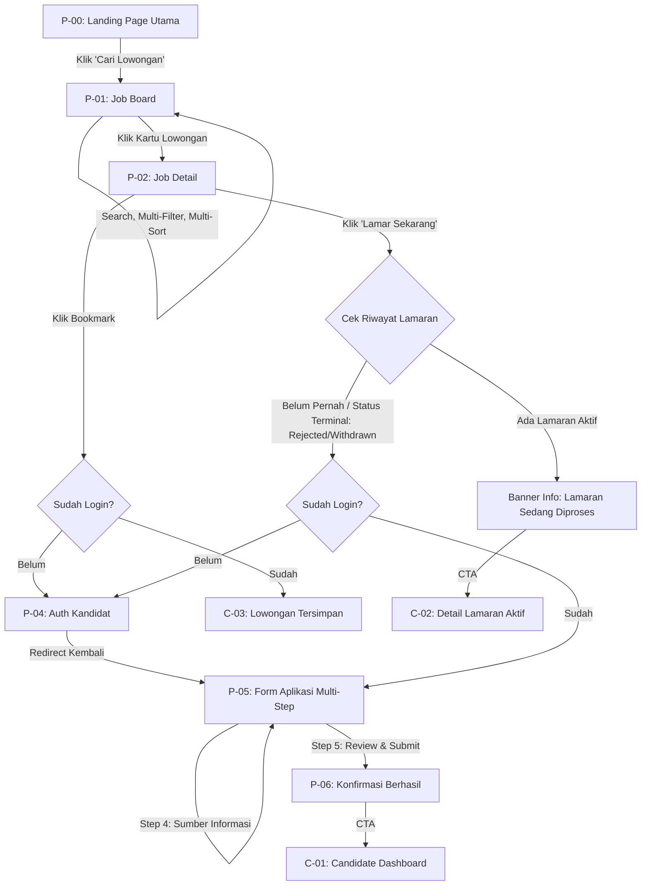
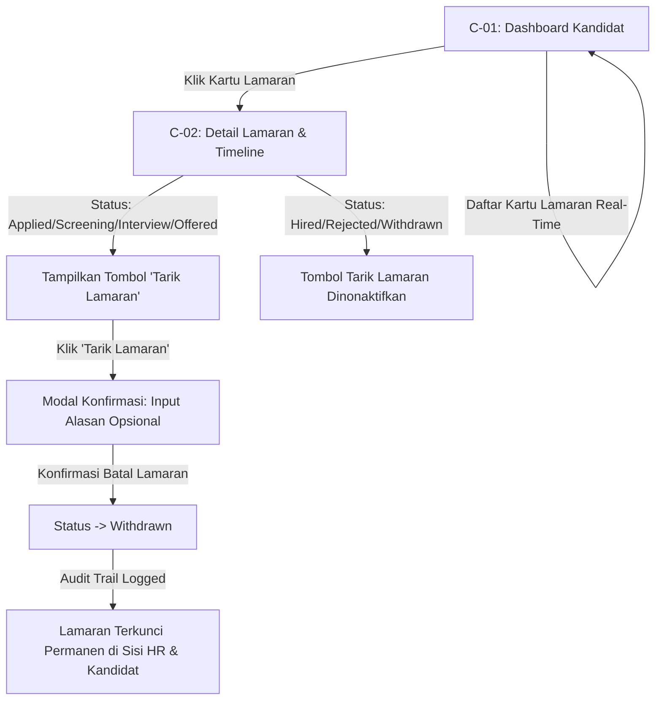
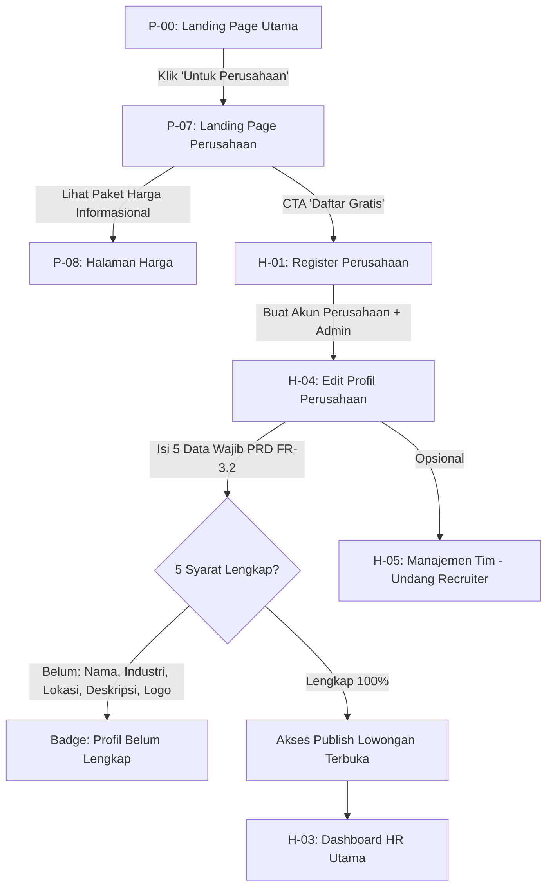
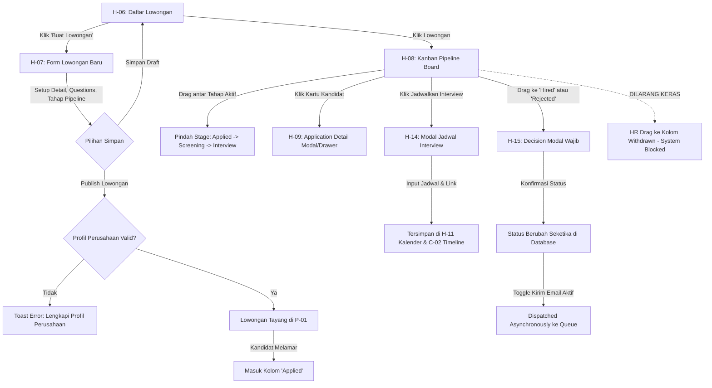

# UI/UX Specification & Flow Document
## RecruitFlow — Recruitment Management System
### Version: 4.0 (Production-Ready Architecture)

*Dokumen ini merupakan turunan resmi dari PDD (01) dan PRD v4.0 (02). Dokumen ini menjadi acuan mutlak untuk penyusunan Design System (05-Design-System-RecruitFlow.md), System Architecture (04-System-Architecture-Design-RecruitFlow.md), dan implementasi Frontend/Backend.*

---

## 1. End-to-End User Flows

Sistem memiliki dua aktor utama yang diperlakukan secara setara: **Kandidat (Talent)** dan **Perusahaan (HR/Admin)**.

### 1.1 Flow Kandidat — Discovery, Aplikasi & Re-Application

### 1.2 Flow Kandidat — Manajemen Lamaran & Hak Tarik Berkas (Withdrawal)

### 1.3 Flow HR/Admin — Onboarding Workspace & Gating Publikasi Lowongan

### 1.4 Flow HR — Siklus Rekrutmen & State Machine Kanban (Pipeline)

---

## 2. Information Architecture & Canonical Routing

Sistem membedakan routing publik, kandidat, dan HR secara tegas dengan canonical URL dan dukungan alias kompatibilitas.

### 2.1 Area Publik & Discovery (Tanpa Autentikasi Wajib)

| Code | Nama Halaman | Canonical URL | Alternative / Alias URL | Akses Guard |
| :--- | :--- | :--- | :--- | :--- |
| **[P-00]** | Landing Page Utama | `/` | `/home` | Public |
| **[P-01]** | Job Board (Pencarian Kerja) | `/cari-lowongan` | `/jobs` | Public |
| **[P-02]** | Detail Lowongan Pekerjaan | `/jobs/:jobId` | `/lowongan/:jobId` | Public |
| **[P-03]** | Profil Publik Perusahaan | `/companies/:companySlug`| `/company/:slug` | Public |
| **[P-04]** | Autentikasi Kandidat | `/candidate/auth` | `/candidate/login`, `/candidate/register` | Public (Guest only) |
| **[P-05]** | Form Aplikasi Pelamar | `/jobs/:jobId/apply` | `/apply/:jobId` | Candidate Auth Required |
| **[P-06]** | Konfirmasi Lamaran Terkirim | `/jobs/:jobId/success` | `/apply/:jobId/success` | Candidate Auth Required |
| **[P-07]** | Landing Page Khusus Perusahaan | `/untuk-perusahaan` | `/employers` | Public |
| **[P-08]** | Halaman Paket & Harga | `/harga` | `/pricing` | Public |

### 2.2 Area Kandidat (Terproteksi — Role: Candidate)

| Code | Nama Halaman | Canonical URL | Alternative / Alias URL | Keterangan |
| :--- | :--- | :--- | :--- | :--- |
| **[C-01]** | Candidate Dashboard | `/candidate/dashboard` | `/candidate` | Ringkasan seluruh lamaran |
| **[C-02]** | Detail Lamaran & Histori | `/candidate/applications/:id`| `/candidate/dashboard/:applicationId` | Timeline status & detail interview |
| **[C-03]** | Lowongan Tersimpan (Bookmark)| `/candidate/saved-jobs` | `/candidate/bookmarks` | Daftar lowongan di-pin |
| **[C-04]** | Kelola Profil Kandidat | `/candidate/profile` | `/candidate/account` | 8 seksi profil pelamar |
| **[C-05]** | Koleksi Berkas & CV | `/candidate/documents` | `/candidate/profile/documents` | Master library CV berlabel |

### 2.3 Area Perusahaan / ATS HR (Terproteksi — Multi-Tenant Scoped)

| Code | Nama Halaman | Canonical URL | Alternative / Alias URL | Batasan Role |
| :--- | :--- | :--- | :--- | :--- |
| **[H-01]** | Registrasi Akun Perusahaan | `/company/register` | `/employer/register` | Public (Guest only) |
| **[H-02]** | Login HR & Tim Recruiter | `/company/login` | `/employer/login` | Public (Guest only) |
| **[H-03]** | HR Dashboard Utama | `/dashboard` | `/dashboard/overview` | Admin, HR Member |
| **[H-04]** | Kelola Profil Perusahaan | `/dashboard/profile` | `/dashboard/company-profile` | Admin, HR Member |
| **[H-05]** | Manajemen Tim Rekrutmen | `/dashboard/team` | `/dashboard/settings/team` | **Admin Only** |
| **[H-06]** | Kelola Lowongan Pekerjaan | `/dashboard/jobs` | `/dashboard/vacancies` | Admin, HR Member |
| **[H-07]** | Buat / Edit Lowongan | `/dashboard/jobs/new`, `/dashboard/jobs/:jobId/edit` | - | Admin, HR Member |
| **[H-08]** | Kanban Pipeline Board | `/dashboard/jobs/:jobId/pipeline` | `/dashboard/pipeline/:id` | Admin, HR Member |
| **[H-09]** | Application Evaluation Detail | `/dashboard/applications/:id` | `/dashboard/candidates/:candidateId` | Admin, HR Member |
| **[H-10]** | Database Kandidat Perusahaan | `/dashboard/candidates` | `/dashboard/talent-pool` | Admin, HR Member |
| **[H-11]** | Kalender Jadwal Wawancara | `/dashboard/interviews` | `/dashboard/calendar` | Admin, HR Member |
| **[H-12]** | Template Pesan & Email | `/dashboard/email-templates` | `/dashboard/templates` | Admin, HR Member |
| **[H-13]** | Analitik & Laporan Rekrutmen| `/dashboard/analytics` | `/dashboard/reports` | Admin, HR Member |
| **[H-14]** | *Modal* — Jadwalkan Interview | *Triggered in H-08/H-09/H-11* | - | Admin, HR Member |
| **[H-15]** | *Modal* — Keputusan (Hired/Reject)| *Triggered in H-08/H-09* | - | Admin, HR Member |

---

## 3. Strict UX Rules & Behavioral Specifications

### 3.1 Mobile-First vs Desktop-First Boundary
* **Area Publik & Kandidat (P-00 s/d P-08, C-01 s/d C-05)**: Didesain dengan paradigma **Mobile-First**. Target ukuran touch-target minimal 44x44px. Tabel pada desktop otomatis bertransformasi menjadi card-list responsif di layar `< 768px`.
* **Area Workspace HR (H-01 s/d H-15)**: Didesain dengan paradigma **Desktop-First (Optimal pada $\ge$ 1024px, adaptif pada tablet $\ge$ 768px)**. Pada layar mobile/tablet kecil, Kanban Board `[H-08]` mengaktifkan mode *Single-Column Tab Switcher* (HR memilih tab stage untuk melihat list kandidat, bukan horizontal scroll yang melelahkan).

### 3.2 Aturan State Machine Kanban & Restriksi Interaksi (H-08)
1. **Withdrawn Read-Only Lock**: Kolom `Withdrawn` berlatar belakang visual muted (abu-abu/slate). HR **dilarang memindahkan kartu apapun ke kolom Withdrawn**. Kartu di dalam kolom Withdrawn terkunci secara absolut (drag handle dinonaktifkan, badge status *"Ditarik oleh Kandidat"*).
2. **Intersepsi Decision Modal (H-15)**: Jika kartu kandidat di-drag ke kolom `Hired` atau `Rejected`, transisi visual UI tertahan sementara (*optimistic pause*) dan membuka **Modal H-15**. Jika HR menekan tombol "Batal" pada modal, kartu otomatis kembali (*snap-back*) ke kolom asalnya tanpa memicu API.
3. **Re-Evaluation dari Terminal Rejected**: Jika HR memindahkan kartu dari `Rejected` kembali ke tahapan aktif (misal `Screening`), sistem wajib memunculkan dialog konfirmasi: *"Aktifkan kembali evaluasi kandidat ini?"* dan mewajibkan pengisian catatan alasan evaluasi ulang (mencatat log audit ke `application_logs`).

### 3.3 Formulir Panjang: Auto-Save Debounce & LocalStorage Fallback
* Pada Form Lowongan `[H-07]` dan Profil Kandidat `[C-04]`, perubahan input otomatis disimpan sebagai draft lokal (*localStorage*) dengan debounce **1500ms** setelah interaksi user berhenti.
* UI menampilkan micro-indicator di sudut kanan atas:
  - *Mengetik...* $\rightarrow$ Dot oranye berdenyut.
  - *Tersimpan di draft lokal* $\rightarrow$ Centang hijau lembut.
* Tombol aksi eksplisit: "Simpan Draft ke Server" dan "Publish / Kirim".

### 3.4 Multi-Criteria Sort & Deterministic Sorting (P-01 & H-10)
* Komponen sorting tidak boleh berupa dropdown tunggal standar. Sistem menggunakan **Prioritized Sort Stack**:
  - Pengguna dapat memilih kriteria urutan bertingkat (misal: Prioritas 1: *Deadline Terdekat*, Prioritas 2: *Gaji Tertinggi*).
  - Tiap kriteria memiliki drag-handle untuk menukar hierarki prioritas dan tombol toggle arah (`ASC` / `DESC`).
  - **Deterministic Tie-Breaker**: Sistem secara otomatis menyisipkan aturan `published_at DESC, id ASC` di lapisan terbawah query backend agar urutan pagination tidak meloncat (*stable sort*).

### 3.5 Validasi Gating Publikasi Profil Perusahaan (H-04 & H-07)
* Perusahaan baru tidak diizinkan mem-publish lowongan sampai memenuhi **5 Kriteria Wajib**:
  1. `company_name` terisi (min 3 karakter).
  2. `industry` dipilih dari daftar kategori.
  3. `location` terisi (Kota / Daerah operasional).
  4. `description` terisi (min 50 karakter ringkasan profil).
  5. `logo_url` terunggah (format PNG/JPG/WebP valid).
* Pada `[H-04]`, progres kelengkapan profil ditampilkan dalam widget progress bar.
* Pada `[H-07]`, tombol "Publish" dalam status *disabled* jika profil belum lengkap, dilengkapi popover penjelasan yang mengarahkan langsung ke `[H-04]`.

### 3.6 Immutability Berkas Snapshot CV (P-05, C-02, H-09)
* Saat kandidat melamar melalui `[P-05]`, sistem mengunci snapshot berkas CV pada instance lamaran tersebut (`application_documents`).
* Jika kandidat kemudian mengubah label, memperbarui, atau menghapus CV di `[C-05]`, berkas yang tersimpan di `[C-02]` (sisi pelamar) dan `[H-09]` (sisi HR) **tetap menampilkan versi CV yang dilampirkan pada saat melamar**.
* UI `[C-05]` menampilkan warning dialog jika kandidat mencoba menghapus dokumen master yang memiliki relasi lamaran aktif.

### 3.7 Asynchronous Decoupled Notification & Error Resilience (H-15)
* Perubahan status kandidat ke `Hired` atau `Rejected` pada UI harus bersifat **Optimistic**:
  1. Status di database & UI langsung berubah seketika ($< 200\text{ms}$).
  2. Modal H-15 menutup dan Kanban Board merefleksikan posisi baru.
  3. Email dispatch diproses secara asynchronous di background worker.
  4. Jika pengiriman email gagal (misal server SMTP timeout), sistem **tidak me-rollback status rekrutmen**. Sebagai gantinya, pada detail kandidat `[H-09]` muncul banner warning: `[Pengiriman Email Pemberitahuan Gagal: Klik untuk Mengirim Ulang]`.

### 3.8 Tenant Isolation & Strict Boundary (H-09 & H-10)
* Notes, Skor Interview, dan Tags yang disematkan oleh HR pada seorang kandidat strictly terisolasi pada `company_id` yang bersangkutan.
* Jika Kandidat X melamar ke Perusahaan A dan Perusahaan B, Recruiter Perusahaan B sama sekali tidak dapat melihat catatan, tag, maupun riwayat evaluasi dari Perusahaan A.

---

## 4. Navigation Architecture & Global Components

### 4.1 Top Navbar Area Publik (`NavbarPublic`)
* **Kiri**: Logo RecruitFlow (SVG vector, klik $\rightarrow$ `/`).
* **Tengah (Desktop)**:
  - `Cari Lowongan` (Link $\rightarrow$ `/cari-lowongan`, active state indicator).
  - `Untuk Perusahaan` (Link $\rightarrow$ `/untuk-perusahaan`).
  - `Harga` (Link $\rightarrow$ `/harga`).
* **Kanan**:
  - *Kondisi Belum Login*: Tombol `Masuk / Daftar` (Link $\rightarrow$ `/candidate/auth`).
  - *Kondisi Kandidat Login*: Link `Lowongan Tersimpan` (icon bookmark), Link `Dashboard Saya` (pill badge jumlah lamaran aktif), Avatar menu dropdown (`Profil`, `Dokumen`, `Keluar`).
  - *Kondisi HR Login*: Link `Masuk ke Workspace HR` (CTA tombol primer $\rightarrow$ `/dashboard`).

### 4.2 Sidebar Navigasi Workspace HR (`SidebarHR`)
Sidebar persisten di desktop ($\ge 1024\text{px}$), collapsible drawer di tablet/mobile:
1. **Workspace Header**: Logo Perusahaan, Nama Perusahaan aktif, badge Plan (`Free/Growth`).
2. **Menu Utama**:
   - `Dashboard` (Icon Home $\rightarrow$ `/dashboard`)
   - `Lowongan` (Icon Briefcase $\rightarrow$ `/dashboard/jobs`)
   - `Database Kandidat` (Icon Users $\rightarrow$ `/dashboard/candidates`)
   - `Jadwal Wawancara` (Icon Calendar $\rightarrow$ `/dashboard/interviews`)
   - `Analitik & Laporan` (Icon BarChart $\rightarrow$ `/dashboard/analytics`)
3. **Menu Konfigurasi**:
   - `Template Email` (Icon Mail $\rightarrow$ `/dashboard/email-templates`)
   - `Profil Perusahaan` (Icon Building $\rightarrow$ `/dashboard/profile`)
   - `Manajemen Tim` (Icon Shield $\rightarrow$ `/dashboard/team` — **Khusus Admin**, disembunyikan untuk HR biasa).
4. **Footer Sidebar**: Profil Pengguna (Nama HR, Role Badge), Tombol `Keluar` (Logout).

---

## 5. Screen Specifications (29 Layar Lengkap)

---

### 5.1 Area Publik & Pemasaran (P-00 s/d P-08)

#### [P-00] Landing Page Utama
* **1. Identitas & Akses Guard**:
  - **Kode & Nama**: `[P-00] Landing Page Utama`
  - **Canonical URL**: `/` | **Alternative URL**: N/A
  - **Auth Guard**: `Public` (Dapat diakses oleh publik, guest, pelamar, maupun staf perusahaan tanpa batasan login).
  - **Tujuan**: Pintu masuk utama platform yang **merepresentasikan kedua sisi platform secara setara dan seimbang** sesuai filosofi PDD §2. Tidak condong hanya ke kandidat atau ke perusahaan.
* **2. Bentuk & Layout Spasial**:
  - **Desktop (≥ 1024px / 1280px)**:
    - Top Navigation Bar (`NavbarPublic`) sticky di paling atas dengan backdrop blur (`glass-panel`).
    - Hero Section terpusat: Headline dwi-arah 2 kolom setara (50% Talenta vs 50% Perusahaan), padding `py-20 max-w-7xl mx-auto`.
    - Live Metrics Strip 4 kolom berdampingan (`grid-cols-4 gap-6`).
    - Value Proposition Grid 3 kolom (`grid-cols-3 gap-8`).
    - Testimonial Section 2 kolom berdampingan (1 Kandidat Hired & 1 HR Manager).
    - Footer Global 4 kolom link navigasi + baris hak cipta bawah.
  - **Mobile (< 768px)**:
    - Navbar berubah menjadi hamburger drawer (`NavbarMobileDrawer`).
    - Dual Hero Cards bertumpuk vertikal (Talenta di atas, Perusahaan di bawah dengan padding dan visual weight identik).
    - Live Metrics Strip beralih ke grid 2x2 (`grid-cols-2 gap-4`).
    - Footer beralih ke accordion vertikal collapsible.
* **3. Komponen UI Terkait (Dokumen 05)**:
  - `NavbarPublic`, `Button` (Primary `#2563EB`, Secondary `#475569`, Ghost), `MetricCard`, `FeatureCard`, `TestimonialCard`, `Badge` (`badge-neutral`), `FooterGlobal`.
* **4. Isi Konten & Field Data**:
  - *Hero Headline*: "Platform Rekrutmen Modern yang Menghubungkan Talenta Terbaik dengan Perusahaan Impian".
  - *Sub-headline*: "Transparansi penuh status seleksi untuk kandidat. Efisiensi kanban pipeline dan otomatisasi rekrutmen untuk HR."
  - *Dual Action Panels*:
    - **Panel Talenta (Kiri)**: Icon UserCheck, Judul "Kembangkan Karir Anda", Deskripsi "Pantau progres lamaran transparan tanpa di-ghosting", CTA "Jelajahi Lowongan Kerja" (Link `/cari-lowongan`).
    - **Panel Perusahaan (Kanan)**: Icon BuildingOffice2, Judul "Rekrut Talenta Hebat", Deskripsi "Kelola pipeline kanban, scoring tim, dan kirim offering instan", CTA "Mulai Rekrut Talenta" (Link `/untuk-perusahaan`).
  - *Live Metrics Data*:
    - `total_active_jobs`: Jumlah lowongan kerja aktif (contoh: "1,240+ Lowongan Aktif").
    - `total_companies`: Perusahaan terdaftar (contoh: "450+ Perusahaan").
    - `total_candidates_hired`: Talenta berhasil diterima (contoh: "3,800+ Talenta Terserap").
    - `avg_time_to_hire`: Rata-rata waktu rekrutmen (contoh: "14 Hari Avg Time-to-Hire").
* **5. Interaksi Pengguna & Kapabilitas**:
  - Pengguna dapat mengklik CTA Talenta untuk navigasi instan ke `[P-01]`.
  - Pengguna dapat mengklik CTA Perusahaan untuk navigasi instan ke `[P-07]`.
  - Pengguna dapat mengklik link Navbar (`Cari Lowongan`, `Untuk Perusahaan`, `Harga`, `Masuk/Daftar`).
  - *Aksi Terlarang / Dibatasi*: Tidak ada batasan akses form atau mutasi data pada halaman ini (stateless presentation page).
* **6. Interaksi Backend & Integrasi API (Dokumen 04)**:
  - *Mount Fetch*: `GET /api/public/platform-stats`
    - Response (200 OK): `{ success: true, data: { active_jobs: 1240, companies: 450, hired_candidates: 3800, avg_tth_days: 14 } }`
    - Fallback: Jika endpoint gagal, render angka estimasi cache terakhir tanpa memblokir render UI.
* **7. State Layar**:
  - *Loading*: Angka metrics menampilkan placeholder pulse shimmer `w-24 h-8 bg-slate-200 animate-pulse rounded`.
  - *Empty State*: N/A (Halaman pemasaran statis).
  - *Error State*: Angka statistik menampilkan badge strip fallback statis tanpa error pop-up agresif.
* **8. Logika Khusus & Aturan Bisnis**:
  - *Two-Sided Equality*: Tidak boleh menampilkan visual dominan yang mengutamakan salah satu pihak. Font weight, padding tombol, dan hierarki visual kedua panel harus identik.

---

#### [P-01] Job Board (Pencarian Kerja Talenta)
* **1. Identitas & Akses Guard**:
  - **Kode & Nama**: `[P-01] Job Board (Pencarian Kerja Talenta)`
  - **Canonical URL**: `/cari-lowongan` | **Alternative URL**: `/jobs`
  - **Auth Guard**: `Public` (Dapat diakses oleh publik tanpa login. Fitur bookmark memerlukan autentikasi kandidat).
  - **Tujuan**: Wadah eksplorasi lowongan lintas perusahaan dengan multi-filter, search kata kunci, dan multi-sorting bertingkat.
* **2. Bentuk & Layout Spasial**:
  - **Desktop (≥ 1024px / 1280px)**:
    - Header pencarian horizontal full-width: Input kata kunci + Dropdown lokasi + Tombol Cari.
    - Struktur 2 Kolom:
      - Kolom Kiri (280px fixed): Sidebar Filter terstruktur (Kategori, Tipe Kerja, Pengaturan Kerja, Rentang Gaji).
      - Kolom Kanan (Flex-1): Toolbar hasil pencarian (Counter hasil, Sort selector, Active filter chips) + Job Card Grid (vertikal list kartu lowongan berjarak `gap-4`).
    - Pagination Bar terpusat di bawah grid kartu.
  - **Mobile (< 768px)**:
    - Search bar sticky di bawah navbar.
    - Tombol "Filter & Urutkan" mengambang (Floating Action Button / Baris Toolbar) yang membuka Fullscreen Filter Drawer dengan tombol "Terapkan Filter" di bawah (`h-12 w-full`).
    - Job Card Grid beralih ke kartu vertikal kompak dengan informasi esensial.
* **3. Komponen UI Terkait (Dokumen 05)**:
  - `NavbarPublic`, `InputText` (Icon Search), `SelectDropdown`, `Checkbox`, `RangeSlider` (Gaji), `Badge` (`badge-neutral`, `badge-primary`), `JobCard`, `MultiSortModal`, `PaginationControl`, `EmptyStateView`.
* **4. Isi Konten & Field Data**:
  - *Search Bar*: Input string keyword (nama posisi, skill, perusahaan) + Dropdown lokasi (Seluruh Indonesia, Jabodetabek, Bandung, Surabaya, Luar Jawa, Remote).
  - *Sidebar Filter*:
    - Kategori Pekerjaan (Multi-select checkbox: Rekayasa Perangkat Lunak, Produk & Desain, Pemasaran, Penjualan, Operasional, Keuangan, SDM).
    - Tipe Pekerjaan (Checkbox: Penuh Waktu / Full-Time, Paruh Waktu / Part-Time, Kontrak, Magang / Internship).
    - Pengaturan Kerja (Checkbox: Kerja di Kantor / On-site, Campuran / Hybrid, Jarak Jauh / Remote).
    - Rentang Gaji (Slider min-max: Rp 3.000.000 s/d Rp 50.000.000+).
  - *Toolbar Urutan*:
    - Teks counter hasil: "Menampilkan 48 lowongan aktif".
    - Dropdown Cepat / Modal Multi-Sort: Prioritas 1 s/d 3 (Contoh: Paling Baru, Gaji Tertinggi, Kuota Tersisa Terbanyak).
  - *Job Card Attributes*: Logo perusahaan (`logo_url`), Judul posisi (`title`), Nama perusahaan (`company_name`), Badge pengaturan kerja (`work_arrangement`), Badge lokasi (`location`), Rentang gaji (`salary_min` - `salary_max` atau "Gaji Dirahasiakan"), Kuota terisi (`hired_count / quota`), Tanggal tayang / sisa waktu deadline, Icon Bookmark (Heart).
* **5. Interaksi Pengguna & Kapabilitas**:
  - User dapat mengetik pencarian (debounced 300ms) atau menekan Enter untuk eksekusi filter.
  - User dapat memilih kombinasi filter; chip filter aktif muncul otomatis di toolbar dan dapat dihapus satuan (klik tanda silang) atau massal ("Reset Semua Filter").
  - User dapat mengklik icon Heart pada kartu untuk bookmark lowongan:
    - Jika sudah login kandidat: status bookmark toggle instan (merah aktif).
    - Jika belum login: diarahkan ke `[P-04]` dengan URL callback: `/candidate/auth?redirect=/cari-lowongan`.
  - User dapat mengklik kartu lowongan untuk membuka detail lowongan `[P-02]`.
  - User dapat beralih halaman melalui Pagination Control.
  - *Aksi Terlarang*: Lowongan dengan status selain `published` (seperti `draft` atau `closed`) di-filter ketat oleh backend dan DILARANG tampil di Job Board.
* **6. Interaksi Backend & Integrasi API (Dokumen 04)**:
  - *Mount & Filter Fetch*: `GET /api/jobs`
    - Query Parameters: `?search=&location=&category=&job_type=&work_arrangement=&salary_min=&salary_max=&sort_by=created_at&sort_order=desc&page=1&limit=10`
    - Response (200 OK): `{ success: true, data: { jobs: [...], pagination: { page: 1, limit: 10, total_items: 48, total_pages: 5 } } }`
  - *Bookmark Mutation*: `POST /api/candidate/saved-jobs` (jika toggle on) / `DELETE /api/candidate/saved-jobs/:jobId` (jika toggle off)
    - Headers: `Authorization: Bearer <jwt_token>`
    - Error Response (401 Unauthorized): `ERR_UNAUTHORIZED` $\rightarrow$ simpan state lokal dan redirect ke `[P-04]`.
* **7. State Layar**:
  - *Loading*: Render 5 kartu shimmer skeleton (`JobCardSkeleton`) dengan animasi pulsa abu-abu.
  - *Empty State*: Jika tidak ada lowongan yang cocok dengan filter, render `EmptyStateView` dengan ikon pencarian kosong, teks "Tidak ada lowongan yang sesuai kriteria", dan tombol "Reset Filter".
  - *Error State*: Banner merah di atas grid: "Gagal memuat lowongan. Silakan periksa koneksi internet Anda" + Tombol "Muat Ulang".
* **8. Logika Khusus & Aturan Bisnis**:
  - URL Query Synchronization: Setiap perubahan filter dan pagination harus merefleksikan query string pada browser address bar agar link dapat dibagikan (shareable URL).
  - Lowongan yang kuotanya telah terpenuhi (`hired_count >= quota`) atau telah melewati tanggal deadline otomatis tidak dikembalikan oleh API `GET /api/jobs`.

---

#### [P-02] Detail Lowongan Pekerjaan
* **1. Identitas & Akses Guard**:
  - **Kode & Nama**: `[P-02] Detail Lowongan Pekerjaan`
  - **Canonical URL**: `/jobs/:jobId` | **Alternative URL**: N/A
  - **Auth Guard**: `Public` (Dapat dilihat oleh publik tanpa login. Aksi melamar kerja mengecek status autentikasi kandidat).
  - **Tujuan**: Menyajikan rincian lengkap tugas, kualifikasi, kompensasi, profil perusahaan, dan portal pengajuan berkas lamaran.
* **2. Bentuk & Layout Spasial**:
  - **Desktop (≥ 1024px / 1280px)**:
    - Layout 2 Kolom Asimetris (Kiri 68% Konten Utama, Kanan 32% Sticky Sidebar Aksi & Profil Perusahaan):
      - Kolom Kiri: Header detail posisi, Badge atribut, Tab/Seksi konten deskripsi pekerjaan, tanggung jawab, kualifikasi, benefit.
      - Kolom Kanan: Sticky Card (`top-24`) berisi Call-to-Action Bar (Tombol Lamar / Indikator Status Lamaran Aktif), info kuota terisi, deadline, kartu ringkas profil perusahaan.
  - **Mobile (< 768px)**:
    - Layout 1 Kolom berurutan vertikal.
    - Sticky Bottom Action Bar tersemat di bagian bawah layar viewport (`fixed bottom-0 left-0 right-0 p-4 bg-white border-t border-slate-200 z-30`) memuat tombol "Lamar Sekarang" dan icon Bookmark.
* **3. Komponen UI Terkait (Dokumen 05)**:
  - `NavbarPublic`, `Button` (Primary, Secondary, Outline), `Badge` (`badge-primary`, `badge-success`, `badge-warning`, `badge-danger`), `AlertBox`, `Card`, `ShareSocialModal`, `BookmarkButton`.
* **4. Isi Konten & Field Data**:
  - *Header Posisi*: Judul lowongan (`title`), Nama instansi (`company_name`), Logo instansi (`logo_url`), Badge tipe kerja (`job_type`), Badge sistem kerja (`work_arrangement`), Lokasi penempatan (`location`), Rentang gaji (`salary_min` - `salary_max`), Tanggal dipublikasikan.
  - *Indikator Kuota & Deadline*: Bar rasio penerimaan kuota (`hired_count` dari `quota`, misal: "1 dari 3 kuota terisi") dan badge tanggal batas akhir lamaran (`deadline`).
  - *Konten Deskripsi*:
    - Ringkasan Peran (Rich Text).
    - Tanggung Jawab Utama (Bullet points).
    - Persyaratan & Kualifikasi Wajib (Bullet points).
    - Nilai Tambah / Kualifikasi Pendukung (Bullet points).
    - Fasilitas & Benefit Kerja (Tag chips: BPJS, Asuransi Kesehatan Swasta, Laptop, Tunjangan Transport, Fleksibilitas WFH).
  - *Kartu Perusahaan*: Logo, nama perusahaan, deskripsi singkat, skala industri, tautan website resmi, dan tautan "Lihat Semua Lowongan dari Perusahaan Ini" ($\rightarrow$ `/companies/:companySlug`).
* **5. Interaksi Pengguna & Kapabilitas**:
  - User dapat membaca seluruh deskripsi dan menyalin tautan lowongan (Share link).
  - User dapat mengklik tombol "Simpan Lowongan" (Bookmark).
  - User dapat mengklik tombol "Lamar Sekarang":
    - **Kasus A (Belum Login)**: Sistem mengarahkan ke `[P-04]` dengan query: `/candidate/auth?redirect=/jobs/:jobId/apply`.
    - **Kasus B (Sudah Login Kandidat & Belum Melamar)**: Sistem langsung mengarahkan ke formulir multi-step `[P-05]`.
    - **Kasus C (Sudah Login & Memiliki Lamaran Aktif `applied/screening/interview/offered`)**: Tombol utama berubah menjadi "Pantau Progres Lamaran" ($\rightarrow$ `[C-02]`), dilengkapi Alert Box biru muda: *"Anda telah mengirimkan lamaran untuk posisi ini pada [Tanggal]. Status terkini: [Status]"*. Tombol submit lamaran baru dinonaktifkan.
    - **Kasus D (Sudah Login & Riwayat Terakhir Terminal `rejected/withdrawn`)**: Sesuai PRD FR-1.4, tombol menampilkan label "Lamar Ulang Posisi Ini" ($\rightarrow$ `[P-05]`), dengan info histori lamaran sebelumnya.
    - **Kasus E (Lowongan Ditutup / Kuota Penuh)**: Tombol "Lamar Sekarang" menjadi `disabled`, teks tombol berubah menjadi "Lowongan Ditutup / Kuota Terpenuhi".
* **6. Interaksi Backend & Integrasi API (Dokumen 04)**:
  - *Mount Fetch Job Detail*: `GET /api/jobs/:jobId`
    - Response (200 OK): `{ success: true, data: { id, title, description, requirements, benefits, salary_min, salary_max, quota, hired_count, deadline, status, company: { id, name, slug, logo_url, industry, location } } }`
    - Error Response (404 Not Found): `ERR_JOB_NOT_FOUND` $\rightarrow$ render tampilan 404 lowongan tidak ditemukan.
  - *Mount Fetch Candidate Application Status (Jika login)*: `GET /api/candidate/applications/check?job_id=:jobId`
    - Response (200 OK): `{ success: true, data: { has_applied: true, application_id: "uuid", current_status: "screening", can_reapply: false } }`
* **7. State Layar**:
  - *Loading*: Skeleton shimmer untuk banner judul, paragraf konten deskripsi, dan sidebar kartu CTA.
  - *Empty / Not Found*: Menampilkan ilustrasi lowongan kadaluarsa/dihapus dengan tombol "Cari Lowongan Lainnya" ($\rightarrow$ `[P-01]`).
  - *Error State*: Error toast atau banner penjelas jika koneksi gagal.
* **8. Logika Khusus & Aturan Bisnis**:
  - *Re-Application Guard (PRD FR-1.4)*: Pelamar yang berstatus `rejected` atau `withdrawn` diizinkan melamar ulang secara resmi; data lamaran baru akan diperlakukan sebagai instance baru dengan ID berbeda, tanpa menghapus histori lamaran lama di database.

---

#### [P-03] Profil Publik Perusahaan
* **1. Identitas & Akses Guard**:
  - **Kode & Nama**: `[P-03] Profil Publik Perusahaan`
  - **Canonical URL**: `/companies/:companySlug` | **Alternative URL**: `/company/:slug`
  - **Auth Guard**: `Public` (Dapat diakses publik tanpa login).
  - **Tujuan**: Etalase profil perusahaan untuk membangun employer branding dan memamerkan seluruh lowongan kerja aktif instansi tersebut.
* **2. Bentuk & Layout Spasial**:
  - **Desktop (≥ 1024px / 1280px)**:
    - Header Hero Banner: Gambar cover banner lebar (rasio 4:1) + Logo perusahaan overlapping di sudut kiri bawah banner + Detail nama dan badge industri.
    - Tab Navigation Bar horizontal di bawah header (`Tentang Perusahaan` vs `Lowongan Aktif [Counter]`).
    - Konten Tab:
      - Tab "Tentang Perusahaan": Grid 2 kolom (Kiri: Narasi budaya dan galeri foto suasana kantor; Kanan: Widget benefit, link sosial media, dan peta lokasi kantor).
      - Tab "Lowongan Aktif": Grid kartu lowongan 2 kolom khusus lowongan perusahaan ini.
  - **Mobile (< 768px)**:
    - Header banner kompak dengan logo terpusat.
    - Tab navigation scrollable horizontal.
    - Konten tab bertumpuk vertikal 1 kolom.
* **3. Komponen UI Terkait (Dokumen 05)**:
  - `NavbarPublic`, `TabNavigation`, `Badge` (`badge-neutral`), `JobCard`, `SocialMediaLinksGroup`, `GalleryImageModal`, `Button` (Outline).
* **4. Isi Konten & Field Data**:
  - *Banner & Identitas Perusahaan*: Banner gambar (`banner_url`), Logo resmi (`logo_url`), Nama instansi (`name`), Industri (`industry`), Ukuran tim/karyawan (`team_size`), Lokasi kota kantor pusat (`location`), Tautan website resmi (`website_url`), Tautan LinkedIn (`linkedin_url`).
  - *Tab Tentang Perusahaan*: Deskripsi narasi visi & budaya kerja (`description`), Galeri foto kantor (`office_gallery_urls`), Daftar benefit unggulan instansi (`benefits_list`).
  - *Tab Lowongan Aktif*: Daftar kartu lowongan berstatus `published` dari perusahaan ini beserta badge tipe, lokasi, dan tanggal posting.
* **5. Interaksi Pengguna & Kapabilitas**:
  - User dapat berpindah antar tab "Tentang Perusahaan" dan "Lowongan Aktif".
  - User dapat mengklik foto galeri untuk melihat versi resolusi tinggi di dalam modal lightbox (`GalleryImageModal`).
  - User dapat mengklik tautan sosial media dan website instansi (membuka tab baru).
  - User dapat mengklik kartu lowongan untuk masuk ke `[P-02]`.
  - *Aksi Terlarang*: Pengguna publik dilarang mengedit atau mengubah data perusahaan dari halaman publik ini.
* **6. Interaksi Backend & Integrasi API (Dokumen 04)**:
  - *Mount Fetch Profil*: `GET /api/companies/:companySlug`
    - Response (200 OK): `{ success: true, data: { id, name, slug, logo_url, banner_url, industry, location, team_size, website_url, linkedin_url, description, gallery_urls: [], benefits: [] } }`
    - Error Response (404 Not Found): `ERR_COMPANY_NOT_FOUND`
  - *Mount Fetch Lowongan Aktif*: `GET /api/companies/:companySlug/jobs`
    - Response (200 OK): `{ success: true, data: { jobs: [...], total: 5 } }`
* **7. State Layar**:
  - *Loading*: Shimmer skeleton header banner dan skeleton tab konten.
  - *Empty State (Tab Lowongan)*: Jika perusahaan saat ini tidak membuka lowongan aktif, tampilkan ilustrasi "Sedang tidak membuka lowongan kerja baru saat ini".
  - *Error State*: Tampilan 404 jika slug perusahaan tidak valid.
* **8. Logika Khusus & Aturan Bisnis**:
  - *Verified Company Branding*: Profil hanya menampilkan lowongan yang berstatus `published`. Lowongan draft milik perusahaan tidak akan pernah bocor ke publik.

---

#### [P-04] Autentikasi Terpadu Kandidat (Login & Register)
* **1. Identitas & Akses Guard**:
  - **Kode & Nama**: `[P-04] Autentikasi Terpadu Kandidat`
  - **Canonical URL**: `/candidate/auth` | **Alternative URL**: `/candidate/login`, `/candidate/register`
  - **Auth Guard**: `Guest Only` (Jika kandidat telah memiliki sesi token valid, otomatis redirect ke `/candidate/dashboard` atau ke target parameter `redirect`).
  - **Tujuan**: Pintu masuk terpadu login dan registrasi akun pencari kerja dengan retensi redirect intent lamaran.
* **2. Bentuk & Layout Spasial**:
  - **Desktop (≥ 1024px / 1280px)**:
    - Split-screen 2 Kolom (50:50):
      - Sisi Kiri: Visual branding RecruitFlow Talenta (Ilustrasi vektor modern, kutipan kebebasan karir, poin keunggulan transparansi lamaran).
      - Sisi Kanan: Kartu Form Auth terpusat vertikal (`max-w-md mx-auto py-12`), Tab Switcher di atas ("Masuk" vs "Daftar Akun Baru"), diikuti field form dan tombol aksi.
  - **Mobile (< 768px)**:
    - Sisi visual branding disembunyikan.
    - Kartu form tampil full-width dengan margin horizontal `px-4`.
* **3. Komponen UI Terkait (Dokumen 05)**:
  - `NavbarPublic` (Versi minimalis: hanya Logo & Link Bantuan), `TabSwitcher`, `InputText` (Email, Password toggle visibility), `Button` (Primary `#2563EB`, Social Google Login), `InlineErrorMessage`, `Checkbox`, `PasswordStrengthMeter`.
* **4. Isi Konten & Field Data**:
  - *Tab Masuk (Login)*:
    - Field Email (Type email, placeholder: "nama@domain.com").
    - Field Password (Type password dengan tombol icon mata untuk toggle intip kata sandi).
    - Link "Lupa Password?".
    - Tombol "Masuk ke Akun Saya".
  - *Tab Daftar (Register)*:
    - Field Nama Lengkap (`full_name`, min 3 karakter).
    - Field Email Aktif (`email`, format RFC 5322).
    - Field Password (`password`, min 8 karakter, indikator kekuatan sandi: Lemah / Sedang / Kuat).
    - Field Konfirmasi Password (`confirm_password`, harus identik dengan field password).
    - Checkbox Persetujuan Syarat & Ketentuan dan Kebijakan Privasi RecruitFlow.
    - Tombol "Buat Akun Kandidat".
* **5. Interaksi Pengguna & Kapabilitas**:
  - User dapat berpindah antara tab Masuk dan Daftar tanpa reload halaman (state form dipertahankan).
  - Validasi form interaktif real-time: Indikator kekuatan password bereaksi saat mengetik; pesan error inline muncul jika format email tidak valid.
  - Setelah sukses login/register:
    - Jika terdapat parameter URL `?redirect=/jobs/:id/apply`, sistem segera me-redirect user kembali ke alur pengajuan lamaran tersebut.
    - Jika tidak ada parameter redirect, user diarahkan ke `[C-01] Candidate Dashboard`.
  - *Aksi Terlarang*: Form register diblokir dari submission jika password belum memenuhi syarat minimal 8 karakter atau checkbox syarat belum dicentang.
* **6. Interaksi Backend & Integrasi API (Dokumen 04)**:
  - *Endpoint Login*: `POST /api/auth/candidate/login`
    - Request Body: `{ email: "user@example.com", password: "SecretPassword123!" }`
    - Response (200 OK): `{ success: true, data: { token: "jwt...", user: { id, email, full_name, role: "candidate" } } }`
    - Error Response (401 Unauthorized): `ERR_INVALID_CREDENTIALS` $\rightarrow$ pesan inline: "Email atau kata sandi tidak cocok."
  - *Endpoint Register*: `POST /api/auth/candidate/register`
    - Request Body: `{ full_name: "Nama Pelamar", email: "user@example.com", password: "SecretPassword123!" }`
    - Response (201 Created): `{ success: true, data: { token: "jwt...", user: { id, email, full_name, role: "candidate" } } }`
    - Error Response (409 Conflict): `ERR_EMAIL_ALREADY_EXISTS` $\rightarrow$ pesan inline: "Email sudah terdaftar. Silakan masuk."
* **7. State Layar**:
  - *Submitting State*: Tombol submit menampilkan spinner animasi dan teks "Memproses...", seluruh field di-disable sementara.
  - *Error State*: Alert banner merah di atas form untuk kegagalan autentikasi global atau pesan inline di bawah field yang bermasalah.
* **8. Logika Khusus & Aturan Bisnis**:
  - *Token Storage*: JWT disimpan di `localStorage` / Secure Cookie dan langsung diset ke default Axios Authorization header.
  - *Strict Separation of Auth*: Akun kandidat TIDAK BISA digunakan untuk login ke portal perusahaan `[H-02]`, dan sebaliknya. Sistem mengembalikan pesan kesalahan peran yang jelas.

---

#### [P-05] Form Aplikasi Pelamar Multi-Step
* **1. Identitas & Akses Guard**:
  - **Kode & Nama**: `[P-05] Form Aplikasi Pelamar Multi-Step`
  - **Canonical URL**: `/jobs/:jobId/apply` | **Alternative URL**: N/A
  - **Auth Guard**: `Candidate Authenticated` (Wajib login sebagai kandidat. Guest otomatis diredirect ke `[P-04]`).
  - **Tujuan**: Alur pengisian dan verifikasi data lamaran terstruktur 5 langkah sebelum berkas dikirim ke tim HR perusahaan.
* **2. Bentuk & Layout Spasial**:
  - **Desktop (≥ 1024px / 1280px)**:
    - Header formulir: Ringkasan posisi yang dilamar (`title` & `company_name`) + Tombol Batal Keluar.
    - Stepper Navigation Bar horizontal 5 Tahap di atas form (`StepIndicator` dengan nomor, label tahap, dan garis penghubung aktif).
    - Konten Form terpusat dalam Card elegan (`max-w-3xl mx-auto p-8 shadow-sm rounded-xl border border-slate-200`).
    - Footer Kontrol Form: Tombol "Sebelumnya" (Kiri) dan Tombol "Lanjutkan / Kirim Lamaran" (Kanan).
  - **Mobile (< 768px)**:
    - Stepper Navigation berubah menjadi ringkas: "Langkah X dari 5: [Nama Tahap]" dengan progress bar ramping.
    - Card padding mengecil (`p-4`), tombol navigasi form sticky di bagian bawah layar.
* **3. Komponen UI Terkait (Dokumen 05)**:
  - `StepIndicator`, `Card`, `InputText`, `Textarea`, `RadioGroup`, `FileUploadBox`, `SelectDropdown`, `Badge`, `Button` (Primary, Secondary, Ghost), `ConfirmationDialog`.
* **4. Isi Konten & Field Data (5 Langkah Terpadu)**:
  - **Langkah 1 — Konfirmasi Profil Dasar**:
    - Pre-filled otomatis dari profil kandidat (`[C-04]`): Nama Lengkap, Email, No Telepon/WhatsApp, Domisili (Kota/Provinsi), Tautan Profil LinkedIn, Tautan Portofolio.
    - Kandidat dapat menyunting data kontak khusus untuk lamaran ini.
  - **Langkah 2 — Berkas Lamaran (CV Selection)**:
    - Opsi A (Radio 1): "Gunakan CV dari Koleksi Profil Saya" $\rightarrow$ Dropdown pemilihan file CV yang sudah tersimpan di library `[C-05]` beserta labelnya.
    - Opsi B (Radio 2): "Unggah CV Baru Khusus Posisi Ini" $\rightarrow$ Area Drag-and-drop file uploader (Format: PDF, DOC, DOCX; Maks 5 MB).
  - **Langkah 3 — Pertanyaan Khusus HR (Custom Screening Questions)**:
    - Di-render dinamis sesuai konfigurasi lowongan:
      - Pertanyaan Pilihan Ganda (Radio list pilihan opsi).
      - Pertanyaan Isian Singkat (Input text).
      - Pertanyaan Esai (Textarea max 500 kata).
      - Penanda tanda bintang merah `*` untuk pertanyaan wajib.
  - **Langkah 4 — Cover Letter & Sumber Informasi**:
    - Textarea Surat Lamaran / Catatan untuk HR (Opsional, max 2000 karakter).
    - Dropdown Sumber Info Lowongan: "Dari mana Anda mengetahui lowongan ini?" (Pilihan: Job Board RecruitFlow, LinkedIn, Glints, Rekomendasi Karyawan/Teman, Media Sosial Perusahaan, Lainnya).
  - **Langkah 5 — Pratinjau & Pengiriman Akhir**:
    - Ringkasan komprehensif data yang akan dikirim (Data diri, Nama file CV terpilih, Jawaban pertanyaan HR, Cover letter).
    - Deklarasi Persetujuan Checkbox: "Saya menyatakan bahwa seluruh data dan berkas yang saya lampirkan adalah benar dan dapat dipertanggungjawabkan."
* **5. Interaksi Pengguna & Kapabilitas**:
  - User dapat bergerak maju dan mundur antar-langkah tanpa kehilangan data yang telah diketik.
  - Validasi lokal per langkah: Tombol "Lanjutkan" hanya aktif jika field wajib pada langkah bersangkutan telah terisi dengan benar.
  - Pada Langkah 5, menekan tombol "Kirim Lamaran Sekarang" memicu proses pengiriman dan pembuatan snapshot CV.
  - *Aksi Terlarang*:
    - Kandidat DILARANG melamar ulang jika sudah memiliki lamaran aktif di posisi ini (Sistem otomatis memblokir di gerbang awal).
    - Kandidat DILARANG mengunggah file CV selain format `.pdf`, `.doc`, `.docx` atau melebihi ukuran 5MB.
* **6. Interaksi Backend & Integrasi API (Dokumen 04)**:
  - *Mount Fetch Lowongan & Custom Questions*: `GET /api/jobs/:jobId/apply-info`
    - Response (200 OK): `{ success: true, data: { job_title, company_name, custom_questions: [...], user_profile: {...}, candidate_resumes: [...] } }`
  - *Submit Application*: `POST /api/jobs/:jobId/apply`
    - Request Body (Multipart/form-data atau JSON jika CV ID dipilih):
      `{ candidate_profile_data: {...}, resume_id: "uuid" OR resume_file: Binary, answers: [{ question_id: "q1", answer: "..." }], cover_letter: "...", source: "LinkedIn" }`
    - Response (201 Created): `{ success: true, data: { application_id: "app-uuid", applied_at: "2026-10-22T10:00:00Z" } }`
    - Error Response (409 Conflict): `ERR_DUPLICATE_APPLICATION` $\rightarrow$ Dialog peringatan bahwa lamaran aktif sudah ada.
    - Error Response (400 Bad Request): `ERR_QUOTA_EXCEEDED` $\rightarrow$ Lowongan baru saja ditutup.
* **7. State Layar**:
  - *Loading Initial*: Skeleton shimmer stepper dan form container.
  - *Submitting State*: Modal overlay dengan spinner animasi: "Sedang mengunggah berkas dan mengunci snapshot CV Anda... Mohon tunggu."
  - *Error State*: Inline error pada field yang belum lengkap; Toast peringatan jika submission gagal akibat koneksi putus.
* **8. Logika Khusus & Aturan Bisnis**:
  - *CV Snapshot Creation (PRD §3.6)*: Berkas CV yang dilampirkan dikloning menjadi snapshot permanen pada tabel `application_documents`. Perubahan atau penghapusan CV di library profil kandidat kelak TIDAK AKAN mengubah berkas lamaran yang sudah masuk ke tangan HR.
  - Status lamaran baru diinisialisasi otomatis ke tahap `applied`.

---

#### [P-06] Konfirmasi Lamaran Berhasil
* **1. Identitas & Akses Guard**:
  - **Kode & Nama**: `[P-06] Konfirmasi Lamaran Berhasil`
  - **Canonical URL**: `/jobs/:jobId/success` | **Alternative URL**: N/A
  - **Auth Guard**: `Candidate Authenticated` (Hanya dapat diakses setelah sukses submit dari `[P-05]`).
  - **Tujuan**: Memberikan rasa kepastian visual (*peace of mind*), nomor referensi lamaran, dan panduan langkah selanjutnya bagi kandidat.
* **2. Bentuk & Layout Spasial**:
  - **Desktop & Mobile**:
    - Layout kartu terpusat (`max-w-xl mx-auto my-16 text-center p-8 bg-white rounded-2xl shadow-sm border border-slate-200`).
    - Elemen disusun vertikal: Animasi ikon centang sukses hijau di bagian atas $\rightarrow$ Headline ucapan sukses $\rightarrow$ Box tiket referensi lamaran $\rightarrow$ Tombol aksi CTA navigasi.
* **3. Komponen UI Terkait (Dokumen 05)**:
  - `Card`, `Badge` (`badge-success`), `Button` (Primary, Secondary), `CheckCircleIcon` (Animated SVG).
* **4. Isi Konten & Field Data**:
  - *Visual Header*: Ikon centang hijau besar dengan lingkaran animasi lembut (*success pulse*).
  - *Headline*: "Lamaran Anda Berhasil Terkirim!"
  - *Sub-headline*: "Tim rekrutmen [Nama Perusahaan] telah menerima berkas lamaran Anda. Setiap perkembangan tahapan seleksi akan selalu diperbarui secara transparan."
  - *Detail Box Tiket Lamaran*:
    - Posisi Dilamar: `job_title` (contoh: "Senior Frontend Engineer").
    - Perusahaan: `company_name` (contoh: "PT Tech Solusi Nusantara").
    - Nomor Referensi Lamaran: `application_ref_no` (contoh: `RF-202610-88412`).
    - Tanggal & Waktu Pengiriman: `applied_at` (contoh: "22 Oktober 2026, 11:30 WIB").
* **5. Interaksi Pengguna & Kapabilitas**:
  - User dapat mengklik tombol primer "Pantau Status di Dashboard" $\rightarrow$ navigasi instan ke `[C-01]`.
  - User dapat mengklik tombol sekunder "Kembali Cari Lowongan Lain" $\rightarrow$ navigasi ke `[P-01]`.
  - User dapat menyalin nomor referensi lamaran ke clipboard.
  - *Aksi Terlarang*: Tombol browser "Back" tidak boleh mengembalikan user ke form submit `[P-05]` yang dapat memicu pengiriman ganda; jika ditekan Back, arahkan ke `[C-01]`.
* **6. Interaksi Backend & Integrasi API (Dokumen 04)**:
  - *Mount Fetch Summary*: Data diperoleh langsung dari navigation route state router (`location.state`). Jika di-refresh tanpa state, panggil:
    `GET /api/candidate/applications/:id/summary`
    - Response (200 OK): `{ success: true, data: { application_id, ref_no, job_title, company_name, applied_at } }`
* **7. State Layar**:
  - *Render State*: Tampilan statis ucapan terima kasih dengan kartu referensi.
* **8. Logika Khusus & Aturan Bisnis**:
  - Sistem secara otomatis mengirimkan email konfirmasi tanda terima lamaran ke email kandidat via background worker asynchronous (Dokumen 04 §4.5).

---

#### [P-07] Landing Page Khusus Perusahaan (Employer Brand)
* **1. Identitas & Akses Guard**:
  - **Kode & Nama**: `[P-07] Landing Page Khusus Perusahaan`
  - **Canonical URL**: `/untuk-perusahaan` | **Alternative URL**: N/A
  - **Auth Guard**: `Public` (Dapat diakses publik, target utama: HR Manager, Recruiter, Founder perusahaan).
  - **Tujuan**: Halaman nilai tambah B2B untuk mengonversi tim HR/pimpinan perusahaan agar mendaftarkan perusahaannya di ekosistem RecruitFlow.
* **2. Bentuk & Layout Spasial**:
  - **Desktop (≥ 1024px / 1280px)**:
    - Navbar Khusus Pemasaran B2B dengan CTA "Daftar Akun Perusahaan" di sudut kanan.
    - Hero Section B2B 2 Kolom:
      - Kiri: Headline persuasif efisiensi hiring + Subtitle + 2 CTA ("Mulai Buat Akun Gratis" & "Pelajari Paket Harga").
      - Kanan: Mockup interaktif Kanban Pipeline ATS yang tampak modern dan hidup.
    - Feature Showcase Grid 4 Blok: Kanban Pipeline, Penjadwalan Wawancara, Template Email Otomatis, Laporan Analitik Time-to-Hire.
    - Testimonial B2B & Logo Cloud: Deretan logo perusahaan fiktif/partner.
    - FAQ B2B Accordion 1 Kolom terpusat (`max-w-4xl mx-auto`).
    - Bottom Call-to-Action Banner lebar full-width.
  - **Mobile (< 768px)**:
    - Mockup kanban di-render sebagai tangkapan layar responsif geser horizontal.
    - Feature showcase beralih ke deretan kartu vertikal.
* **3. Komponen UI Terkait (Dokumen 05)**:
  - `NavbarPublic`, `Button` (Primary, Outline), `FeatureGridCard`, `AccordionItem`, `TestimonialCard`, `FooterGlobal`.
* **4. Isi Konten & Field Data**:
  - *Headline Hero*: "Kelola Seluruh Alur Rekrutmen dalam Satu Sistem ATS yang Rapi, Cepat, dan Transparan."
  - *Pilar Fitur Utama*:
    - Visual Kanban Pipeline: Pindahkan kandidat antar tahapan seleksi secara drag-and-drop tanpa spreadsheet berantakan.
    - Jadwal Wawancara Tanpa Bentrok: Kalender terintegrasi dengan deteksi tabrakan waktu pewawancara.
    - Keputusan Sekali Klik: Kirim penawaran kerja (Offering) atau penolakan santun (Rejection) dengan template otomatis.
    - Analisis Metrik Time-to-Hire: Ukur kecepatan dan biaya rekrutmen tim secara presisi.
  - *FAQ B2B Items*: Pertanyaan tentang kemudahan migrasi data, batas kuota anggota tim, keamanan data privasi kandidat, dan komitmen SLA.
* **5. Interaksi Pengguna & Kapabilitas**:
  - User dapat mengklik CTA "Mulai Buat Akun Perusahaan" $\rightarrow$ diarahkan ke `[H-01]`.
  - User dapat mengklik CTA "Lihat Paket Harga" $\rightarrow$ diarahkan ke `[P-08]`.
  - User dapat membuka-tutup accordion FAQ interaktif.
* **6. Interaksi Backend & Integrasi API (Dokumen 04)**:
  - Halaman landing statis; tidak memerlukan pemanggilan API dinamis kecuali log analytics pageview:
    `POST /api/analytics/track-pageview` (Payload: `{ page: "employer_landing" }`).
* **7. State Layar**:
  - Render statis visual modern dengan lazy loading pada gambar galeri fitur.
* **8. Logika Khusus & Aturan Bisnis**:
  - Jika pengguna yang sedang membuka halaman ini sudah terdeteksi login sebagai HR (`company_user`), CTA hero berubah menjadi "Masuk ke Workspace Anda" ($\rightarrow$ `[H-03]`).

---

#### [P-08] Halaman Paket & Harga
* **1. Identitas & Akses Guard**:
  - **Kode & Nama**: `[P-08] Halaman Paket & Harga`
  - **Canonical URL**: `/harga` | **Alternative URL**: `/pricing`
  - **Auth Guard**: `Public` (Dapat diakses publik tanpa login).
  - **Tujuan**: Menyajikan informasi struktur paket harga (Starter, Growth, Enterprise) secara transparan sesuai Batasan PRD tanpa paywall enforcement.
* **2. Bentuk & Layout Spasial**:
  - **Desktop (≥ 1024px / 1280px)**:
    - Header teks terpusat: Headline, penjelasan model lisensi, dan banner edukasi bahwa seluruh fitur saat ini terbuka penuh untuk pengujian.
    - Grid 3 Kartu Paket Harga berdampingan (`grid-cols-3 gap-8 max-w-7xl mx-auto`): Kartu tengah (Growth) memiliki aksen visual elevated highlight (`border-blue-600 shadow-xl scale-105`) sebagai paket paling populer.
    - Tabel Matriks Perbandingan Fitur mendalam di bagian bawah kartu (`ComparisonTable`).
  - **Mobile (< 768px)**:
    - Kartu paket harga disusun bertumpuk vertikal dengan urutan prioritas: Growth $\rightarrow$ Starter $\rightarrow$ Enterprise.
    - Tabel komparasi dapat di-scroll horizontal (`overflow-x-auto`).
* **3. Komponen UI Terkait (Dokumen 05)**:
  - `NavbarPublic`, `PricingCard`, `Badge` (`badge-primary` "Paling Populer"), `Button` (Primary, Secondary, Outline), `ComparisonTable`, `CheckIcon`, `MinusIcon`.
* **4. Isi Konten & Field Data**:
  - *Paket 1 — Starter (Gratis)*:
    - Harga: "Rp 0 / bulan" (Gratis Selamanya).
    - Deskripsi: "Untuk startup rintisan atau bisnis kecil yang baru memulai proses hiring pertama."
    - Fitur: 3 Lowongan Kerja Aktif, 1 Akun HR Admin, Papan Kanban Pipeline Standar, Notifikasi Email Otomatis.
    - CTA: "Daftar Gratis Sekarang" ($\rightarrow$ `[H-01]`).
  - *Paket 2 — Growth (Paling Populer)*:
    - Harga: "Rp 499.000 / bulan" (Saat ini Gratis Masa Pengujian).
    - Deskripsi: "Untuk perusahaan berkembang yang membutuhkan kolaborasi multi-recruiter dan analitik."
    - Fitur: Kuota Lowongan Tanpa Batas, Hingga 10 Anggota Tim HR, Custom Screening Questions, Penjadwalan Wawancara Kalender, Template Email Dinamis, Laporan Analitik Lengkap & Export CSV.
    - CTA: "Mulai Uji Coba Gratis" ($\rightarrow$ `[H-01]`).
  - *Paket 3 — Enterprise*:
    - Harga: "Hubungi Kami" (Kustomisasi Khusus).
    - Deskripsi: "Untuk korporasi besar dengan kebutuhan kepatuhan data tingkat lanjut dan SLA khusus."
    - Fitur: Anggota Tim Tanpa Batas, Integrasi API Kustom, Onboarding Dedicated Manager, SLA Uptime 99.9%.
    - CTA: "Hubungi Tim Penjualan" (Mailto link ke `sales@recruitflow.id`).
* **5. Interaksi Pengguna & Kapabilitas**:
  - User dapat mengklik tombol CTA pada masing-masing kartu paket untuk langsung menuju pendaftaran perusahaan `[H-01]`.
  - User dapat meninjau tabel komparasi detail untuk melihat rincian centang fitur.
  - *Aksi Terlarang*: Tidak ada penagihan kartu kredit atau gateway pembayaran (PRD menetapkan batasan tanpa sistem pembayaran riil pada fase rilis ini).
* **6. Interaksi Backend & Integrasi API (Dokumen 04)**:
  - Halaman statis murni informasional. Tidak memerlukan API billing.
* **7. State Layar**:
  - Render statis cepat, responsif, dan bebas loading lag.
* **8. Logika Khusus & Aturan Bisnis**:
  - Banner Transparansi: Di bagian atas halaman ditampilkan catatan resmi: *"Catatan: Selama masa rilis produksi v4.0, seluruh fitur tier Growth dapat diakses tanpa biaya oleh seluruh perusahaan terverifikasi."*

---

### 5.2 Area Kandidat Terproteksi (C-01 s/d C-05)

#### [C-01] Candidate Dashboard
* **1. Identitas & Akses Guard**:
  - **Kode & Nama**: `[C-01] Candidate Dashboard`
  - **Canonical URL**: `/candidate/dashboard` | **Alternative URL**: N/A
  - **Auth Guard**: `Candidate Authenticated` (Wajib login dengan role `candidate`. Jika unauthenticated, redirect ke `/candidate/auth`).
  - **Tujuan**: Pusat kendali dan transparansi status seluruh lamaran kerja yang diajukan kandidat secara real-time.
* **2. Bentuk & Layout Spasial**:
  - **Desktop (≥ 1024px / 1280px)**:
    - Navbar Khusus Kandidat (`NavbarCandidate`) di bagian atas memuat foto avatar, notifikasi, dan link lowongan tersimpan.
    - Container lebar terpusat (`max-w-7xl mx-auto py-8 px-4`):
      - Strip 4 Metrik Status berbentuk kartu berdampingan (`grid-cols-4 gap-6`).
      - Toolbar Filter Status (Tab bar horizontal: `Semua`, `Dalam Proses`, `Wawancara`, `Selesai/Arsip`) + Search bar nama posisi.
      - Daftar Kartu Lamaran (`ApplicationCardList`) berjarak vertikal `gap-4`.
  - **Mobile (< 768px)**:
    - 4 Metrik Status di-render dalam carousel geser horizontal atau grid 2x2.
    - Tab filter berubah menjadi scrollable chip horizontal.
    - Kartu lamaran berbentuk vertikal rapat dengan touch target luas (min 44px).
* **3. Komponen UI Terkait (Dokumen 05)**:
  - `NavbarCandidate`, `MetricCard`, `TabNavigation`, `Badge` (FSM State Tokens: `badge-applied` `#2563EB`, `badge-screening` `#D97706`, `badge-interview` `#7C3AED`, `badge-offered` `#0D9488`, `badge-hired` `#16A34A`, `badge-rejected` `#DC2626`, `badge-withdrawn` `#475569`), `ApplicationCard`, `EmptyStateView`, `Button` (Outline, Ghost).
* **4. Isi Konten & Field Data**:
  - *Strip 4 Metrik Ringkasan*:
    - `total_applied`: Total Lamaran yang Pernah Diajukan.
    - `in_review`: Lamaran Sedang Ditinjau (`applied` + `screening`).
    - `interviews_scheduled`: Jadwal Wawancara Mendatang (`interview`).
    - `completed_count`: Lamaran Selesai (`hired` + `rejected` + `withdrawn`).
  - *Data Kartu Lamaran (`ApplicationCard`)*:
    - Logo resmi perusahaan (`company_logo`).
    - Judul posisi pekerjaan (`job_title`).
    - Nama perusahaan instansi (`company_name`).
    - Tanggal berkas diajukan (`applied_at`, format: "DD MMMM YYYY").
    - **Badge Status Real-time**: Indikator status tahapan saat ini dengan warna semantik FSM.
    - **Highlight Banner Wawancara (Kondisional)**: Jika kandidat memiliki agenda interview aktif, muncul strip ungu: *"Wawancara dijadwalkan pada DD/MM/YYYY pukul HH:mm WIB (Online via Google Meet)"*.
    - Tombol Aksi: *"Lihat Detail Lamaran & Histori"* ($\rightarrow$ `[C-02]`).
* **5. Interaksi Pengguna & Kapabilitas**:
  - User dapat beralih tab filter untuk menyaring lamaran yang tampil.
  - User dapat mencari lamaran berdasarkan nama posisi atau nama perusahaan via search bar.
  - User dapat mengklik kartu lamaran untuk membuka rincian tahapan seleksi di `[C-02]`.
  - *Aksi Terlarang*: Kandidat dilarang mengubah status lamaran dari dashboard ini (hanya dapat melihat status).
* **6. Interaksi Backend & Integrasi API (Dokumen 04)**:
  - *Mount Fetch Stats*: `GET /api/candidate/dashboard-stats`
    - Response (200 OK): `{ success: true, data: { total_applied: 5, in_review: 2, interviews: 1, completed: 2 } }`
  - *Mount Fetch Applications List*: `GET /api/candidate/applications`
    - Query Parameters: `?status=all&search=&page=1&limit=10`
    - Response (200 OK): `{ success: true, data: { applications: [{ id, job_id, job_title, company_name, company_logo, current_status, applied_at, next_interview: {...} }], pagination: {...} } }`
* **7. State Layar**:
  - *Loading*: 4 Shimmer card skeleton untuk metrik dan 3 card skeleton memanjang untuk daftar lamaran.
  - *Empty State*: Jika kandidat belum pernah melamar, tampilkan `EmptyStateView` dengan ilustrasi resume, pesan "Anda belum mengajukan lamaran pekerjaan", dan tombol primer "Mulai Jelajahi Lowongan" ($\rightarrow$ `[P-01]`).
  - *Error State*: Alert banner kegagalan koneksi data dengan tombol "Coba Lagi".
* **8. Logika Khusus & Aturan Bisnis**:
  - *Real-time Sync*: Jika HR memperbarui tahapan seleksi di pipeline `[H-08]`, badge status di dashboard ini langsung merefleksikan perubahan saat halaman dibuka atau di-refresh tanpa jeda batch processing.

---

#### [C-02] Detail Lamaran & Histori Tahapan
* **1. Identitas & Akses Guard**:
  - **Kode & Nama**: `[C-02] Detail Lamaran & Histori Tahapan`
  - **Canonical URL**: `/candidate/applications/:id` | **Alternative URL**: `/candidate/dashboard/:applicationId`
  - **Auth Guard**: `Candidate Authenticated (Resource Owner Only)` (Hanya pemilik berkas lamaran yang dapat mengakses. Upaya membuka lamaran orang lain menghasilkan 403 Forbidden).
  - **Tujuan**: Menyediakan visualisasi tahapan seleksi transparan, rincian jadwal wawancara, pratinjau snapshot CV, dan hak penarikan berkas (Withdrawal).
* **2. Bentuk & Layout Spasial**:
  - **Desktop (≥ 1024px / 1280px)**:
    - Layout 2 Kolom (Kiri 65% Stepper & Rincian; Kanan 35% Dokumen Snapshot & Tindakan Penarikan):
      - Kolom Kiri: Header lamaran (Posisi, Perusahaan, Badge status), `StageRail` visual stepper tahapan seleksi vertikal/horizontal, Kartu Detail Wawancara (jika ada jadwal).
      - Kolom Kanan: Kartu Berkas Snapshot CV (Pratinjau nama file, ukuran, link unduh), Kartu Kebijakan Penarikan Lamaran (Tombol "Tarik Lamaran").
  - **Mobile (< 768px)**:
    - Kolom vertikal tunggal: Header $\rightarrow$ Visual Stepper $\rightarrow$ Kartu Wawancara $\rightarrow$ Berkas CV $\rightarrow$ Tombol Tarik Lamaran di paling bawah.
* **3. Komponen UI Terkait (Dokumen 05)**:
  - `NavbarCandidate`, `StageRail`, `Badge` (FSM Tokens), `Card`, `CvSnapshotBadge`, `AlertBox`, `Button` (Primary, Outline, Danger `#DC2626`), `Modal` (`WithdrawConfirmationModal`).
* **4. Isi Konten & Field Data**:
  - *Header Lamaran*: Judul posisi pekerjaan (`job_title`), Nama instansi (`company_name`), Tanggal melamar (`applied_at`), Badge status aktif.
  - *Visual Stepper Tahapan (`StageRail`)*:
    - Tahap 1: Berkas Diterima (`applied`) — Timestamp tanggal & jam.
    - Tahap 2: Seleksi Berkas (`screening`) — Status (Menunggu Review / Lolos).
    - Tahap 3: Wawancara (`interview`) — Status & Tanggal jadwal.
    - Tahap 4: Penawaran Kerja (`offered`) — Status penerbitan surat offering.
    - Tahap Akhir: `hired` (Diterima) ATAU `rejected` (Belum Berhasil).
  - *Kartu Detail Wawancara (Tampil jika ada jadwal aktif)*:
    - Waktu Pelaksanaan: Tanggal & Jam (WIB).
    - Format Wawancara: Online (Link Google Meet / Zoom dengan tombol "Buka Link Pertemuan") ATAU Offline (Alamat kantor lengkap).
    - Pewawancara: Nama HR / User Interviewer.
    - Instruksi Tambahan: Catatan dari tim HR (misal: "Harap menyiapkan presentasi portofolio 10 menit").
  - *Kartu Berkas Snapshot CV*:
    - Badge `[Snapshot CV Terkunci]`, Nama file saat melamar, Ukuran berkas, Tombol "Unduh Berkas yang Dilampirkan".
  - *Seksi Hak Tarik Lamaran*:
    - Tombol Outlined Merah: "Tarik Lamaran Saya" (Hanya aktif jika status: `applied`, `screening`, `interview`, `offered`).
* **5. Interaksi Pengguna & Kapabilitas**:
  - User dapat melihat timeline tahapan seleksi lengkap dengan riwayat waktu.
  - User dapat mengklik tombol "Buka Link Pertemuan" untuk langsung bergabung ke Google Meet / Zoom wawancara.
  - User dapat mengunduh berkas snapshot CV yang dilampirkan pada saat melamar.
  - User dapat mengklik tombol "Tarik Lamaran Saya":
    - Membuka modal konfirmasi: "Apakah Anda yakin ingin menarik lamaran ini? Tindakan ini bersifat permanen dan tidak dapat dibatalkan."
    - Terdapat textarea opsional: "Alasan penarikan berkas (Opsional)".
    - Setelah konfirmasi, status seketika berubah menjadi `withdrawn`.
  - *Aksi Terlarang*:
    - Jika status sudah `hired`, `rejected`, atau `withdrawn`, tombol "Tarik Lamaran" DINONAKTIFKAN secara permanen.
* **6. Interaksi Backend & Integrasi API (Dokumen 04)**:
  - *Mount Fetch Application Detail*: `GET /api/candidate/applications/:id`
    - Response (200 OK): `{ success: true, data: { id, job_id, job_title, company_name, current_status, timeline: [{ stage: "applied", timestamp: "..." }], interview_schedule: {...}, resume_snapshot: { file_url, file_name, file_size } } }`
    - Error Response (403 Forbidden): `ERR_FORBIDDEN` (bukan pemilik berkas).
    - Error Response (404 Not Found): `ERR_APPLICATION_NOT_FOUND`.
  - *Withdraw Mutation*: `PATCH /api/candidate/applications/:id/withdraw`
    - Request Body: `{ reason: "Menerima tawaran di tempat lain" }`
    - Response (200 OK): `{ success: true, message: "Lamaran berhasil ditarik", data: { status: "withdrawn", withdrawn_at: "..." } }`
    - Error Response (400 Bad Request): `ERR_CANNOT_WITHDRAW` $\rightarrow$ status sudah final.
* **7. State Layar**:
  - *Loading*: Shimmer skeleton header dan vertical stepper.
  - *State Withdrawn*: Menampilkan banner abu-abu netral: *"Lamaran ini telah Anda tarik pada [Tanggal]. Berkas Anda telah diarsipkan oleh perusahaan."*
  - *State Rejected*: Menampilkan banner simpati santun: *"Terima kasih atas partisipasi Anda. Untuk saat ini perusahaan belum dapat melanjutkan proses ke tahap berikutnya."*
* **8. Logika Khusus & Aturan Bisnis**:
  - *Immutable Snapshot (PRD §3.6)*: Berkas CV yang diunduh dari layar ini SELALU merupakan snapshot versi saat melamar, meskipun kandidat telah mengedit atau menghapus file di `[C-05]`.
  - *Sync ke Pipeline HR*: Saat lamaran ditarik (withdrawn), kartu kandidat di Kanban Board HR `[H-08]` otomatis berpindah ke kolom `Withdrawn` dan terkunci permanen (HR dilarang men-drag keluar).

---

#### [C-03] Lowongan Tersimpan (Bookmarks)
* **1. Identitas & Akses Guard**:
  - **Kode & Nama**: `[C-03] Lowongan Tersimpan (Bookmarks)`
  - **Canonical URL**: `/candidate/saved-jobs` | **Alternative URL**: N/A
  - **Auth Guard**: `Candidate Authenticated` (Wajib login sebagai kandidat).
  - **Tujuan**: Menyimpan daftar lowongan incaran kandidat yang belum sempat dilamar untuk ditinjau kembali di kemudian hari.
* **2. Bentuk & Layout Spasial**:
  - **Desktop (≥ 1024px / 1280px)**:
    - Toolbar atas: Counter lowongan tersimpan ("5 Lowongan Tersimpan") + Tombol "Hapus Semua".
    - Grid Kartu Lowongan 2 Kolom (`grid-cols-2 gap-6 max-w-7xl mx-auto py-8`).
  - **Mobile (< 768px)**:
    - 1 Kolom kartu vertikal kompak dengan aksi cepat swipe-to-delete atau tombol icon tong sampah.
* **3. Komponen UI Terkait (Dokumen 05)**:
  - `NavbarCandidate`, `JobCard`, `Badge` (`badge-neutral`, `badge-danger`), `Button` (Primary, Ghost), `EmptyStateView`, `ConfirmationDialog`.
* **4. Isi Konten & Field Data**:
  - *Data Kartu Lowongan Tersimpan*:
    - Logo dan nama perusahaan (`company_logo`, `company_name`).
    - Posisi pekerjaan (`title`).
    - Atribut kerja: Lokasi, tipe kerja (Full-Time, Contract), sistem kerja (Remote/Hybrid).
    - Rentang gaji (jika ditampilkan).
    - Status ketersediaan lowongan:
      - Normal: Tanggal deadline lowongan.
      - Kadaluarsa: Badge merah `[Lowongan Ditutup]` jika HR telah menutup lowongan.
    - Tanggal disimpan: "Disimpan pada DD/MM/YYYY".
* **5. Interaksi Pengguna & Kapabilitas**:
  - User dapat mengklik tombol "Lamar Sekarang" pada kartu lowongan aktif $\rightarrow$ navigasi ke `[P-02]` atau `[P-05]`.
  - User dapat mengklik icon tong sampah / tombol "Hapus Simpanan" untuk menghapus lowongan dari bookmark.
  - *Aksi Terlarang*: Tombol "Lamar Sekarang" DINONAKTIFKAN jika lowongan telah berstatus `closed` oleh perusahaan.
* **6. Interaksi Backend & Integrasi API (Dokumen 04)**:
  - *Mount Fetch Saved Jobs*: `GET /api/candidate/saved-jobs`
    - Response (200 OK): `{ success: true, data: { saved_jobs: [{ id, job_id, title, company_name, company_logo, location, job_type, salary_min, salary_max, is_active, deadline, saved_at }] } }`
  - *Delete Bookmark Mutation*: `DELETE /api/candidate/saved-jobs/:jobId`
    - Response (200 OK): `{ success: true, message: "Lowongan berhasil dihapus dari daftar tersimpan" }`
* **7. State Layar**:
  - *Loading*: Shimmer skeleton kartu 2x2.
  - *Empty State*: Jika tidak ada lowongan yang disimpan, render `EmptyStateView` dengan icon bookmark kosong, teks "Belum ada lowongan tersimpan", dan tombol "Jelajahi Job Board" ($\rightarrow$ `[P-01]`).
* **8. Logika Khusus & Aturan Bisnis**:
  - *Status Drift Detection*: Jika lowongan yang disimpan telah ditutup oleh perusahaan (`status = 'closed'`), sistem tetap menampilkannya dengan visual redup (*opacity-60*) dan badge `[Telah Ditutup]`, memberi kesempatan kandidat membersihkannya secara manual.

---

#### [C-04] Kelola Profil Kandidat
* **1. Identitas & Akses Guard**:
  - **Kode & Nama**: `[C-04] Kelola Profil Kandidat`
  - **Canonical URL**: `/candidate/profile` | **Alternative URL**: N/A
  - **Auth Guard**: `Candidate Authenticated` (Wajib login sebagai kandidat).
  - **Tujuan**: Tempat kandidat menyusun resume digital komprehensif 8 seksi yang otomatis digunakan sebagai data dasar pelamaran kerja.
* **2. Bentuk & Layout Spasial**:
  - **Desktop (≥ 1024px / 1280px)**:
    - Layout 2 Kolom Asimetris (Kiri 25% Sticky Profile Completion Sidebar, Kanan 75% Konten Form 8 Seksi):
      - Kiri (Sticky `top-24`): Avatar foto profil dengan tombol ganti foto, Nama lengkap, Indikator Persentase Kelengkapan Profil (`ProfileCompletionBar`), Navigasi shortcut klik-ke-seksi (*anchor links*).
      - Kanan: 8 Seksi Formulir Terstruktur (`Card` berurutan dengan tombol simpan per seksi atau floating save bar).
  - **Mobile (< 768px)**:
    - Header profil ringkas dengan progress bar melingkar di atas form.
    - 8 Seksi formulir tersusun vertikal penuh dengan accordion buka-tutup per seksi untuk menghemat ruang layar.
* **3. Komponen UI Terkait (Dokumen 05)**:
  - `NavbarCandidate`, `Card`, `InputText`, `Textarea`, `SelectDropdown`, `TagInput` (Skills), `Button` (Primary, Secondary, Ghost, Danger), `ProgressBar`, `AutoSaveIndicator`, `ImageCropModal`.
* **4. Isi Konten & Field Data (8 Seksi Profil Terstruktur)**:
  - *Header Profil*: Foto profil (`avatar_url`), Nama lengkap (`full_name`), Headline profesional (contoh: "Senior Fullstack Developer | React & Node.js").
  - *Seksi 1 — Informasi Pribadi*: Nomor WhatsApp aktif (`phone`), Tanggal lahir (`birth_date`), Jenis kelamin (`gender`), Domisili kota & provinsi (`location`).
  - *Seksi 2 — Ringkasan Tentang Saya*: Textarea bio profil profesional (`summary`, min 50 karakter, max 1000 karakter).
  - *Seksi 3 — Riwayat Pengalaman Kerja*: Daftar dinamis (Nama Perusahaan, Jabatan/Posisi, Tanggal Mulai - Selesai, Checkbox "Masih Bekerja di Sini", Deskripsi Tanggung Jawab & Pencapaian).
  - *Seksi 4 — Riwayat Pendidikan*: Daftar dinamis (Jenjang: SMA/D3/S1/S2/S3, Nama Institusi / Universitas, Jurusan / Program Studi, Tahun Kelulusan, Nilai Akhir / IPK).
  - *Seksi 5 — Keahlian & Keterampilan (Skills)*: Tag builder interaktif (Kandidat dapat mengetik nama skill, autocomplete saran skill populer, menambah dan menghapus chip tag skill).
  - *Seksi 6 — Lisensi & Sertifikasi*: Daftar dinamis (Nama Sertifikat, Lembaga Penerbit, Tahun Terbit, Tanggal Kadaluarsa, URL Kredensial).
  - *Seksi 7 — Tautan Portofolio & Media Sosial*: Input URL LinkedIn, GitHub, Website Pribadi, Dribbble/Behance.
  - *Seksi 8 — Preferensi Kerja*: Ekspektasi Gaji Bersih per Bulan (`expected_salary`, format mata uang Rupiah), Masa Pemberitahuan / Notice Period (Segera / 1 Bulan / 2 Bulan), Preferensi Sistem Kerja (Remote / Hybrid / On-site).
* **5. Interaksi Pengguna & Kapabilitas**:
  - User dapat mengunggah foto profil baru (otomatis membuka modal crop gambar 1:1).
  - User dapat menambah, menyunting, dan menghapus item pada seksi riwayat pengalaman kerja, pendidikan, dan sertifikasi.
  - User dapat menambah skill tags dengan menekan enter atau memilih dari dropdown saran.
  - Sistem mendukung fitur **Auto-Save Draft** (indikator teks "Menyimpan otomatis..." bereaksi 1 detik setelah berhenti mengetik).
  - User dapat mengklik tombol "Simpan Profil Lengkap" untuk memastikan seluruh data tersimpan permanen.
* **6. Interaksi Backend & Integrasi API (Dokumen 04)**:
  - *Mount Fetch Candidate Profile*: `GET /api/candidate/profile`
    - Response (200 OK): `{ success: true, data: { full_name, headline, avatar_url, completion_percentage: 85, personal_info: {...}, summary, work_experiences: [...], educations: [...], skills: [...], certifications: [...], social_links: {...}, job_preferences: {...} } }`
  - *Update Profile Mutation*: `PUT /api/candidate/profile`
    - Request Body: `{ personal_info, summary, work_experiences, educations, skills, certifications, social_links, job_preferences }`
    - Response (200 OK): `{ success: true, message: "Profil berhasil diperbarui", data: { completion_percentage: 100 } }`
  - *Upload Avatar*: `POST /api/candidate/profile/avatar` (Multipart/form-data)
    - Response (200 OK): `{ success: true, data: { avatar_url: "https://..." } }`
* **7. State Layar**:
  - *Loading Initial*: Shimmer skeleton sidebar dan container form.
  - *Saving Indicator*: Teks halus di header: `[Menyimpan perubahan...]` $\rightarrow$ `[Semua perubahan tersimpan]`.
  - *Validation Warning*: Tanda seru oranye pada tab seksi yang belum lengkap.
* **8. Logika Khusus & Aturan Bisnis**:
  - *Form Auto-Fill Integration*: Data yang tersimpan di layar ini secara otomatis dijadikan nilai bawaan (*default values*) saat kandidat mengisi Langkah 1 formulir lamaran `[P-05]`.
  - *Snapshot Independence*: Pembaruan profil kandidat di layar ini TIDAK AKAN mengubah data profil yang telah terkirim pada lamaran aktif masa lalu (terisolasi aman di snapshot).

---

#### [C-05] Koleksi Berkas & CV
* **1. Identitas & Akses Guard**:
  - **Kode & Nama**: `[C-05] Koleksi Berkas & CV`
  - **Canonical URL**: `/candidate/documents` | **Alternative URL**: `/candidate/profile/documents`
  - **Auth Guard**: `Candidate Authenticated` (Wajib login sebagai kandidat).
  - **Tujuan**: Master library penyimpanan dan pengelolaan variasi berkas CV serta portofolio dokumen kandidat (maksimal 5 berkas).
* **2. Bentuk & Layout Spasial**:
  - **Desktop (≥ 1024px / 1280px)**:
    - Area Upload Dropzone di bagian atas layar: Box putus-putus lebar (`border-dashed border-2 border-slate-300 rounded-xl p-8 text-center bg-slate-50 hover:bg-blue-50/50`).
    - Grid Kartu Dokumen CV di bawah dropzone (`grid-cols-3 gap-6 max-w-7xl mx-auto py-8`).
  - **Mobile (< 768px)**:
    - Dropzone kompak dengan tombol "Pilih File Dokumen" (`h-12 w-full`).
    - Kartu dokumen tersusun bertumpuk vertikal 1 kolom.
* **3. Komponen UI Terkait (Dokumen 05)**:
  - `NavbarCandidate`, `FileUploadBox`, `Card`, `Badge` (`badge-primary` "CV Utama", `badge-neutral`), `DropdownMenu`, `Button` (Primary, Outline, Danger), `ConfirmationDialog`, `EditLabelModal`.
* **4. Isi Konten & Field Data**:
  - *Upload Dropzone*:
    - Icon Upload Dokumen (SVG).
    - Teks petunjuk: "Tarik & Lepas berkas CV Anda di sini, atau klik untuk memilih berkas".
    - Keterangan format & batas: "Format yang didukung: PDF, DOC, DOCX (Maksimal 5 MB per berkas). Kuota penyimpanan: X dari 5 dokumen terpakai."
  - *Data Kartu Dokumen CV (`ResumeCard`)*:
    - Icon tipe file (PDF merah / DOCX biru).
    - Nama asli file (`original_filename`, contoh: `CV_Budi_Santoso_2026.pdf`).
    - **Label CV Khusus** (`label`, contoh: "CV Software Engineer" atau "CV Project Manager").
    - Ukuran berkas (`file_size`, contoh: "1.4 MB").
    - Tanggal unggah (`created_at`).
    - Badge "CV Utama" (Default CV yang otomatis terpilih saat melamar).
    - Menu Aksi (Titik tiga):
      - Unduh Berkas Asli.
      - Ubah Label CV.
      - Jadikan sebagai CV Utama.
      - Hapus Berkas.
* **5. Interaksi Pengguna & Kapabilitas**:
  - User dapat mengunggah file baru via drag-and-drop atau file explorer picker.
  - User dapat menetapkan salah satu CV sebagai "CV Utama".
  - User dapat mengubah label nama CV melalui modal popup ringkas.
  - User dapat mengunduh berkas CV kapan saja.
  - User dapat menghapus dokumen yang tidak terpakai:
    - Membuka dialog konfirmasi: *"Apakah Anda yakin ingin menghapus dokumen ini? Berkas master ini akan dihapus dari koleksi Anda."*
  - *Aksi Terlarang*:
    - Mengunggah file melebihi batas kuota 5 dokumen (tombol upload dinonaktifkan dengan notifikasi kuota penuh).
    - Mengunggah format selain `.pdf`, `.doc`, `.docx` atau ukuran di atas 5 MB.
* **6. Interaksi Backend & Integrasi API (Dokumen 04)**:
  - *Mount Fetch Resumes*: `GET /api/candidate/resumes`
    - Response (200 OK): `{ success: true, data: { resumes: [{ id, original_filename, file_url, file_size, label, is_primary, created_at }], quota_used: 2, quota_limit: 5 } }`
  - *Upload Resume Mutation*: `POST /api/candidate/resumes` (Multipart/form-data)
    - Body: `file: Binary, label: "CV Frontend Developer"`
    - Response (201 Created): `{ success: true, data: { resume: {...} } }`
    - Error Response (400 Bad Request): `ERR_INVALID_FILE_TYPE` atau `ERR_FILE_TOO_LARGE`.
    - Error Response (422 Unprocessable): `ERR_RESUME_QUOTA_EXCEEDED` (jika $>5$ file).
  - *Update Label / Primary Status*: `PATCH /api/candidate/resumes/:id`
    - Body: `{ label: "Label Baru", is_primary: true }`
    - Response (200 OK): `{ success: true, data: {...} }`
  - *Delete Resume*: `DELETE /api/candidate/resumes/:id`
    - Response (200 OK): `{ success: true, message: "Dokumen berhasil dihapus dari koleksi" }`
* **7. State Layar**:
  - *Loading Initial*: Shimmer skeleton 3 kartu dokumen.
  - *Uploading State*: Progress bar persentase unggahan pada dropzone (0% s/d 100%).
  - *Empty State*: Area dropzone menyala penuh dengan teks motivasi "Unggah CV pertama Anda untuk mulai melamar kerja lebih cepat".
* **8. Logika Khusus & Aturan Bisnis**:
  - *Safety of Past Applications (PRD §3.6)*: Menghapus file CV master di `[C-05]` **TIDAK AKAN merusak atau menghapus berkas lamaran yang pernah dikirimkan sebelumnya ke HR**. Instance berkas pada `application_documents` telah dikunci sebagai snapshot immutable permanen.

---

### 5.3 Area Perusahaan & ATS HR (H-01 s/d H-15)

#### [H-01] Registrasi Akun Perusahaan
* **1. Identitas & Akses Guard**:
  - **Kode & Nama**: `[H-01] Registrasi Akun Perusahaan`
  - **Canonical URL**: `/company/register` | **Alternative URL**: N/A
  - **Auth Guard**: `Guest Only` (Khusus publik/founder/HR yang belum login. Jika sudah terautentikasi, otomatis redirect ke `/dashboard`).
  - **Tujuan**: Mendaftarkan entitas perusahaan baru dan sekaligus menetapkan pendaftar pertama sebagai role **Admin Perusahaan** (Resource Owner).
* **2. Bentuk & Layout Spasial**:
  - **Desktop (≥ 1024px / 1280px)**:
    - Split Screen 2 Kolom (45% Banner Testimoni/Value HR vs 55% Formulir Pendaftaran Perusahaan):
      - Kiri: Ilustrasi alur kanban pipeline, testimoni HR Director, daftar keunggulan efisiensi waktu hiring 40%.
      - Kanan: Kontainer Card form terstruktur (`max-w-xl mx-auto py-12 px-8`), header logo RecruitFlow Enterprise, field form 2 kolom grid pada nama dan email, tombol aksi submit di bagian bawah.
  - **Mobile (< 768px)**:
    - Kolom kiri disembunyikan; kartu form tampil vertikal 1 kolom memenuhi layar dengan padding `px-4 py-6`.
* **3. Komponen UI Terkait (Dokumen 05)**:
  - `NavbarPublic` (Versi ringkas), `Card`, `InputText` (Nama PIC, Email Bisnis, Nama Perusahaan, Password), `PasswordStrengthMeter`, `Checkbox`, `Button` (Primary `#2563EB`), `InlineErrorMessage`.
* **4. Isi Konten & Field Data**:
  - *Header Form*: "Daftarkan Perusahaan Anda" + Subtitle "Mulai rekrut talenta terbaik dengan ATS modern tanpa biaya langganan awal."
  - *Field Nama Lengkap PIC*: `full_name` (Label: "Nama Lengkap Penanggung Jawab HR", placeholder: "Contoh: Budi Santoso").
  - *Field Email Bisnis*: `email` (Label: "Email Resmi / Email Kantor", placeholder: "hr@namaperusahaan.com", validasi format email).
  - *Field Nama Resmi Perusahaan*: `company_name` (Label: "Nama Perusahaan / Organisasi", placeholder: "Contoh: PT Teknologi Inovasi Nusantara").
  - *Field Kata Sandi*: `password` (Label: "Kata Sandi", min 8 karakter dengan kombinasi huruf besar, angka, dan simbol khusus).
  - *Field Konfirmasi Kata Sandi*: `confirm_password` (Harus cocok 100% dengan password).
  - *Checkbox Persetujuan*: Checkbox wajib: "Saya menyetujui Ketentuan Layanan Rekrutmen dan Kebijakan Privasi Data Perusahaan di RecruitFlow."
* **5. Interaksi Pengguna & Kapabilitas**:
  - Validasi interaktif formulir saat mengetik (real-time error checking).
  - Menekan tombol "Daftar Perusahaan & Buat Workspace":
    - Sistem membuat tenant perusahaan (`companies`), membuat akun pengguna (`company_users`) dengan role `admin`, menginisialisasi template tahapan kanban default, dan menerbitkan token JWT.
    - Pengguna langsung diredirect ke halaman Pengisian Profil Perusahaan `[H-04]` untuk melengkapi 5 syarat wajib.
  - *Aksi Terlarang*: Form diblokir dari submission jika email sudah terdaftar di sistem perusahaan atau nama perusahaan kosong.
* **6. Interaksi Backend & Integrasi API (Dokumen 04)**:
  - *Register Mutation*: `POST /api/auth/company/register`
    - Request Body: `{ full_name: "Budi Santoso", email: "hr@nusantara.com", password: "PasswordKuat123!", company_name: "PT Nusantara Tech" }`
    - Response (201 Created): `{ success: true, message: "Perusahaan berhasil didaftarkan", data: { token: "jwt...", company: { id: "c-uuid", name: "PT Nusantara Tech", slug: "pt-nusantara-tech" }, user: { id: "u-uuid", email: "hr@nusantara.com", role: "admin" } } }`
    - Error Response (409 Conflict): `ERR_COMPANY_EMAIL_EXISTS` $\rightarrow$ pesan inline: "Email ini sudah terdaftar sebagai akun perusahaan lain."
* **7. State Layar**:
  - *Submitting State*: Tombol submit menampilkan loading spinner dan teks "Mempersiapkan Workspace Perusahaan...".
  - *Error State*: Pesan error inline merah di bawah field yang tidak valid atau alert banner di atas form.
* **8. Logika Khusus & Aturan Bisnis**:
  - *First User Admin Privilege*: Pendaftar pertama dari entitas perusahaan otomatis mendapatkan role `admin`. Anggota tim berikutnya yang bergabung melalui undangan `[H-05]` dapat diberikan role `admin` atau `member`.
  - *Default Stages Initialization*: Saat perusahaan dibuat, database secara otomatis menginjeksi 5 tahapan pipeline default (`Applied`, `Screening`, `Interview`, `Offered`, `Hired`).

---

#### [H-02] Login HR & Tim Recruiter
* **1. Identitas & Akses Guard**:
  - **Kode & Nama**: `[H-02] Login HR & Tim Recruiter`
  - **Canonical URL**: `/company/login` | **Alternative URL**: N/A
  - **Auth Guard**: `Guest Only` (Jika telah login sebagai pengguna perusahaan, otomatis diarahkan ke `/dashboard`).
  - **Tujuan**: Autentikasi bagi staf HR, Recruiter, dan Admin Perusahaan untuk masuk ke workspace ATS.
* **2. Bentuk & Layout Spasial**:
  - **Desktop (≥ 1024px / 1280px)**:
    - Layout Card Terpusat vertikal & horizontal di layar (`max-w-md mx-auto my-20 p-8 bg-white rounded-2xl shadow-sm border border-slate-200`).
    - Logo RecruitFlow dengan badge aksen "HR Workspace" di header kartu.
  - **Mobile (< 768px)**:
    - Card memenuhi layar dengan margin `px-4`.
* **3. Komponen UI Terkait (Dokumen 05)**:
  - `NavbarPublic` (Versi ringkas), `Card`, `InputText` (Email, Password toggle visibility), `Checkbox` ("Ingat Sesi Saya"), `Button` (Primary `#2563EB`), `InlineErrorMessage`, `SecurityBadge`.
* **4. Isi Konten & Field Data**:
  - *Header*: "Masuk ke Workspace HR" + Subtitle "Akses papan kanban dan database pelamar perusahaan Anda."
  - *Field Email Bisnis*: `email` (placeholder: "nama@perusahaan.com").
  - *Field Kata Sandi*: `password` (type password dengan toggle icon mata).
  - *Checkbox*: "Ingat Sesi Saya selama 30 Hari".
  - *Link*: "Lupa Kata Sandi Perusahaan?".
  - *Security Footer Note*: "Area ini terisolasi khusus staf HR terotorisasi. Mencari lowongan kerja? [Masuk sebagai Pelamar di sini](/candidate/auth)".
* **5. Interaksi Pengguna & Kapabilitas**:
  - User memasukkan kredensial dan mengklik "Masuk ke Dashboard".
  - Sukses login mengarahkan user ke `[H-03] HR Dashboard Utama`.
  - *Aksi Terlarang*: Akun yang didaftarkan sebagai kandidat (`candidate`) DILARANG login di layar ini; sistem akan memvalidasi tipe peran akun dan mengembalikan error jika salah portal.
* **6. Interaksi Backend & Integrasi API (Dokumen 04)**:
  - *Login Mutation*: `POST /api/auth/company/login`
    - Request Body: `{ email: "hr@nusantara.com", password: "PasswordKuat123!" }`
    - Response (200 OK): `{ success: true, data: { token: "jwt...", company: { id: "c-uuid", name: "PT Nusantara Tech", slug: "pt-nusantara-tech" }, user: { id: "u-uuid", full_name: "Budi Santoso", email: "hr@nusantara.com", role: "admin" } } }`
    - Error Response (401 Unauthorized): `ERR_INVALID_CREDENTIALS` $\rightarrow$ "Email atau kata sandi perusahaan tidak cocok."
    - Error Response (403 Forbidden): `ERR_ACCOUNT_DEACTIVATED` $\rightarrow$ "Akun Anda telah dinonaktifkan oleh Admin Perusahaan."
* **7. State Layar**:
  - *Submitting State*: Tombol masuk disabled dengan indikator spinner.
  - *Error State*: Pesan error jelas di atas form.
* **8. Logika Khusus & Aturan Bisnis**:
  - *Tenant Separation*: Token JWT perusahaan membawa klaim `company_id` dan `role` (`admin` atau `member`). Setiap panggilan API berikutnya di-lock strictly ke `company_id` ini.

---

#### [H-03] HR Dashboard Utama (Overview)
* **1. Identitas & Akses Guard**:
  - **Kode & Nama**: `[H-03] HR Dashboard Utama (Overview)`
  - **Canonical URL**: `/dashboard` | **Alternative URL**: N/A
  - **Auth Guard**: `Company Authenticated (Role: Admin / Member)` (Wajib login sebagai user perusahaan).
  - **Tujuan**: Menyajikan snapshot operasional rekrutmen perusahaan secara menyeluruh dalam satu layar pandang cepat.
* **2. Bentuk & Layout Spasial**:
  - **Desktop (≥ 1024px / 1280px)**:
    - Struktur 2 Kolom Layout Aplikasi:
      - Kolom Kiri (260px fixed): Sidebar Navigasi Persisten (`SidebarHR`).
      - Kolom Kanan (Flex-1): Header Workspace (Nama Perusahaan, Notifikasi, Avatar HR) + Konten Dashboard:
        - Strip 4 Kartu Metrik Utama di bagian paling atas (`grid-cols-4 gap-6`).
        - Grid 2 Kolom Tengah (60% Funnel Chart Rekrutmen vs 40% Widget 5 Jadwal Wawancara Terdekat).
        - Seksi Bawah: Feed Aktivitas Tim Terbaru (Audit Log Feed) berdampingan dengan Tombol Shortcut Cepat ("Buat Lowongan Baru", "Kelola Tim").
  - **Mobile (< 768px)**:
    - SidebarHR beralih ke mobile slide drawer.
    - Metrik di-render dalam grid 2x2.
    - Chart funnel dan jadwal wawancara bertumpuk vertikal 1 kolom.
* **3. Komponen UI Terkait (Dokumen 05)**:
  - `SidebarHR`, `TopHeaderHR`, `MetricCard`, `FunnelChart`, `InterviewScheduleListCard`, `AuditActivityFeed`, `Button` (Primary `#2563EB`, Secondary, Ghost), `Badge` (`badge-primary`, `badge-success`).
* **4. Isi Konten & Field Data**:
  - *4 Kartu Metrik Utama*:
    - `active_jobs`: Jumlah Lowongan Kerja Berstatus Published (contoh: "6 Lowongan Aktif").
    - `total_candidates`: Akumulasi Total Pelamar Masuk di Seluruh Lowongan (contoh: "148 Pelamar").
    - `interviews_this_week`: Jumlah Agenda Wawancara dalam 7 Hari ke Depan (contoh: "12 Wawancara Terjadwal").
    - `total_hired`: Jumlah Kandidat Berhasil Diterima/Hired (contoh: "8 Posisi Terisi").
  - *Recruitment Conversion Funnel Chart*:
    - Visualisasi bar diagram konversi: `Applied` (148) $\rightarrow$ `Screening` (84) $\rightarrow$ `Interview` (32) $\rightarrow$ `Offered` (11) $\rightarrow$ `Hired` (8).
    - Menampilkan persentase konversi efisiensi di setiap gerbang tahapan.
  - *Tabel / Widget Wawancara Terdekat*:
    - 5 Agenda interview paling mendesak: Jam & Tanggal, Nama Kandidat, Posisi yang Dilamar, Nama Interviewer, Format (Online/Offline), Tombol Shortcut "Buka Link Google Meet" / "Rincian".
  - *Audit Activity Feed (Aktivitas Tim)*:
    - Log real-time: Nama staf HR + aksi yang dilakukan + nama kandidat + timestamp (contoh: "Siti Rahma memindahkan Budi Hartono ke tahap Interview • 15 menit lalu").
  - *Tombol Aksi Cepat*:
    - Tombol primer "Buat Lowongan Baru" ($\rightarrow$ `[H-07]`).
* **5. Interaksi Pengguna & Kapabilitas**:
  - User dapat mengklik kartu metrik untuk shortcut navigasi (misal klik "Lowongan Aktif" $\rightarrow$ `[H-06]`).
  - User dapat mengklik tombol "Buka Link Google Meet" pada daftar jadwal untuk langsung join meeting.
  - User dapat mengklik item kandidat pada funnel chart untuk menyaring pipeline.
  - User dapat mengklik tombol "Buat Lowongan Baru" untuk masuk ke formulir `[H-07]`.
* **6. Interaksi Backend & Integrasi API (Dokumen 04)**:
  - *Mount Fetch Overview Data*: `GET /api/company/dashboard/overview`
    - Response (200 OK): `{ success: true, data: { metrics: { active_jobs: 6, total_applicants: 148, upcoming_interviews: 12, hired_count: 8 }, funnel: [{ stage: "applied", count: 148 }, ...], upcoming_interviews: [...], recent_activities: [...] } }`
* **7. State Layar**:
  - *Loading Initial*: Shimmer skeleton 4 card metrik, kotak chart skeleton, dan 5 baris jadwal skeleton.
  - *Empty State (Belum ada lowongan)*: Tampilkan banner onboard selamat datang: *"Selamat datang di RecruitFlow! Buat lowongan pertama Anda untuk mulai menerima pelamar."* + Tombol CTA "Mulai Buat Lowongan".
* **8. Logika Khusus & Aturan Bisnis**:
  - *Multi-Tenant Data Scoping*: Seluruh metrik, grafik funnel, dan jadwal yang dikembalikan oleh backend strictly terikat pada `company_id` dari JWT sesi yang aktif.

---

#### [H-04] Kelola Profil Perusahaan (Setup & Branding)
* **1. Identitas & Akses Guard**:
  - **Kode & Nama**: `[H-04] Kelola Profil Perusahaan (Setup & Branding)`
  - **Canonical URL**: `/dashboard/profile` | **Alternative URL**: `/dashboard/company-profile`
  - **Auth Guard**: `Company Authenticated (Role: Admin / Member)` (Catatan: Pengubahan data profil hanya dapat dilakukan oleh role `admin`, sedangkan role `member` berstatus read-only view).
  - **Tujuan**: Mengelola identitas, media, fasilitas, budaya kerja instansi, dan memvalidasi **5 Syarat Mutlak Publikasi Lowongan (PRD FR-3.2)**.
* **2. Bentuk & Layout Spasial**:
  - **Desktop (≥ 1024px / 1280px)**:
    - Layout 2 Kolom (Kiri 30% Sticky Checklist Widget 5 Syarat, Kanan 70% Formulir Profil 6 Seksi):
      - Kiri (Sticky `top-20`): `ProfileGateChecklist` widget memuat progress bar kelengkapan profil (0% s/d 100%), checklist interaktif 5 syarat wajib PRD FR-3.2, dan tombol "Pratinjau Halaman Publik" ($\rightarrow$ `/companies/:slug`).
      - Kanan: Card formulir terstruktur berurutan (Identitas Dasar, Media Visual Logo & Banner, Deskripsi & Budaya, Fasilitas/Benefit Builder, Galeri Foto Kantor, Kontak Resmi).
  - **Mobile (< 768px)**:
    - Widget 5 syarat ditampilkan ringkas di atas formulir.
    - Seksi formulir bertumpuk vertikal dengan tombol simpan sticky di footer layar.
* **3. Komponen UI Terkait (Dokumen 05)**:
  - `SidebarHR`, `TopHeaderHR`, `ProfileGateChecklist`, `Card`, `InputText`, `Textarea`, `SelectDropdown`, `FileUploadBox`, `TagInput` (Benefit), `Button` (Primary `#2563EB`, Outline), `AutoSaveIndicator`, `ImageCropModal`.
* **4. Isi Konten & Field Data (6 Seksi Formulir Terstruktur)**:
  - *Widget Checklist 5 Syarat Wajib PRD FR-3.2*:
    - 1. Nama Resmi Perusahaan (`name`): [Centang Hijau / Silang Abu-abu].
    - 2. Kategori Industri (`industry`): [Centang Hijau / Silang Abu-abu].
    - 3. Lokasi Kantor Operasional (`location`): [Centang Hijau / Silang Abu-abu].
    - 4. Deskripsi Profil Perusahaan (`description`, min 50 karakter): [Centang Hijau / Silang Abu-abu].
    - 5. Logo Resmi Terunggah (`logo_url`): [Centang Hijau / Silang Abu-abu].
    - Keterangan Status Gating: "Profil Lengkap 100% — Siap Mempublikasikan Lowongan" (Hijau) ATAU "Lengkapi 5 Syarat untuk Membuka Fitur Publish Lowongan" (Kuning).
  - *Seksi 1 — Identitas Dasar*: Nama Perusahaan, Slug URL Publik (otomatis dari nama atau kustom: `recruitflow.id/companies/[slug]`), Dropdown Kategori Industri (Teknologi, Finansial, E-Commerce, Kesehatan, Manufaktur, dll), Dropdown Skala Tim (1-10, 11-50, 51-200, 201-500, 500+ Karyawan).
  - *Seksi 2 — Media Visual*: Upload Box Logo Perusahaan (PNG/JPG, Min 200x200px, Maks 2MB) & Upload Box Banner Header Perusahaan (Rasio 4:1, Maks 5MB).
  - *Seksi 3 — Profil & Budaya*: Textarea Deskripsi Perusahaan (Rich text editor ringkas untuk visi, misi, dan nilai kerja instansi).
  - *Seksi 4 — Fasilitas & Benefit Karyawan*: Tag builder interaktif benefit (Pilihan template: BPJS Ketenagakerjaan, Asuransi Rawat Inap Swasta, Fleksibilitas WFH/Remote, Laptop Kerja Mac/PC, Uang Makan, Tunjangan Kebugaran/Gym, dll).
  - *Seksi 5 — Galeri Foto Lingkungan Kerja*: Multi-file upload foto kantor (Hingga 6 foto suasana ruang kerja untuk menarik kandidat).
  - *Seksi 6 — Kontak Resmi*: Alamat lengkap kantor fisik, Tautan Website Perusahaan, Tautan Akun LinkedIn Resmi.
* **5. Interaksi Pengguna & Kapabilitas**:
  - User dapat mengunggah dan memotong (crop) logo serta banner header.
  - Checklist 5 syarat wajib bereaksi secara real-time saat field diisi; progress bar bergeser dari 0% menuju 100%.
  - User dapat mengklik tombol "Simpan Perubahan Profil" untuk menyimpan ke database.
  - User dapat mengklik "Pratinjau Tampilan Publik" untuk melihat hasil tampilan di `[P-03]` pada tab baru.
  - *Aksi Terlarang*: Staf dengan role `member` diblokir dari mengedit field (hanya view-only). Tombol simpan dinonaktifkan dengan tooltip: "Hanya Admin yang dapat mengubah profil perusahaan".
* **6. Interaksi Backend & Integrasi API (Dokumen 04)**:
  - *Mount Fetch Profile*: `GET /api/company/profile`
    - Response (200 OK): `{ success: true, data: { name, slug, industry, location, team_size, logo_url, banner_url, description, benefits: [...], gallery_urls: [...], website_url, linkedin_url, is_complete: true, missing_requirements: [] } }`
  - *Update Profile Mutation*: `PUT /api/company/profile`
    - Request Body: `{ name, industry, location, team_size, description, benefits, website_url, linkedin_url }`
    - Response (200 OK): `{ success: true, message: "Profil perusahaan berhasil diperbarui", data: { is_complete: true } }`
  - *Upload Logo*: `POST /api/company/profile/logo` (Multipart/form-data) $\rightarrow$ Response: `{ logo_url: "https://..." }`
  - *Upload Banner*: `POST /api/company/profile/banner` (Multipart/form-data) $\rightarrow$ Response: `{ banner_url: "https://..." }`
* **7. State Layar**:
  - *Loading Initial*: Skeleton form dan sidebar checklist.
  - *Saving State*: Tombol simpan berputar dan disabled.
  - *Success Toast*: Notifikasi hijau: "Perubahan profil perusahaan berhasil disimpan".
* **8. Logika Khusus & Aturan Bisnis**:
  - *Publication Gating Authority (PRD FR-3.2)*: Nilai boolean `is_complete` dihitung ketat di database backend. Jika salah satu dari 5 data wajib bernilai null/kosong, backend `POST /api/company/jobs` akan menolak publikasi dengan error `ERR_PROFILE_INCOMPLETE`.

---

#### [H-05] Manajemen Tim Rekrutmen (Admin Only)
* **1. Identitas & Akses Guard**:
  - **Kode & Nama**: `[H-05] Manajemen Tim Rekrutmen`
  - **Canonical URL**: `/dashboard/team` | **Alternative URL**: N/A
  - **Auth Guard**: `Company:Admin Only` (Khusus user ber-role `admin`. Staf ber-role `member` yang mencoba mengakses URL ini otomatis diblokir dengan tampilan 403 Forbidden).
  - **Tujuan**: Mengelola seluruh anggota tim HR internal, mengundang recruiter baru, mengubah peran hak akses, dan menonaktifkan akun anggota tim.
* **2. Bentuk & Layout Spasial**:
  - **Desktop (≥ 1024px / 1280px)**:
    - Header Seksi Tim: Judul "Manajemen Tim Rekrutmen" + Keterangan kuota kursi recruiter ("3 dari 10 Recruiter Digunakan") + Tombol Primer "+ Undang Anggota Tim".
    - Tabel Daftar Anggota Tim (`TeamMembersTable`) dengan 6 kolom lebar di dalam Card putih bersih.
  - **Mobile (< 768px)**:
    - Tombol undang tim tampil full-width di atas.
    - Tabel di-render sebagai kumpulan kartu anggota tim vertikal dengan menu titik tiga aksi di sudut kanan kartu.
* **3. Komponen UI Terkait (Dokumen 05)**:
  - `SidebarHR`, `TopHeaderHR`, `Card`, `Table`, `Badge` (`badge-primary` "Admin", `badge-neutral` "Member", `badge-success` "Aktif", `badge-warning` "Menunggu Konfirmasi"), `Button` (Primary, Outline, Danger), `Modal` (`InviteTeamMemberModal`), `ConfirmationDialog`.
* **4. Isi Konten & Field Data**:
  - *Modal Undangan Anggota Baru (`InviteTeamMemberModal`)*:
    - Field Nama Anggota: `full_name` (Contoh: "Siti Rahmawati").
    - Field Email Kantor: `email` (Contoh: "siti.rahma@namaperusahaan.com").
    - Radio / Dropdown Pemilihan Role:
      - **Admin**: Akses penuh ke seluruh fitur, konfigurasi profil, billing, dan manajemen tim.
      - **Member (Recruiter)**: Akses ke lowongan, evaluasi pelamar, kanban pipeline, dan jadwal wawancara (Dilarang mengedit tim dan profil instansi).
    - Tombol Aksi: "Batal" & "Kirim Tautan Undangan Email".
  - *Kolom Tabel Anggota Tim*:
    - 1. Nama & Avatar Anggota: Foto profil, nama lengkap, dan status penanda "Anda" jika baris milik user yang sedang aktif.
    - 2. Email Kantor: Alamat email resmi.
    - 3. Peran (Role): Badge `Admin` (Biru) atau `Member` (Abu-abu).
    - 4. Tanggal Bergabung: Format DD/MM/YYYY.
    - 5. Status Akun: Badge `Aktif` (Hijau) atau `Menunggu Verifikasi` (Kuning).
    - 6. Menu Aksi (Titik Tiga):
      - Ubah Peran (Admin $\leftrightarrow$ Member).
      - Nonaktifkan Akses Akun (Deactivate).
      - Hapus dari Tim (Delete permanently).
* **5. Interaksi Pengguna & Kapabilitas**:
  - Admin dapat mengklik "+ Undang Anggota Tim" untuk memunculkan modal undangan.
  - Admin dapat mengubah peran sesama rekan tim melalui modal konfirmasi ubah peran.
  - Admin dapat menonaktifkan akun anggota tim (mencabut akses login instan tanpa menghapus histori audit review kandidat yang pernah dibuat anggota tersebut).
  - *Aksi Terlarang*:
    - Admin DILARANG menghapus atau mendowngrade akun dirinya sendiri jika ia adalah satu-satunya admin tersisa di perusahaan (mencegah *orphan tenant lockout*).
    - User ber-role `member` DILARANG keras melihat atau membuka halaman ini.
* **6. Interaksi Backend & Integrasi API (Dokumen 04)**:
  - *Mount Fetch Team*: `GET /api/company/team`
    - Response (200 OK): `{ success: true, data: { members: [{ id, full_name, email, role, status, joined_at, avatar_url }], seats_used: 3, seats_limit: 10 } }`
    - Error Response (403 Forbidden): `ERR_FORBIDDEN_ROLE` $\rightarrow$ Render tampilan 403.
  - *Invite Member Mutation*: `POST /api/company/team/invite`
    - Request Body: `{ full_name: "Siti Rahma", email: "siti@nusantara.com", role: "member" }`
    - Response (201 Created): `{ success: true, message: "Undangan berhasil dikirim via email" }`
    - Error Response (409 Conflict): `ERR_MEMBER_ALREADY_IN_TEAM` $\rightarrow$ "Email sudah menjadi anggota tim."
  - *Update Role*: `PATCH /api/company/team/:userId/role`
    - Request Body: `{ role: "admin" }`
    - Response (200 OK): `{ success: true, message: "Peran berhasil diubah" }`
  - *Remove Member*: `DELETE /api/company/team/:userId`
    - Response (200 OK): `{ success: true, message: "Anggota tim berhasil dihapus" }`
* **7. State Layar**:
  - *Loading Initial*: Shimmer skeleton tabel 4 baris.
  - *Forbidden State (403)*: Ilustrasi gembok proteksi dengan teks "Akses Terbatas: Hanya Admin Perusahaan yang memiliki wewenang mengelola anggota tim." + Tombol kembali ke Dashboard.
* **8. Logika Khusus & Aturan Bisnis**:
  - *Asynchronous Email Invitation*: Undangan dikirimkan via background worker Resend (Dokumen 04 §4.5) yang memuat token verifikasi unik berlaku 48 jam.

---

#### [H-06] Kelola Lowongan Pekerjaan
* **1. Identitas & Akses Guard**:
  - **Kode & Nama**: `[H-06] Kelola Lowongan Pekerjaan`
  - **Canonical URL**: `/dashboard/jobs` | **Alternative URL**: N/A
  - **Auth Guard**: `Company Authenticated (Role: Admin / Member)` (Dapat diakses oleh seluruh anggota tim HR perusahaan).
  - **Tujuan**: Pusat kendali dan pengelolaan seluruh daftar lowongan kerja perusahaan (aktif/published, rancangan/draft, dan tutup/closed).
* **2. Bentuk & Layout Spasial**:
  - **Desktop (≥ 1024px / 1280px)**:
    - Toolbar Atas: Search bar kata kunci posisi + Tab Filter Status (`Semua`, `Published [6]`, `Draft [2]`, `Closed [4]`) + Tombol Primer "+ Buat Lowongan Baru" ($\rightarrow$ `[H-07]`).
    - Tabel Utama Lowongan (`JobsManagementTable`) di dalam Card bergaris elegan dengan 7 kolom data.
    - Pagination Control di bawah tabel.
  - **Mobile (< 768px)**:
    - Toolbar filter menjadi chip scrollable.
    - Tabel bertransformasi menjadi deretan kartu lowongan vertikal dengan aksi utama tombol "Buka Pipeline" memenuhi lebar kartu.
* **3. Komponen UI Terkait (Dokumen 05)**:
  - `SidebarHR`, `TopHeaderHR`, `Card`, `Table`, `InputText` (Icon Search), `TabNavigation`, `Badge` (`badge-published` `#16A34A`, `badge-draft` `#D97706`, `badge-closed` `#DC2626`), `ProgressBar` (Kuota), `Button` (Primary, Secondary, Ghost, Danger), `DropdownMenu`, `PaginationControl`.
* **4. Isi Konten & Field Data**:
  - *Data Kolom Tabel Lowongan*:
    - 1. Judul Posisi & Departemen: Nama jabatan (`title`), Kategori divisi (`category`), Badge sistem kerja (Remote/Hybrid/Onsite).
    - 2. Status Lowongan: Badge `Published` (Hijau), `Draft` (Kuning), atau `Closed` (Merah/Muted).
    - 3. Progres Kuota: Rasio visual bar pelamar diterima vs total kebutuhan (`hired_count / quota`, misal: "2 / 3 Kuota Terisi").
    - 4. Total Pelamar Aktif: Jumlah kandidat yang saat ini sedang berada di kanban pipeline (`active_applicants_count`).
    - 5. Tanggal Batas Waktu: Tanggal deadline lowongan atau status `[Tenggat Terlewati]`.
    - 6. Tombol Aksi Cepat: Tombol sekunder "Buka Pipeline" (Shortcut langsung ke `[H-08]`).
    - 7. Menu Opsi Tambahan (Titik Tiga):
      - Edit Lowongan ($\rightarrow$ `[H-07]`).
      - Gandakan Lowongan (Duplicate).
      - Salin Tautan Publik (Copy public job URL).
      - Tutup Lowongan Sekarang (Close job manually).
* **5. Interaksi Pengguna & Kapabilitas**:
  - User dapat mencari lowongan berdasarkan nama jabatan secara instan (debounced 300ms).
  - User dapat memfilter daftar berdasarkan status (Published, Draft, Closed).
  - User dapat mengklik tombol "Buka Pipeline" untuk langsung masuk ke papan kanban lowongan tersebut di `[H-08]`.
  - User dapat memilih "Tutup Lowongan" dari menu aksi:
    - Muncul dialog konfirmasi: *"Apakah Anda yakin ingin menutup lowongan ini? Pelamar tidak akan dapat melamar lagi di Job Board publik."*
    - Status lowongan langsung beralih ke `closed`.
  - User dapat mengklik "Gandakan Lowongan" untuk membuat draf salinan baru dengan cepat.
* **6. Interaksi Backend & Integrasi API (Dokumen 04)**:
  - *Mount Fetch Jobs*: `GET /api/company/jobs`
    - Query Parameters: `?status=all&search=&page=1&limit=10`
    - Response (200 OK): `{ success: true, data: { jobs: [{ id, title, category, status, quota, hired_count, active_applicants_count, deadline, created_at }], pagination: { page: 1, limit: 10, total_items: 12, total_pages: 2 } } }`
  - *Update Job Status Mutation*: `PATCH /api/company/jobs/:id/status`
    - Request Body: `{ status: "closed" }`
    - Response (200 OK): `{ success: true, message: "Status lowongan berhasil diperbarui" }`
  - *Duplicate Job Mutation*: `POST /api/company/jobs/:id/duplicate`
    - Response (201 Created): `{ success: true, data: { new_job_id: "uuid" } }`
* **7. State Layar**:
  - *Loading Initial*: Shimmer skeleton tabel 5 baris.
  - *Empty State*: Jika belum ada lowongan dengan filter aktif, render `EmptyStateView` dengan pesan "Tidak ada lowongan ditemukan" dan tombol "Buat Lowongan Baru".
* **8. Logika Khusus & Aturan Bisnis**:
  - *Auto-Closure on Quota Fulfilled*: Jika jumlah kandidat berstatus `hired` telah mencapai angka kuota lowongan (`hired_count >= quota`), status lowongan otomatis beralih menjadi `closed` oleh sistem dan lowongan ditarik dari Job Board publik.

---

#### [H-07] Buat / Edit Lowongan Pekerjaan
* **1. Identitas & Akses Guard**:
  - **Kode & Nama**: `[H-07] Buat / Edit Lowongan Pekerjaan`
  - **Canonical URL**: `/dashboard/jobs/new`, `/dashboard/jobs/:jobId/edit` | **Alternative URL**: N/A
  - **Auth Guard**: `Company Authenticated (Role: Admin / Member)`
  - **Tujuan**: Formulir komprehensif pembuatan atau penyuntingan lowongan kerja dengan custom questions dan kustomisasi alur tahapan pipeline seleksi.
* **2. Bentuk & Layout Spasial**:
  - **Desktop (≥ 1024px / 1280px)**:
    - Header Form: Judul halaman ("Buat Lowongan Baru" / "Edit Lowongan: [Judul]") + Tombol Kembali ke `[H-06]`.
    - Tab Stepper 4 Seksi Form horizontal di bagian atas (`Seksi 1: Info Dasar` $\rightarrow$ `Seksi 2: Rincian & Kualifikasi` $\rightarrow$ `Seksi 3: Pertanyaan Skrining` $\rightarrow$ `Seksi 4: Alur Pipeline`).
    - Kontainer Card Form lebar terpusat (`max-w-4xl mx-auto p-8 bg-white rounded-xl shadow-sm border border-slate-200`).
    - Footer Aksi Sticky di bawah layar: Tombol "Simpan sebagai Draft" (Kiri) dan Tombol Primer "Publikasikan Lowongan" (Kanan).
  - **Mobile (< 768px)**:
    - Stepper 4 seksi berbentuk nomor ringkas.
    - Card padding mengecil (`p-4`), tombol aksi draft dan publish bertumpuk di footer sticky.
* **3. Komponen UI Terkait (Dokumen 05)**:
  - `SidebarHR`, `TopHeaderHR`, `Card`, `InputText`, `Textarea`, `SelectDropdown`, `Checkbox`, `RadioGroup`, `Button` (Primary `#2563EB`, Secondary, Outline, Danger), `Popover` (Gating warning), `CustomQuestionBuilder`, `PipelineStageConfigurator`.
* **4. Isi Konten & Field Data (4 Seksi Terstruktur)**:
  - **Seksi 1 — Informasi Dasar**:
    - Judul Pekerjaan (`title`, wajib): Input text (contoh: "Senior Backend Developer").
    - Kategori Departemen (`category`, wajib): Dropdown (Engineering, Product, Marketing, Sales, Operations, Finance, HR).
    - Jenis Pekerjaan (`job_type`, wajib): Dropdown (Penuh Waktu / Full-Time, Paruh Waktu / Part-Time, Kontrak, Magang).
    - Pengaturan Kerja (`work_arrangement`, wajib): Radio Button (On-site / Dari Kantor, Hybrid, Remote / Jarak Jauh).
    - Lokasi Penempatan (`location`, wajib): Input text kota operasional.
    - Kuota Kebutuhan Rekrutmen (`quota`, angka wajib $\ge 1$): Input number (contoh: "2 Orang").
    - Batas Akhir Penerimaan Lamaran (`deadline`, wajib): Date picker (minimal H+1 dari hari ini).
  - **Seksi 2 — Deskripsi & Kualifikasi**:
    - Deskripsi Pekerjaan & Tanggung Jawab: Textarea rich editor (bullet points tanggung jawab harian).
    - Persyaratan & Kualifikasi Wajib: Textarea rich editor (pengalaman minimal, latar belakang, keterampilan inti).
    - Kualifikasi Nilai Tambah: Textarea rich editor (keterampilan bonus yang diutamakan).
    - Rentang Gaji Bersih: Input Gaji Min & Gaji Max + Checkbox *"Sembunyikan estimasi gaji dari tampilan publik"*.
  - **Seksi 3 — Custom Screening Questions**:
    - Builder pertanyaan khusus untuk kandidat saat melamar:
      - Tombol "+ Tambah Pertanyaan".
      - Input Teks Pertanyaan.
      - Pemilihan Tipe Respon: Pilihan Ganda (dengan form penambahan opsi jawaban dinamis), Isian Singkat, atau Esai Panjang.
      - Checkbox: "Wajib dijawab oleh pelamar".
  - **Seksi 4 — Konfigurasi Tahapan Pipeline (Kanban Configuration)**:
    - Visual alur tahapan seleksi:
      - Tahap Awal Terkunci: `Applied` (Tahap berkas masuk, tidak dapat dihapus).
      - Tahap Perantara Fleksibel: Default: `Screening` $\rightarrow$ `Interview` $\rightarrow$ `Offered`. HR dapat menambah tahapan baru (misal: "Tes Teknis", "Wawancara User"), mengubah nama label tahapan, atau menghapus tahapan perantara.
      - Tahap Akhir Terkunci: `Hired` (Diterima) serta kolom terpisah `Rejected` dan `Withdrawn`.
* **5. Interaksi Pengguna & Kapabilitas**:
  - User dapat berpindah antar 4 seksi formulir.
  - User dapat menambah hingga 10 pertanyaan skrining kustom dan mengatur urutan pertanyaan.
  - User dapat menambah, mengubah nama, atau menghapus tahapan pipeline seleksi.
  - User dapat mengklik "Simpan sebagai Draft":
    - Lowongan tersimpan dengan status `draft` tanpa memeriksa kelengkapan profil perusahaan 5 syarat.
  - User dapat mengklik "Publikasikan Lowongan":
    - Sistem memverifikasi validasi formulir dan memvalidasi **5 Syarat Profil Perusahaan (PRD FR-3.2)**.
    - Jika profil lengkap: lowongan berstatus `published` dan langsung tayang di Job Board publik `[P-01]`.
    - Jika profil belum lengkap: tombol publish terblokir, memunculkan popover peringatan interaktif: *"Profil Perusahaan Anda belum lengkap (X dari 5 syarat). [Lengkapi Profil Sekarang di Sini](/dashboard/profile)"*.
  - *Aksi Terlarang*: Menghapus tahapan sistem terkunci (`Applied`, `Hired`, `Rejected`, `Withdrawn`) DILARANG KERAS oleh antarmuka configurator.
* **6. Interaksi Backend & Integrasi API (Dokumen 04)**:
  - *Mount Fetch Job (Jika Edit)*: `GET /api/company/jobs/:id`
    - Response (200 OK): `{ success: true, data: { job: {...}, custom_questions: [...], pipeline_stages: [...] } }`
  - *Mount Fetch Gating Status*: `GET /api/company/profile/gating-status`
    - Response (200 OK): `{ success: true, data: { can_publish: true, missing_fields: [] } }`
  - *Create Job Mutation*: `POST /api/company/jobs`
    - Request Body: `{ title, category, job_type, work_arrangement, location, quota, deadline, description, requirements, benefits, salary_min, salary_max, hide_salary, status: "draft" | "published", custom_questions: [...], stages: [...] }`
    - Response (201 Created): `{ success: true, message: "Lowongan berhasil disimpan", data: { job_id: "uuid" } }`
    - Error Response (422 Unprocessable): `ERR_PROFILE_INCOMPLETE` $\rightarrow$ "Gagal mempublikasikan: Lengkapi 5 syarat profil perusahaan terlebih dahulu."
    - Error Response (400 Bad Request): `ERR_INVALID_QUOTA` $\rightarrow$ "Kuota harus berupa bilangan bulat minimal 1."
  - *Update Job Mutation*: `PUT /api/company/jobs/:id`
    - Response (200 OK): `{ success: true, message: "Lowongan berhasil diperbarui" }`
* **7. State Layar**:
  - *Loading Initial*: Shimmer skeleton form seksi.
  - *Submitting State*: Tombol submit menampilkan status "Menyimpan konfigurasi lowongan...".
  - *Gating Blocked State*: Tombol Publish menampilkan gembok kecil oranye jika syarat profil belum 100%.
* **8. Logika Khusus & Aturan Bisnis**:
  - *Profile Gate Enforcement*: Aturan 5 syarat mutlak profil perusahaan dijalankan secara ganda (Dual-layer): di sisi frontend melalui validasi visual checklist & popover peringatan, dan di sisi backend Express controller sebagai validasi transaksi database sebelum field `status` diset ke `published`.

---

#### [H-08] Kanban Pipeline Board (Inti Rekrutmen)
* **1. Identitas & Akses Guard**:
  - **Kode & Nama**: `[H-08] Kanban Pipeline Board (Inti Rekrutmen)`
  - **Canonical URL**: `/dashboard/jobs/:jobId/pipeline` | **Alternative URL**: `/dashboard/pipeline/:id`
  - **Auth Guard**: `Company Authenticated (Role: Admin / Member)`
  - **Tujuan**: Papan kanban visual interaktif untuk mengelola dan memindahkan kandidat antar tahapan seleksi secara drag-and-drop real-time.
* **2. Bentuk & Layout Spasial**:
  - **Desktop (≥ 1024px / 1280px)**:
    - Sub-Header Pipeline (Sticky di bawah topbar): Judul lowongan aktif, badge status lowongan (`Published`), Bar progress kuota (`hired_count / quota`), Search input filter kandidat di pipeline, Tombol shortcut ke konfigurasi lowongan (`[H-07]`).
    - Board Container Horizontal Scrollable (`overflow-x-auto h-[calc(100vh-140px)] flex gap-4 p-4`):
      - Kolom Tahapan Aktif berurutan: `Applied` $\rightarrow$ `Screening` $\rightarrow$ `Interview` $\rightarrow$ `Offered`.
      - Kolom Terminal Terpisah di sisi kanan: Kolom `Hired` (Aksen hijau lembut), Kolom `Rejected` (Collapsible toggle), Kolom `Withdrawn` (Read-only locked, visual abu-abu redup).
  - **Mobile (< 768px)**:
    - Tab bar swipeable untuk berpindah kolom antar tahapan (hanya 1 kolom tampil penuh per layar).
    - Kartu kandidat memiliki tombol dropdown alternatif untuk memindahkan tahap bagi pengguna perangkat sentuh (touch accessible).
* **3. Komponen UI Terkait (Dokumen 05)**:
  - `SidebarHR`, `TopHeaderHR`, `KanbanBoard`, `KanbanColumn`, `KanbanCard`, `Badge` (FSM Tokens), `RatingStars`, `InterviewPill`, `DropdownMenu`, `Button` (Ghost, Outline), `Modal` (`[H-14]`, `[H-15]`).
* **4. Isi Konten & Field Data**:
  - *Header Kolom*: Nama tahapan seleksi + Counter jumlah kandidat aktif di kolom tersebut (contoh: "Screening (8)").
  - *Data Kartu Kandidat (`KanbanCard`)*:
    - Nama lengkap kandidat (`candidate_name`).
    - Pendidikan terakhir / Pengalaman kerja terkini (`latest_experience`).
    - Tag keahlian utama (Maksimal 3 chip skills).
    - Rata-rata Skor Penilaian Tim (`average_rating`, rating bintang / angka 4.5).
    - Indikator Jadwal Wawancara (Pill ungu jika ada agenda interview mendatang).
    - Durasi berada di tahap ini ("3 hari di tahap ini").
    - Menu Aksi (Titik tiga):
      - Pindahkan ke Tahap Lain...
      - Jadwalkan Wawancara (`[H-14]`).
      - Putuskan Status (`[H-15]`).
      - Buka Lembar Evaluasi Lengkap (`[H-09]`).
  - *Kolom Terminal*:
    - `Hired`: Menampilkan kandidat yang telah resmi diterima.
    - `Rejected`: Menampilkan kandidat yang ditolak (dapat disembunyikan/collapse untuk menghemat ruang).
    - `Withdrawn`: Menampilkan pelamar yang mengundurkan diri (Read-only, badge abu-abu).
* **5. Interaksi Pengguna & Kapabilitas**:
  - User dapat men-drag kartu kandidat antar kolom tahapan aktif secara halus (*smooth transition*).
  - Men-drag kartu ke kolom `Hired` atau `Rejected`:
    - Otomatis memunculkan modal konfirmasi keputusan `[H-15]`.
    - Jika user membatalkan di modal, kartu otomatis snap-back kembali ke kolom asalnya.
  - User dapat mengklik nama kartu kandidat untuk membuka Drawer Evaluasi Terpadu `[H-09]`.
  - User dapat menyaring kandidat di dalam papan berdasarkan nama melalui search bar sub-header.
  - *Aksi Terlarang*:
    - HR DILARANG KERAS men-drag kartu kandidat ke kolom `Withdrawn` (Sistem menolak drop dan menampilkan toast: "Status Withdrawn hanya dapat dilakukan oleh kandidat").
    - HR DILARANG men-drag kartu yang sudah berada di kolom `Withdrawn` ke kolom manapun (status terkunci permanen).
* **6. Interaksi Backend & Integrasi API (Dokumen 04)**:
  - *Mount Fetch Pipeline*: `GET /api/company/jobs/:id/pipeline`
    - Response (200 OK): `{ success: true, data: { job_title, quota, hired_count, stages: [{ id, name, type, candidates: [{ application_id, name, rating, latest_role, skills, interview_scheduled, days_in_stage }] }] } }`
  - *Stage Move Mutation*: `PATCH /api/company/applications/:id/stage`
    - Request Body: `{ stage_id: "s-uuid", order_index: 2 }`
    - Response (200 OK): `{ success: true, message: "Tahap kandidat berhasil diperbarui" }`
    - Error Response (400 Bad Request): `ERR_INVALID_STAGE_TRANSITION` atau `ERR_CANNOT_MOVE_TO_WITHDRAWN`.
* **7. State Layar**:
  - *Loading Initial*: Shimmer skeleton 4 kolom kanban dengan 2 kartu shimmer per kolom.
  - *Drag Overlay State*: Kartu yang sedang di-drag sedikit terangkat (`rotate-2 shadow-2xl scale-105`), kolom target menyala dengan border biru putus-putus.
  - *Empty Column State*: Garis putus-putus abu-abu lembut dengan teks "Tarik kandidat ke sini".
* **8. Logika Khusus & Aturan Bisnis**:
  - *Optimistic UI Update*: Saat kartu dilepas, UI kanban langsung menempatkan kartu di kolom baru (<50ms). API dipanggil di latar belakang. Jika API gagal akibat gangguan jaringan, kartu otomatis kembali ke kolom asal disertai toast error merah.

---

#### [H-09] Application Evaluation Detail (Drawer / Layar Evaluasi)
* **1. Identitas & Akses Guard**:
  - **Kode & Nama**: `[H-09] Application Evaluation Detail (Drawer / Layar Evaluasi)`
  - **Canonical URL**: `/dashboard/applications/:id` | **Alternative URL**: `/dashboard/candidates/:candidateId`
  - **Auth Guard**: `Company Authenticated (Role: Admin / Member)`
  - **Tujuan**: Satu layar terintegrasi untuk mengevaluasi seluruh berkas, jawaban screening, penilaian tim, dan riwayat lamaran tanpa perlu berpindah aplikasi.
* **2. Bentuk & Layout Spasial**:
  - **Desktop (≥ 1024px / 1280px)**:
    - Slide-over Drawer ekstra lebar (lebar 75% viewport kanan) atau Layar Penuh Terpadu:
      - Header Evaluasi Sticky di atas: Foto avatar pelamar, Nama lengkap, Kontak (Email, WA), Dropdown Tahap Seleksi Aktif, Tombol Shortcut "Jadwalkan Wawancara" (`[H-14]`), Tombol "Putuskan Hasil" (`[H-15]`), Tombol Tutup Drawer.
      - Tab Navigation Bar 5 Tab di bawah header:
        - `Tab 1: Profil & Jawaban Skrining`
        - `Tab 2: Berkas CV Snapshot (PDF Viewer)`
        - `Tab 3: Penilaian & Catatan Tim`
        - `Tab 4: Tag & Label Perusahaan`
        - `Tab 5: Riwayat Aktivitas (Audit Trail)`
      - Konten tab yang dapat di-scroll vertikal (`overflow-y-auto max-h-[calc(100vh-160px)]`).
  - **Mobile (< 768px)**:
    - Drawer membuka fullscreen 100% viewport.
    - Tab navigation scrollable horizontal.
* **3. Komponen UI Terkait (Dokumen 05)**:
  - `SlideOverDrawer`, `TabNavigation`, `Badge` (FSM Tokens), `RatingStarsInput`, `Textarea`, `PdfViewer`, `CvSnapshotBadge`, `TagInput`, `AuditTrailTimeline`, `Button` (Primary, Outline, Danger).
* **4. Isi Konten & Field Data (5 Tab Terpadu)**:
  - *Header Evaluasi*:
    - Foto kandidat (`avatar_url`), Nama lengkap (`full_name`), Posisi pekerjaan (`job_title`), Tanggal pengajuan berkas (`applied_at`).
    - Dropdown Selector Tahapan Seleksi (Dapat mengubah tahapan secara instan).
    - Tombol Shortcut "+ Jadwalkan Wawancara" ($\rightarrow$ `[H-14]`).
    - Tombol "Putuskan Status" ($\rightarrow$ `[H-15]`).
  - *Tab 1 — Profil & Jawaban Skrining*:
    - Resume Lengkap Pelamar: Ringkasan bio, riwayat pengalaman kerja terinci, riwayat pendidikan, keterampilan teknis, tautan portofolio/LinkedIn.
    - Seksi Jawaban Custom Screening Questions: Teks pertanyaan HR beserta jawaban yang diberikan oleh pelamar pada saat mengisi `[P-05]`.
    - Cover Letter yang dilampirkan pelamar.
  - *Tab 2 — Berkas CV Snapshot (Embedded PDF Viewer)*:
    - Badge semantik: `[Snapshot CV Resmi — Terkunci saat Pelamaran]`.
    - Embedded Interactive PDF Viewer: Mendukung zoom in/out, navigasi halaman, dan tombol "Unduh Berkas Asli".
  - *Tab 3 — Penilaian & Catatan Tim (Scoring & Notes)*:
    - Form Input Review HR:
      - Input Skor Angka / Bintang (Skala 1 s/d 5).
      - Textarea Catatan Kualitatif Reviewer (contoh: "Kemampuan teknis React sangat solid, namun perlu konfirmasi kesiapan on-site").
      - Tombol "Kirim Penilaian".
    - Daftar Riwayat Review Anggota Tim Internal: Menampilkan nama reviewer HR, tanggal review, skor bintang, dan teks catatan.
  - *Tab 4 — Tag & Label Perusahaan*:
    - Tag Input Builder: HR dapat menambahkan label internal khusus (contoh: "Top Talent", "Ex-Unicorn", "Nego Gaji", "Kandidat Cadangan").
    - Tag tersimpan otomatis dan dapat dihapus dengan mengklik tanda silang.
  - *Tab 5 — Riwayat Aktivitas (Audit Trail)*:
    - Garis waktu vertikal rekaman audit otomatis: Pergeseran tahapan seleksi, penjadwalan wawancara, penambahan skor, dan pengiriman email.
* **5. Interaksi Pengguna & Kapabilitas**:
  - User dapat membaca resume dan jawaban skrining.
  - User dapat membaca CV langsung di browser tanpa perlu mengunduh file ke komputer lokal.
  - User dapat memberikan skor rating dan catatan evaluasi yang langsung tersinkron ke rekan tim.
  - User dapat menambahkan dan menghapus tag pelamar.
  - User dapat mengubah status tahapan seleksi via dropdown header.
* **6. Interaksi Backend & Integrasi API (Dokumen 04)**:
  - *Mount Fetch Detail*: `GET /api/company/applications/:id`
    - Response (200 OK): `{ success: true, data: { application: {...}, candidate_profile: {...}, custom_answers: [...], resume_snapshot: { file_url, file_name }, reviews: [...], tags: [...], audit_logs: [...] } }`
  - *Submit Review Mutation*: `POST /api/company/applications/:id/reviews`
    - Request Body: `{ score: 4.5, notes: "Kandidat sangat menjanjikan untuk tahap wawancara." }`
    - Response (201 Created): `{ success: true, message: "Penilaian berhasil disimpan" }`
  - *Update Tags Mutation*: `POST /api/company/applications/:id/tags`
    - Request Body: `{ tags: ["Top Talent", "Fast Learner"] }`
    - Response (200 OK): `{ success: true, data: { tags: [...] } }`
* **7. State Layar**:
  - *Loading Initial*: Shimmer skeleton drawer dan placeholder PDF.
  - *Saving Note State*: Indikator halus teks "Menyimpan catatan...".
* **8. Logika Khusus & Aturan Bisnis**:
  - *Strict Tenant Isolation (PRD §3.8)*: Catatan review, skor rating, dan tags yang disematkan oleh HR pada kandidat ini **terisolasi strictly pada `company_id` yang bersangkutan**. Jika kandidat yang sama melamar ke perusahaan lain di RecruitFlow, perusahaan lain sama sekali tidak dapat melihat catatan maupun riwayat evaluasi ini.

---

#### [H-10] Database Kandidat Perusahaan (Talent Pool)
* **1. Identitas & Akses Guard**:
  - **Kode & Nama**: `[H-10] Database Kandidat Perusahaan (Talent Pool)`
  - **Canonical URL**: `/dashboard/candidates` | **Alternative URL**: `/dashboard/talent-pool`
  - **Auth Guard**: `Company Authenticated (Role: Admin / Member)`
  - **Tujuan**: Repositori pencarian, penyaringan, dan pengarsipan seluruh talenta yang pernah melamar ke perusahaan ini di masa lalu untuk rekrutmen masa depan.
* **2. Bentuk & Layout Spasial**:
  - **Desktop (≥ 1024px / 1280px)**:
    - Toolbar Atas: Search bar global (nama kandidat, email, skill, kata kunci catatan) + Tombol Primer `[Export CSV]` (`ExportCsvButton`).
    - Panel Filter Cepat di bawah search bar: Filter berdasarkan Posisi yang Pernah Dilamar, Tag Khusus Perusahaan, Status Terakhir, Rentang Tanggal Melamar.
    - Tabel Utama Database Kandidat (`TalentPoolTable`) di dalam Card dengan 6 kolom lebar.
    - Pagination Control di bawah tabel.
  - **Mobile (< 768px)**:
    - Search bar dan tombol export bertumpuk.
    - Tabel beralih ke deretan kartu kandidat vertikal.
* **3. Komponen UI Terkait (Dokumen 05)**:
  - `SidebarHR`, `TopHeaderHR`, `Card`, `Table`, `InputText` (Icon Search), `SelectDropdown`, `Badge` (Tag & FSM), `ExportCsvButton`, `Button` (Primary, Outline), `PaginationControl`, `Modal` (`ExportCsvModal`).
* **4. Isi Konten & Field Data**:
  - *Kolom Tabel Talent Pool*:
    - 1. Nama Kandidat & Kontak: Foto profil, nama lengkap pelamar, alamat email, dan nomor WhatsApp.
    - 2. Riwayat Posisi yang Dilamar: Daftar jabatan yang pernah dilamar di perusahaan ini beserta tahun melamar.
    - 3. Tag Perusahaan: Badge label tenant yang disematkan (contoh: `[Top Talent]`, `[Nego Gaji]`).
    - 4. Rata-rata Skor Review: Angka bintang penilaian dari tim HR instansi ini (contoh: "★ 4.2").
    - 5. Tanggal Lamaran Terakhir: Format DD MMMM YYYY.
    - 6. Tombol Aksi: "Buka Berkas & Riwayat" (Membuka riwayat kandidat di `[H-09]`).
  - *Modal Export CSV (`ExportCsvModal`)*:
    - Konfirmasi rentang data yang akan diekspor (Semua Kandidat atau Berdasarkan Filter Aktif).
    - Keterangan format output: File spreadsheet CSV terkompresi dengan penamaan `candidates_export_[companySlug]_[YYYYMMDD].csv`.
* **5. Interaksi Pengguna & Kapabilitas**:
  - User dapat mencari kandidat lintas seluruh lowongan menggunakan kata kunci nama atau keahlian.
  - User dapat memfilter daftar berdasarkan tag label perusahaan.
  - User dapat mengklik tombol "Export CSV":
    - Membuka modal konfirmasi export.
    - Menekan "Mulai Unduh": browser secara otomatis men-download file CSV data pelamar.
  - User dapat mengklik baris kandidat untuk melihat detail evaluasi masa lalunya.
* **6. Interaksi Backend & Integrasi API (Dokumen 04)**:
  - *Mount Fetch Talent Pool*: `GET /api/company/candidates`
    - Query Parameters: `?search=&tag=&job_id=&status=&page=1&limit=15`
    - Response (200 OK): `{ success: true, data: { candidates: [{ id, full_name, email, phone, applied_jobs: [...], tags: [...], avg_score: 4.2, last_applied_at }], pagination: {...} } }`
  - *Export CSV Stream*: `GET /api/company/candidates/export-csv`
    - Headers: `Content-Type: text/csv`, `Content-Disposition: attachment; filename="candidates_export.csv"`
    - Response (200 OK): Streaming data CSV dengan header kolom terstandarisasi.
* **7. State Layar**:
  - *Loading Initial*: Shimmer skeleton tabel 6 baris.
  - *Exporting State*: Tombol Export CSV menampilkan spinner animasi: "Menyiapkan Berkas CSV...".
  - *Empty State*: Ilustrasi database kosong dengan teks "Belum ada riwayat kandidat yang tersimpan di talent pool Anda".
* **8. Logika Khusus & Aturan Bisnis**:
  - *Tenant Privacy Firewall*: Layar ini HANYA menampilkan talenta yang secara eksplisit pernah mengirimkan lamaran ke instansi ini. Database tidak membocorkan data kandidat umum yang belum pernah melamar ke perusahaan tersebut.

---

#### [H-11] Kalender Jadwal Wawancara
* **1. Identitas & Akses Guard**:
  - **Kode & Nama**: `[H-11] Kalender Jadwal Wawancara`
  - **Canonical URL**: `/dashboard/interviews` | **Alternative URL**: `/dashboard/calendar`
  - **Auth Guard**: `Company Authenticated (Role: Admin / Member)`
  - **Tujuan**: Kalender terpadu untuk memantau, merencanakan, dan mendeteksi tabrakan waktu wawancara kerja lintas tim HR.
* **2. Bentuk & Layout Spasial**:
  - **Desktop (≥ 1024px / 1280px)**:
    - Toolbar Kalender Atas:
      - Tombol Navigasi Bulan / Minggu (Prev, Next, Hari Ini).
      - Judul Periode Aktif ("Oktober 2026").
      - Timezone Indicator Badge ("Zona Waktu: WIB (UTC+7)").
      - View Selector Switcher: Tombol pilihan tampilan **Bulan (Month Grid)**, **Minggu (Week View 08:00–18:00)**, dan **Daftar Agenda (Agenda View)**.
      - Tombol Primer "+ Jadwalkan Wawancara Baru" ($\rightarrow$ `[H-14]`).
    - Area Kalender Luas (`AgendaCalendarView` / Grid 7 Kolom Senin s/d Minggu dengan cell tanggal interaktif).
  - **Mobile (< 768px)**:
    - Tampilan otomatis beralih ke format **Daftar Agenda (Agenda View)** berurutan tanggal untuk kemudahan interaksi di layar sempit.
* **3. Komponen UI Terkait (Dokumen 05)**:
  - `SidebarHR`, `TopHeaderHR`, `AgendaCalendarView`, `CalendarGrid`, `EventCard`, `Badge` (`badge-primary`, `badge-success`, `badge-purple`), `Button` (Primary, Outline, Ghost), `Modal` (`[H-14]`), `InterviewDetailPopover`.
* **4. Isi Konten & Field Data**:
  - *Event Card di dalam Kalender*:
    - Waktu Mulai - Selesai (contoh: "10:00 - 11:00 WIB").
    - Nama Lengkap Kandidat (contoh: "Budi Hartono").
    - Posisi yang Dilamar (contoh: "Frontend Dev").
    - Pewawancara yang Bertugas (`interviewer_name`).
    - Badge Format: `Online` (Icon Kamera / Google Meet) atau `Offline` (Icon Kantor).
  - *Popover Rincian Event (Saat Event Diklik)*:
    - Ringkasan data wawancara lengkap.
    - Tombol "Buka Link Google Meet" (Membuka video call di tab baru).
    - Tombol "Reschedule Jadwal" (Membuka modal `[H-14]` mode sunting).
    - Tombol "Batalkan Wawancara" (Menghapus jadwal dan mengirim email pemberitahuan pembatalan ke kandidat).
* **5. Interaksi Pengguna & Kapabilitas**:
  - User dapat beralih antar tampilan Bulan, Minggu, dan Agenda.
  - User dapat mengklik tanggal kosong pada kalender untuk langsung membuka modal `[H-14]` dengan tanggal prefilled.
  - User dapat mengklik kartu event untuk membuka popover rincian aksi.
  - User dapat mengklik tombol "Buka Link Google Meet" untuk langsung bergabung ke sesi wawancara.
* **6. Interaksi Backend & Integrasi API (Dokumen 04)**:
  - *Mount Fetch Interviews*: `GET /api/company/interviews`
    - Query Parameters: `?start_date=2026-10-01&end_date=2026-10-31&view=month`
    - Response (200 OK): `{ success: true, data: { interviews: [{ id, application_id, candidate_name, job_title, scheduled_at, duration_minutes, format, meeting_link, interviewer: { id, name } }] } }`
  - *Cancel Interview Mutation*: `DELETE /api/company/interviews/:id`
    - Response (200 OK): `{ success: true, message: "Jadwal wawancara berhasil dibatalkan" }`
* **7. State Layar**:
  - *Loading Initial*: Shimmer skeleton kisi-kisi kalender 7 kolom.
  - *Collision Alert*: Highlight batas merah pada cell tanggal jika terdapat jadwal yang bertabrakan.
  - *Empty State*: Cell tanpa event menampilkan teks tanggal bersih dan responsif hover.
* **8. Logika Khusus & Aturan Bisnis**:
  - *Two-Sided Calendar Sync*: Setiap penambahan, pemindahan jam, atau pembatalan jadwal wawancara di layar ini **otomatis tersinkronisasi seketika ke tampilan kandidat di `[C-02]`** dan mengirimkan notifikasi email undangan ke kedua pihak.

---

#### [H-12] Template Pesan & Email Rekrutmen
* **1. Identitas & Akses Guard**:
  - **Kode & Nama**: `[H-12] Template Pesan & Email Rekrutmen`
  - **Canonical URL**: `/dashboard/email-templates` | **Alternative URL**: N/A
  - **Auth Guard**: `Company Authenticated (Role: Admin / Member)`
  - **Tujuan**: Melakukan standardisasi komunikasi resmi penawaran kerja (Offer) dan penolakan santun (Rejection) agar konsisten dan efisien.
* **2. Bentuk & Layout Spasial**:
  - **Desktop (≥ 1024px / 1280px)**:
    - Tab Switcher di atas: `Template Penawaran Kerja (Offering Letter)` vs `Template Penolakan Resmi (Rejection Letter)`.
    - Split Screen 2 Kolom (55% Editor Formulir vs 45% Live Preview Interaktif):
      - Kolom Kiri: Input Judul / Subjek Email + Toolbar Variabel Dinamis (Click to Insert) + Textarea Rich Editor Isi Surat + Tombol Simpan Template.
      - Kolom Kanan: Card Mockup Surat Email Resmi (`LiveEmailPreview`) dengan toggle tampilan Desktop dan Mobile view.
  - **Mobile (< 768px)**:
    - Editor dan preview bertumpuk vertikal dengan tab pemilih ("Edit Template" vs "Pratinjau").
* **3. Komponen UI Terkait (Dokumen 05)**:
  - `SidebarHR`, `TopHeaderHR`, `TabNavigation`, `Card`, `InputText`, `Textarea`, `VariablePillGroup`, `LiveEmailPreview`, `Button` (Primary `#2563EB`, Secondary), `Toast`.
* **4. Isi Konten & Field Data**:
  - *Toolbar Variabel Dinamis (Click to Insert Tag)*:
    - `{{candidate_name}}` — Nama Lengkap Pelamar.
    - `{{job_title}}` — Posisi Pekerjaan yang Dilamar.
    - `{{company_name}}` — Nama Resmi Perusahaan.
    - `{{interview_date}}` — Tanggal & Jam Wawancara Terakhir.
    - `{{portal_url}}` — Tautan Akses Portal Kandidat.
  - *Editor Field*:
    - Subjek Email: Input text (contoh: `Penawaran Resmi Pekerjaan: {{job_title}} di {{company_name}}`).
    - Isi Tubuh Email: Rich textarea editor dengan placeholder dinamis.
  - *Live Preview Window*:
    - Menampilkan simulasi email terkirim dengan variabel yang telah digantikan oleh contoh data realistis (Budi Santoso, Frontend Engineer, PT Nusantara Tech).
* **5. Interaksi Pengguna & Kapabilitas**:
  - User dapat mengklik tag variabel dinamis untuk menyisipkan placeholder persis di posisi kursor editor teks.
  - Tampilan live preview di kolom kanan ter-update secara real-time saat teks diketik.
  - User dapat beralih antara template Offering dan template Rejection.
  - User dapat mengklik "Simpan Template":
    - Data tersimpan dan otomatis menjadi template default pada Modal Keputusan `[H-15]`.
* **6. Interaksi Backend & Integrasi API (Dokumen 04)**:
  - *Mount Fetch Templates*: `GET /api/company/email-templates`
    - Response (200 OK): `{ success: true, data: { offer_template: { subject, body }, rejection_template: { subject, body } } }`
  - *Update Template Mutation*: `PUT /api/company/email-templates/:type`
    - Request Body: `{ subject: "Penawaran Resmi: {{job_title}}", body: "Halo {{candidate_name}}, kami dengan senang hati..." }`
    - Response (200 OK): `{ success: true, message: "Template email berhasil disimpan" }`
* **7. State Layar**:
  - *Loading Initial*: Shimmer skeleton editor form dan preview box.
  - *Saving State*: Tombol simpan menampilkan teks "Menyimpan template...".
  - *Success Toast*: Notifikasi hijau "Template berhasil diperbarui".
* **8. Logika Khusus & Aturan Bisnis**:
  - *Fallback Default Templates*: Jika perusahaan baru belum menyunting template, sistem menyediakan template default standar industri yang profesional dan santun baik untuk surat penawaran maupun surat penolakan.

---

#### [H-13] Analitik & Laporan Rekrutmen
* **1. Identitas & Akses Guard**:
  - **Kode & Nama**: `[H-13] Analitik & Laporan Rekrutmen`
  - **Canonical URL**: `/dashboard/analytics` | **Alternative URL**: N/A
  - **Auth Guard**: `Company Authenticated (Role: Admin / Member)`
  - **Tujuan**: Menyediakan visualisasi metrik performa rekrutmen berbasis data untuk mengukur kecepatan hiring dan efektivitas saluran pelamar.
* **2. Bentuk & Layout Spasial**:
  - **Desktop (≥ 1024px / 1280px)**:
    - Toolbar Filter Analitik: Dropdown Rentang Waktu (30 Hari Terakhir, Kuartal Ini, Tahun Ini, Kustom) + Dropdown Filter Spesifik Lowongan Kerja + Tombol `[Export Laporan CSV]`.
    - Grid 4 Kartu Metrik KPI Analitik (`grid-cols-4 gap-6`).
    - Baris Tengah (60% Recruitment Funnel Diagram vs 40% Grafik Garis Tren Time-to-Hire Bulanan).
    - Baris Bawah (40% Pie Chart Source Attribution vs 60% Tabel Efisiensi Rekrutmen Per Lowongan).
  - **Mobile (< 768px)**:
    - Seluruh chart dan tabel bertumpuk vertikal 1 kolom responsif.
* **3. Komponen UI Terkait (Dokumen 05)**:
  - `SidebarHR`, `TopHeaderHR`, `Card`, `DateRangePicker`, `SelectDropdown`, `MetricCard`, `FunnelChart`, `LineChart` (TTH), `PieChart` (Source Attribution), `Table`, `ExportCsvButton`, `Button`.
* **4. Isi Konten & Field Data**:
  - *4 Kartu Metrik KPI Analitik*:
    - **Rata-rata Time-to-Hire (TTH)**: Angka rata-rata hari (contoh: "14 Hari") dengan indikator tren perbandingan bulan lalu (contoh: "↓ 2 hari lebih cepat").
    - **Offer Acceptance Rate**: Persentase kandidat menerima penawaran kerja (contoh: "88% Acceptance Rate").
    - **Total Pelamar Diproses**: Akumulasi pelamar dalam rentang waktu terpilih (contoh: "340 Kandidat").
    - **Rata-rata Pelamar Per Lowongan**: Rasio pelamar per posisi aktif (contoh: "28 Pelamar / Lowongan").
  - *Recruitment Conversion Funnel Chart*:
    - Agregasi alur pelamar: `Applied` $\rightarrow$ `Screening` $\rightarrow$ `Interview` $\rightarrow$ `Offered` $\rightarrow$ `Hired` beserta drop-off percentage di setiap tahapan.
  - *Grafik Tren Time-to-Hire (TTH)*:
    - Line chart durasi hari per bulan: Formula: $\text{TTH} = \text{Tanggal Hired} - \text{Tanggal Applied}$ (dalam satuan Hari).
  - *Grafik Asal Usul Pelamar (Source Attribution)*:
    - Donut/Pie Chart: LinkedIn (45%), RecruitFlow Job Board (30%), Glints (15%), Referral Karyawan (10%).
  - *Tabel Efisiensi Per Lowongan*:
    - Kolom: Nama Lowongan, Kuota Target, Total Pelamar Masuk, Pelamar Lolos ke Interview, Hired, Rata-rata TTH Posisi Tersebut.
* **5. Interaksi Pengguna & Kapabilitas**:
  - User dapat mengganti rentang waktu analisis (data langsung dimuat ulang tanpa reload browser).
  - User dapat menyaring data analitik untuk satu lowongan spesifik.
  - User dapat mengarahkan kursor (hover) pada titik chart untuk melihat tooltip detail angka.
  - User dapat mengklik tombol "Export Laporan CSV" untuk mengunduh rekapitulasi data performa rekrutmen.
* **6. Interaksi Backend & Integrasi API (Dokumen 04)**:
  - *Mount Fetch Analytics*: `GET /api/company/analytics/overview`
    - Query Parameters: `?period=30d&job_id=all`
    - Response (200 OK): `{ success: true, data: { metrics: { avg_tth_days: 14, offer_acceptance_rate: 88, total_applicants: 340, avg_applicants_per_job: 28 }, funnel: [...], tth_trend: [...], source_attribution: [...], job_efficiency_table: [...] } }`
  - *Export Analytics CSV*: `GET /api/company/analytics/export-csv`
    - Response (200 OK): File CSV unduhan performa rekrutmen instansi.
* **7. State Layar**:
  - *Loading Initial*: Shimmer skeleton 4 kotak metrik dan 3 kontainer chart.
  - *Empty State*: Jika perusahaan belum memiliki histori data hiring yang cukup, tampilkan pesan: "Data analitik akan terisi secara otomatis seiring proses rekrutmen berjalan."
* **8. Logika Khusus & Aturan Bisnis**:
  - *Accurate TTH Calculation*: Formula matematis Time-to-Hire strictly dihitung berdasarkan selisih waktu mutasi status dari baris `applications.applied_at` hingga status beralih ke `hired` (dalam satuan hari penuh terbulatkan).

---

#### [H-14 — Modal] Jadwalkan / Reschedule Wawancara
* **1. Identitas & Akses Guard**:
  - **Kode & Nama**: `[H-14 — Modal] Jadwalkan / Reschedule Wawancara`
  - **Trigger Layar**: Modal Dialog Terpusat (Dipicu melalui klik tombol "Jadwalkan Wawancara" pada `[H-08]`, `[H-09]`, atau cell tanggal `[H-11]`).
  - **Auth Guard**: `Company Authenticated (Role: Admin / Member)`
  - **Tujuan**: Menetapkan tanggal, jam, pewawancara, dan tautan pertemuan wawancara kerja dengan deteksi bentrok jadwal otomatis.
* **2. Bentuk & Layout Spasial**:
  - **Desktop & Mobile**:
    - Modal Dialog Terpusat (`max-w-lg mx-auto p-6 bg-white rounded-2xl shadow-2xl border border-slate-200 z-50`).
    - Header modal dengan judul dinamis: "Jadwalkan Wawancara: [Nama Pelamar]" + Tombol Close silang di sudut kanan.
    - Konten formulir tersusun vertikal teratur dengan padding `gap-4`.
    - Footer modal: Tombol "Batal" (Kiri) dan Tombol Primer "Simpan & Kirim Undangan Wawancara" (Kanan).
* **3. Komponen UI Terkait (Dokumen 05)**:
  - `ModalDialog`, `DatePicker`, `TimePicker`, `RadioGroup`, `InputText`, `SelectDropdown`, `CollisionWarningPill`, `Textarea`, `Button` (Primary `#2563EB`, Secondary).
* **4. Isi Konten & Field Data**:
  - *Informasi Ringkas Pelamar*: Nama kandidat dan nama lowongan kerja terkait (Read-only summary).
  - *Input Tanggal Wawancara*: Date picker interaktif (Tanggal minimal hari ini).
  - *Input Rentang Jam Wawancara*: Waktu Mulai & Waktu Selesai (Format: HH:mm WIB, default durasi: 60 menit).
  - *Format Wawancara*: Radio Button:
    - **Online (Video Meeting)**: Menampilkan input URL Google Meet / Zoom.
    - **Offline (Tatap Muka di Kantor)**: Menampilkan input alamat ruangan dan instruksi kedatangan di kantor.
  - *Dropdown Pemilihan Pewawancara (Interviewer)*: Daftar anggota tim HR perusahaan (`company_users`).
  - *Collision Warning Pill*:
    - Komponen peringatan kuning-oranye jika interviewer terpilih telah memiliki agenda lain di jam tersebut:
      `[Peringatan: Siti Rahmawati telah memiliki agenda wawancara lain pada pukul 10:00–11:00 WIB]`
  - *Catatan Instruksi untuk Kandidat*: Textarea instruksi persiapan (contoh: "Harap menyiapkan laptop dan contoh kode proyek terakhir").
* **5. Interaksi Pengguna & Kapabilitas**:
  - User dapat memilih tanggal, waktu, format, dan pewawancara.
  - Sistem mengecek tabrakan jadwal secara interaktif saat pewawancara atau jam dipilih: jika bentrok, `CollisionWarningPill` langsung tampil namun tidak menghentikan paksa (HR dapat tetap melanjutkan jika disengaja).
  - Menekan "Simpan & Kirim Undangan":
    - Sistem menyimpan record wawancara ke database.
    - Agenda otomatis muncul di Kalender `[H-11]` dan Timeline Lamaran Kandidat `[C-02]`.
    - Undangan email dikirimkan secara otomatis via background worker ke kandidat dan staf interviewer.
* **6. Interaksi Backend & Integrasi API (Dokumen 04)**:
  - *Create / Update Interview Mutation*: `POST /api/company/interviews` (atau `PUT /api/company/interviews/:id` jika reschedule)
    - Request Body: `{ application_id: "app-uuid", scheduled_at: "2026-10-25T10:00:00+07:00", duration_minutes: 60, format: "online", meeting_link: "https://meet.google.com/xyz-abc", interviewer_id: "u-uuid", notes: "Persiapkan portofolio..." }`
    - Response (201 Created): `{ success: true, message: "Jadwal wawancara berhasil ditetapkan", data: { interview_id: "uuid" } }`
    - Error Response (400 Bad Request): `ERR_INVALID_SCHEDULE_TIME` $\rightarrow$ "Waktu wawancara tidak boleh di masa lampau."
* **7. State Layar**:
  - *Checking Collision State*: Indikator halus teks "Memeriksa ketersediaan jadwal...".
  - *Submitting State*: Tombol simpan berputar dan disabled.
* **8. Logika Khusus & Aturan Bisnis**:
  - *Audit Trail Logging*: Penjadwalan atau pemindahan jam wawancara otomatis mencatat entri log pada audit trail lamaran `[H-09]` dan memperbarui status tahapan lamaran ke `interview` jika sebelumnya berada di tahapan `screening`.

---

#### [H-15 — Modal] Keputusan Status Akhir (Hired / Rejected)
* **1. Identitas & Akses Guard**:
  - **Kode & Nama**: `[H-15 — Modal] Keputusan Status Akhir (Hired / Rejected)`
  - **Trigger Layar**: Modal Konfirmasi Terpusat (Dipicu saat HR men-drag kartu kandidat ke kolom `Hired` atau `Rejected` pada `[H-08]` atau mengklik tombol "Putuskan Status" di `[H-09]`).
  - **Auth Guard**: `Company Authenticated (Role: Admin / Member)`
  - **Tujuan**: Konfirmasi mutasi status final pelamar ke `hired` atau `rejected` dengan validasi kuota penerimaan dan pengiriman email asynchronous.
* **2. Bentuk & Layout Spasial**:
  - **Desktop & Mobile**:
    - Modal Dialog Terpusat (`max-w-lg mx-auto p-6 bg-white rounded-2xl shadow-2xl border border-slate-200 z-50`).
    - Header modal dinamis dengan aksen warna semantik FSM:
      - Hijau Emerald jika keputusan **Terima Kandidat (Hired)**.
      - Merah / Muted Rose jika keputusan **Tolak Lamaran (Rejected)**.
    - Konten formulir konfirmasi tersusun vertikal dengan pratinjau pesan email.
    - Footer modal: Tombol "Batal" (Mengembalikan kartu ke posisi semula) dan Tombol Primer Konfirmasi Aksi.
* **3. Komponen UI Terkait (Dokumen 05)**:
  - `ModalDialog`, `Badge` (`badge-hired`, `badge-rejected`), `AlertBox`, `SelectDropdown`, `ToggleSwitch`, `LiveEmailPreview`, `Button` (Primary, Secondary, Ghost).
* **4. Isi Konten & Field Data**:
  - *Header Modal*:
    - Mode Hired: Icon CheckCircle Hijau + Judul "Konfirmasi Penerimaan: Terima Kandidat (Hired)".
    - Mode Rejected: Icon XCircle Merah + Judul "Konfirmasi Penolakan: Tolak Lamaran (Rejected)".
  - *Seksi Konfirmasi Kuota (Khusus Mode Hired)*:
    - Alert Box: Menampilkan dampak kuota lowongan jika kandidat ini diterima:
      `[Dengan menerima Budi Santoso, sisa kuota lowongan menjadi 0 dari 3. Lowongan akan otomatis ditutup setelah konfirmasi ini].`
  - *Seksi Alasan Penolakan (Khusus Mode Rejected)*:
    - Dropdown Alasan Internal (Wajib diisi untuk arsip perusahaan):
      - Kualifikasi Teknis Belum Sesuai.
      - Pengalaman Kerja Belum Memenuhi Syarat.
      - Ekspektasi Gaji Melebihi Anggaran.
      - Kuota Posisi Sudah Terpenuhi oleh Kandidat Lain.
      - Tidak Hadir dalam Sesi Wawancara (No-Show).
      - Lainnya.
  - *Seksi Pengiriman Email Otomatis*:
    - Toggle Switch: *"Kirimkan email resmi pemberitahuan kepada kandidat sekarang"* (Default: Aktif).
    - Jika toggle aktif: Menampilkan boks pratinjau teks email dari template `[H-12]` dengan variabel yang telah terisi otomatis (Nama, Perusahaan, Posisi). HR dapat menyunting pesan khusus jika diperlukan.
* **5. Interaksi Pengguna & Kapabilitas**:
  - User dapat memilih alasan penolakan (jika rejected).
  - User dapat menyalakan atau mematikan toggle kirim email.
  - User dapat mengklik "Batal":
    - Modal menutup seketika.
    - Di papan Kanban `[H-08]`, kartu kandidat otomatis kembali (*snap-back*) ke posisi kolom sebelumnya tanpa perubahan data apapun.
  - User dapat mengklik "Konfirmasi Perubahan Status":
    - Status kandidat seketika berubah di database (<200ms).
    - Kanban board merefleksikan posisi baru.
    - Job otomatis ditutup jika kuota habis.
    - Pesan email dikirimkan secara asynchronous.
* **6. Interaksi Backend & Integrasi API (Dokumen 04)**:
  - *Decision Mutation*: `PATCH /api/company/applications/:id/decision`
    - Request Body:
      `{ decision: "hired" | "rejected", rejection_reason: "Kualifikasi Belum Sesuai", send_email: true, email_custom_body: "..." }`
    - Response (200 OK): `{ success: true, message: "Status lamaran berhasil diperbarui", data: { application_id, new_status: "hired", job_closed: true } }`
    - Error Response (400 Bad Request): `ERR_QUOTA_EXCEEDED` $\rightarrow$ "Gagal menerima kandidat: Kuota lowongan sudah terpenuhi."
* **7. State Layar**:
  - *Submitting State*: Tombol konfirmasi berputar dan disabled.
  - *Optimistic Update*: Modal menutup seketika saat submit berhasil.
* **8. Logika Khusus & Aturan Bisnis**:
  - *Asynchronous Decoupled Notification & Error Resilience (PRD §3.7)*:
    1. Status di database & UI langsung berubah seketika ($< 200\text{ms}$).
    2. Modal H-15 menutup dan Kanban Board merefleksikan posisi baru.
    3. Email dispatch diproses secara asynchronous di background worker Resend (Dokumen 04 §4.5).
    4. Jika pengiriman email gagal (misal server timeout), sistem **tidak me-rollback status rekrutmen**. Sebagai gantinya, pada detail kandidat `[H-09]` muncul banner peringatan: `[Pengiriman Email Pemberitahuan Gagal: Klik untuk Mengirim Ulang]`.

---

## 6. Matrix Interaksi Antar-Layar (Cross-Screen Tracing)

| Layar Pemicu (Trigger) | Aksi Pengguna (Action) | Layar Tujuan / Modal yang Terbuka | Dampak Data / State Machine |
| :--- | :--- | :--- | :--- |
| **P-00** | Klik "Jelajahi Lowongan Kerja" | **P-01** (Job Board) | Render lowongan published |
| **P-00** | Klik "Mulai Rekrut Talenta" | **P-07** (Untuk Perusahaan) | Mengarahkan ke landing B2B |
| **P-01** | Klik Kartu Lowongan | **P-02** (Job Detail) | Load detail lowongan by `:jobId` |
| **P-02** | Klik "Lamar Sekarang" (Belum Login) | **P-04** (Auth) $\rightarrow$ redirect ke **P-05** | Menyimpan intent lamaran di query |
| **P-02** | Klik "Lamar Sekarang" (Ada Lamaran Aktif) | Modal Alert $\rightarrow$ **C-02** (Detail Lamaran) | Form P-05 diblokir |
| **P-05** | Submit Form Aplikasi Sukses | **P-06** (Konfirmasi Sukses) | Snapshot CV dibuat, masuk kolom Applied di H-08 |
| **C-02** | Klik "Tarik Lamaran" + Konfirmasi | **C-02** (Update Status ke Withdrawn) | Status terkunci, kartu di H-08 pindah ke Withdrawn |
| **H-01** | Submit Registrasi Perusahaan | **H-04** (Kelola Profil Perusahaan) | Perusahaan & user admin terdaftar |
| **H-04** | Lengkapi 5 Data Wajib Profil | **H-04** & **H-07** (Gating Unlocked) | Tombol Publish di H-07 menjadi aktif |
| **H-06** | Klik "Buka Pipeline" | **H-08** (Pipeline Board) | Load kanban stage lowongan terkait |
| **H-07** | Klik "Publikasikan Lowongan" | **H-06** (Daftar Lowongan) | Lowongan berstatus Published, tayang di P-01 |
| **H-08** | Drag kartu ke Hired / Rejected | **H-15** (Modal Decision) | Membuka konfirmasi status & email |
| **H-08 / H-09** | Klik "Jadwalkan Wawancara" | **H-14** (Modal Jadwal Interview) | Membuat record jadwal, muncul di H-11 & C-02 |
| **H-08** | Klik Kartu Pelamar | **H-09** (Application Detail) | Membuka drawer evaluasi lengkap |
| **H-10** | Klik "Export CSV" | Unduhan file CSV otomatis | Mengunduh file kandidat terisolasi tenant |

---

## 7. Sign-off & Status Kesiapan Dokumen

* **Status Dokumen**: **FINAL / APPROVED (Versi 4.0 - Production-Grade Exhaustive Specification)**
* **Kesesuaian**: Memenuhi 100% prinsip kesetaraan dua sisi PDD (01), seluruh aturan teknis/state machine PRD v4.0 (02), arsitektur 70 endpoint Dokumen 04 v4.0, dan desain sistem Dokumen 05 v4.0.
* **Langkah Selanjutnya**: 
  1. Melanjutkan pengembangan implementasi fitur Frontend dan Backend dalam konsistensi 100% terhadap rantai dokumen kebenaran (PDD $\rightarrow$ PRD v4.0 $\rightarrow$ UI/UX Spec v4.0 $\rightarrow$ System Architecture v4.0 $\rightarrow$ Design System v4.0).
  2. Memastikan seluruh 29 layar teruji fungsional dan terintegrasi penuh tanpa inkonsistensi.
