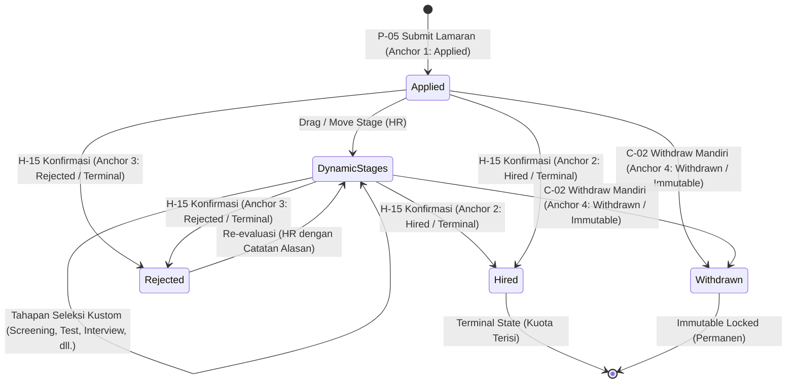

# System Architecture & Design Document
## RecruitFlow — Recruitment Management System
### Version: 4.0 (Enterprise Production-Ready Architecture)

*Dokumen ini merupakan turunan resmi tingkat rekayasa sistem dari PDD (01), PRD v4.0 (02), dan UI/UX Spec v4.0 (03). Dokumen ini menjadi Single Source of Technical Truth (SSoT) mutlak untuk implementasi backend Express.js, basis data Postgres/Supabase, seluruh kontrak API RESTful, serta integrasi frontend React.*

---

## 1. Tech Stack, Framework & External Systems Decision Matrix

Untuk menghilangkan seluruh ambiguitas teknis dan memastikan tidak ada keputusan arsitektur yang mengambang (*zero open decisions*), berikut adalah matriks keputusan teknologi resmi yang telah ditetapkan untuk seluruh ekosistem RecruitFlow:

| Layer / Kategori | Komponen / Library | Versi Resmi | Peran & Justifikasi Teknis |
| :--- | :--- | :--- | :--- |
| **Frontend Framework** | **React** | `v18.3.x` | UI rendering engine berbasis komponen deklaratif, optimal untuk reaktivitas kanban & dashboard. |
| **Build Tool & Bundler** | **Vite** | `v5.x` | Lightning-fast HMR, build production teroptimasi ES modules, FCP $< 1.2\text{s}$. |
| **CSS Styling Engine** | **Tailwind CSS** | `v3.4.x` | Utility-first CSS, zero runtime overhead, penegakan token desain presisi via `tailwind.config.js`. |
| **Frontend State Store** | **Zustand** | `v4.5.x` | State management global ringan ($< 1\text{KB}$) untuk sesi auth, filter stack, dan cache pipeline kanban. |
| **HTTP Client** | **Axios** | `v1.7.x` | Client HTTP terisolasi dengan interceptor otomatis untuk Bearer JWT, refresh token, dan error handler. |
| **Iconography** | **Lucide React** | `v0.400.x` | Set ikon SVG stroke seragam 1.75px, ringan, mencakup seluruh kebutuhan domain rekrutmen. |
| **Routing** | **React Router DOM** | `v6.23.x` | Client-side routing dengan route guards (`ProtectedRoute`, `PublicRoute`, `AdminOnlyRoute`). |
| **Backend Runtime** | **Node.js (LTS)** | `v20.x LTS` | Runtime JavaScript asynchronous event-driven performa tinggi untuk I/O intensif. |
| **Backend Framework** | **Express.js** | `v4.19.x` | Minimalist web framework, fleksibilitas middleware pipeline, arsitektur MVC berlapis. |
| **Database Engine** | **PostgreSQL (Supabase)**| `v15.x / v16.x` | Relational database enterprise dengan ACID compliance, partial unique indexes, UUID v4, JSONB. |
| **Database Driver** | **`pg` (node-postgres)** | `v8.11.x` | Native Postgres connection pooler berlatensi rendah ($< 5\text{ms}$ query execution). |
| **Password Hashing** | **bcryptjs** | `v2.4.x` | One-way cryptographic adaptive hashing dengan Cost Factor 12 untuk pengamanan kredensial. |
| **Token Generator** | **jsonwebtoken** | `v9.0.x` | Dual-token authentication: Access Token (15 menit) & Refresh Token (30 hari) bertanda tangan HMAC SHA-256. |
| **Schema Validation** | **Zod** | `v3.23.x` | Strict runtime request validation untuk body, query, dan params sebelum menyentuh controller. |
| **Security Middlewares** | **Helmet & CORS** | `helmet v7.x` | Pengamanan HTTP security headers (CSP, HSTS, X-Frame-Options) dan pembatasan origin domain. |
| **Rate Limiter** | **express-rate-limit** | `v7.2.x` | Proteksi DoS dan brute-force bertingkat (Auth 5 req/min, Workspace 300 req/min). |
| **Object Storage SDK** | **`@supabase/supabase-js`**| `v2.43.x` | Manajemen bucket S3-compatible, penerbitan Signed Upload URL berbatas waktu 60 detik. |
| **Email Gateway** | **Resend (resend.com)** | `resend SDK v4.x` | Layanan transactional email eksternal berbasis HTTP REST API resmi untuk surat penawaran (Offer), penolakan (Reject), dan Reset Password. |
| **Task Scheduler** | **node-cron** | `v3.0.x` | Background cron scheduler untuk auto-close lowongan expired dan pembersihan token usang. |
| **Database Migration**| **node-pg-migrate** | `v7.x` | Tool migrasi skema database terkelola berbasis file SQL berurutan dengan tracking `pgmigrations`. |
| **Cloud Hosting (FE)** | **Vercel** | Production Edge | Hosting global CDN untuk React SPA dengan auto-deployment dari Git. |
| **Cloud Hosting (BE)** | **Railway** | Production Node | Containerized Linux environment untuk API Express dengan zero-downtime rolling restart. |

---

## 2. System Topology & Component Architecture

### 2.1 High-Level Architecture

```
┌────────────────────────────────────────────────────────────────────────┐
│                          CLIENT TIER (Vercel)                          │
│   React 18 + Vite + Tailwind CSS + Lucide Icons                        │
│   - Area Publik & Talenta: Mobile-First Responsive P-00 s/d P-08, C-01 │
│   - Area Workspace HR: Desktop-First Dashboard H-01 s/d H-15           │
└────────────────────────────────────┬───────────────────────────────────┘
                                     │ HTTPS / REST JSON (Bearer JWT)
                                     v
┌────────────────────────────────────────────────────────────────────────┐
│                        API GATEWAY & BUSINESS ENGINE (Railway)         │
│   Node.js (LTS) + Express.js Framework                                 │
│   - Rate Limiters (Tiered: Auth, Public, Workspace)                    │
│   - Custom JWT Authentication (HMAC SHA-256)                           │
│   - Multi-Tenant Scoping Middleware                                    │
│   - Request Validators (Zod Engine)                                    │
│   - Controller & Service Business Logic Layers                         │
│   - Asynchronous Event Dispatcher & Cron Schedulers                    │
└───────────────────┬───────────────────┬────────────────────┬───────────┘
                    │                   │                    │
                    │ TCP / SSL (pg)    │ Storage SDK        │ SMTP / API
                    v                   v                    v
┌─────────────────────────┐   ┌──────────────────┐   ┌───────────────────┐
│ MANAGED POSTGRES ENGINE │   │ OBJECT STORAGE   │   │ EMAIL SERVICE     │
│ (Supabase Postgres)     │   │ (Supabase S3)    │   │ (Resend / Mailer) │
│ - 23 Relational Tables  │   │ - Buckets:       │   │ - Lifecycle Offer │
│ - Composite Indexes     │   │   * resumes      │   │ - Reject Notice   │
│ - Check Constraints     │   │   * logos        │   │ - Password Reset  │
│ - Tenant Scoped Views   │   │   * avatars      │   │ - Decoupled Queue │
└─────────────────────────┘   └──────────────────┘   └───────────────────┘
```

### 2.2 Clean Layered Architectural Pattern

Backend mengadopsi pola **Strict Layered Clean Architecture**:
$$\text{HTTP Request} \longrightarrow \text{Middleware} \longrightarrow \text{Controller} \longrightarrow \text{Service} \longrightarrow \text{Repository} \longrightarrow \text{Database}$$

1. **Route Layer (`/routes`)**: Murni mendefinisikan URL endpoint, HTTP verb, dan rantai middleware yang bertugas.
2. **Middleware Layer (`/middlewares`)**: Otentikasi token JWT, validasi role, penguncian tenant `scopeToCompany`, validasi skema Zod, dan rate limiting.
3. **Controller Layer (`/controllers`)**: Menerima request HTTP, mengekstrak data, memanggil service terkait, dan menyusun envelope response JSON standar.
4. **Service Layer (`/services`)**: Menjalankan logika bisnis murni, penegakan state machine, transaksi database atomik, dan pemicuan event asinkron.
5. **Repository Layer (`/repositories`)**: Lapisan tunggal akses query basis data Postgres yang mewajibkan penyertaan parameter `company_id`.

---

## 3. Multi-Tenant Architecture & Security Model

### 3.1 Logical Multi-Tenancy Scoping

RecruitFlow mengadopsi model **Shared Database, Shared Schema, Logical Isolation**:
1. **Sisi Perusahaan (Tenant-Scoped)**:
   - Seluruh tabel operasional perusahaan (`jobs`, `company_locations`, `company_members`, `candidate_tags`, `email_templates`, `interviews`) memiliki kolom `company_id UUID NOT NULL`.
   - `company_id` **selalu diekstrak dari kredensial JWT terverifikasi**, tidak pernah dari body/query klien.
2. **Sisi Kandidat (Global Equality — PDD §2)**:
   - Tabel profil pelamar (`candidates`, `candidate_profiles`, `candidate_experiences`, `candidate_documents`) **tidak memiliki kolom `company_id`**. Kandidat bebas melamar ke banyak perusahaan secara independen.
3. **Relasi Akses Multi-Tenant (`applications`)**:
   - HR perusahaan A hanya dapat mengakses data pelamar melalui relasi `applications` yang terikat pada `job_id` milik perusahaannya:
   $$\text{Company} \longleftrightarrow \text{Jobs (company\_id)} \longleftrightarrow \text{Applications} \longleftrightarrow \text{Candidate}$$

### 3.2 Dual Token Authentication Engine

```
               ┌────────────────────────────────────────────────────────┐
               │                     LOGIN REQUEST                      │
               └───────────────────────────┬────────────────────────────┘
                                           │
                                           v
               ┌────────────────────────────────────────────────────────┐
               │           Bcrypt Password Hash Verification            │
               │                   (Cost Factor: 12)                    │
               └───────────────────────────┬────────────────────────────┘
                                           │
                                           v
               ┌────────────────────────────────────────────────────────┐
               │          Generate Dual Cryptographic Tokens            │
               ├────────────────────────────┬───────────────────────────┤
               │ ACCESS TOKEN               │ REFRESH TOKEN             │
               │ - Algorithm: HMAC SHA-256  │ - Algorithm: HMAC SHA-256 │
               │ - Lifespan: 15 Menit       │ - Lifespan: 30 Hari       │
               │ - Stored: Memory / Header  │ - Stored: HttpOnly Cookie │
               │ - Payload: sub, role, comp │ - Hashed in DB Table      │
               └────────────────────────────┴───────────────────────────┘
```

1. **Token Rotation**: Setiap kali token di-refresh (`POST /api/auth/*/refresh`), refresh token lama langsung ditandai `revoked = true` di database dan digantikan dengan token baru.
2. **Kunci Kriptografi Terpisah**: `JWT_ACCESS_SECRET` dan `JWT_REFRESH_SECRET` dipisahkan secara fisik.

### 3.3 Kebijakan Global Session Revocation Saat Reset Password

Untuk mencegah kebocoran sesi saat akun diretas atau password diperbarui:
1. Saat endpoint `POST /api/auth/*/reset-password` berhasil dieksekusi, sistem secara atomik mengeksekusi query database pembatalan seluruh sesi:
   ```sql
   UPDATE refresh_tokens SET revoked = true WHERE user_id = $1 AND type = $2;
   ```
2. Seluruh perangkat yang sebelumnya login menggunakan akun tersebut akan terlempar (*forced global logout*) saat access token berdurasi 15 menit berakhir, karena refresh token mereka telah hangus di database.

### 3.4 Tiered Rate Limiting

| Tier Limiter | Scope Target | Limit Threshold | Window | Aksi Saat Pelanggaran |
| :--- | :--- | :--- | :--- | :--- |
| **Auth Strict** | `/api/auth/*/login`, `/register` | 5 request | 1 Menit | HTTP 429 Too Many Requests |
| **Password Reset**| `/api/auth/*/forgot-password` | 3 request | 15 Menit | HTTP 429 + Cooldown timer |
| **Public Discovery**| `/api/job-board/*`, `/companies/*`| 100 request | 1 Menit | HTTP 429 Too Many Requests |
| **Workspace HR** | `/api/dashboard/*` | 300 request | 1 Menit | HTTP 429 Too Many Requests |
| **Upload Signed URL**| `/api/uploads/signed-url` | 10 request | 1 Menit | HTTP 429 Too Many Requests |

---

## 4. Physical Database Architecture (DDL, Constraints & Indexes)

Seluruh primary key menggunakan `UUID v4` (`gen_random_uuid()`).

### 4.1 DDL Skema Relasional Inti

```sql
CREATE EXTENSION IF NOT EXISTS "uuid-ossp";
CREATE EXTENSION IF NOT EXISTS "pgcrypto";

-- ENUMS
CREATE TYPE member_role AS ENUM ('admin', 'hr');
CREATE TYPE user_type AS ENUM ('company_member', 'candidate');
CREATE TYPE job_status AS ENUM ('draft', 'published', 'closed');
CREATE TYPE app_status AS ENUM ('active', 'hired', 'rejected', 'withdrawn');
CREATE TYPE interview_format AS ENUM ('online', 'offline');
CREATE TYPE interview_status AS ENUM ('scheduled', 'completed', 'cancelled');
CREATE TYPE template_type AS ENUM ('offer', 'reject');
CREATE TYPE email_status AS ENUM ('pending', 'processing', 'sent', 'failed');
CREATE TYPE actor_type AS ENUM ('company_member', 'candidate', 'system');

-- 1. COMPANIES
CREATE TABLE companies (
    id UUID PRIMARY KEY DEFAULT gen_random_uuid(),
    name VARCHAR(255) NOT NULL,
    slug VARCHAR(255) UNIQUE NOT NULL,
    logo_url TEXT,
    banner_url TEXT,
    tagline VARCHAR(255),
    industry VARCHAR(100),
    size_range VARCHAR(50),
    founded_year INT,
    website VARCHAR(255),
    socials JSONB DEFAULT '{}'::jsonb,
    description TEXT,
    benefits JSONB DEFAULT '[]'::jsonb,
    is_profile_complete BOOLEAN DEFAULT false,
    created_at TIMESTAMPTZ DEFAULT CURRENT_TIMESTAMP,
    updated_at TIMESTAMPTZ DEFAULT CURRENT_TIMESTAMP
);

-- 2. COMPANY LOCATIONS
CREATE TABLE company_locations (
    id UUID PRIMARY KEY DEFAULT gen_random_uuid(),
    company_id UUID NOT NULL REFERENCES companies(id) ON DELETE CASCADE,
    city VARCHAR(100) NOT NULL,
    province VARCHAR(100),
    country VARCHAR(100) DEFAULT 'Indonesia',
    is_headquarters BOOLEAN DEFAULT false,
    created_at TIMESTAMPTZ DEFAULT CURRENT_TIMESTAMP
);

-- 3. COMPANY MEMBERS
CREATE TABLE company_members (
    id UUID PRIMARY KEY DEFAULT gen_random_uuid(),
    company_id UUID NOT NULL REFERENCES companies(id) ON DELETE CASCADE,
    name VARCHAR(255) NOT NULL,
    email VARCHAR(255) UNIQUE NOT NULL,
    password_hash VARCHAR(255) NOT NULL,
    role member_role NOT NULL DEFAULT 'hr',
    is_active BOOLEAN DEFAULT true,
    created_at TIMESTAMPTZ DEFAULT CURRENT_TIMESTAMP,
    updated_at TIMESTAMPTZ DEFAULT CURRENT_TIMESTAMP
);

-- 4. CANDIDATES
CREATE TABLE candidates (
    id UUID PRIMARY KEY DEFAULT gen_random_uuid(),
    email VARCHAR(255) UNIQUE NOT NULL,
    password_hash VARCHAR(255) NOT NULL,
    created_at TIMESTAMPTZ DEFAULT CURRENT_TIMESTAMP,
    updated_at TIMESTAMPTZ DEFAULT CURRENT_TIMESTAMP
);

-- 5. CANDIDATE PROFILES
CREATE TABLE candidate_profiles (
    candidate_id UUID PRIMARY KEY REFERENCES candidates(id) ON DELETE CASCADE,
    full_name VARCHAR(255) NOT NULL,
    headline VARCHAR(255),
    summary TEXT,
    phone VARCHAR(50),
    dob DATE,
    location VARCHAR(255),
    salary_expectation NUMERIC(15, 2),
    notice_period VARCHAR(100),
    photo_url TEXT,
    updated_at TIMESTAMPTZ DEFAULT CURRENT_TIMESTAMP
);

-- 6. CANDIDATE DOCUMENTS (MASTER LIBRARY)
CREATE TABLE candidate_documents (
    id UUID PRIMARY KEY DEFAULT gen_random_uuid(),
    candidate_id UUID NOT NULL REFERENCES candidates(id) ON DELETE CASCADE,
    label VARCHAR(100) NOT NULL,
    file_url TEXT NOT NULL,
    file_size_bytes INT NOT NULL,
    mime_type VARCHAR(100) NOT NULL,
    created_at TIMESTAMPTZ DEFAULT CURRENT_TIMESTAMP
);

-- 7. JOBS
CREATE TABLE jobs (
    id UUID PRIMARY KEY DEFAULT gen_random_uuid(),
    company_id UUID NOT NULL REFERENCES companies(id) ON DELETE CASCADE,
    title VARCHAR(255) NOT NULL,
    department VARCHAR(100) NOT NULL,
    location_id UUID REFERENCES company_locations(id) ON DELETE SET NULL,
    employment_type VARCHAR(50) NOT NULL,
    experience_level VARCHAR(50) NOT NULL,
    work_arrangement VARCHAR(50) NOT NULL,
    description TEXT NOT NULL,
    responsibilities JSONB DEFAULT '[]'::jsonb,
    requirements JSONB DEFAULT '[]'::jsonb,
    preferred_qualifications JSONB DEFAULT '[]'::jsonb,
    benefits_extra JSONB DEFAULT '[]'::jsonb,
    salary_min NUMERIC(15, 2),
    salary_max NUMERIC(15, 2),
    salary_visible BOOLEAN DEFAULT true,
    quota INT NOT NULL CHECK (quota >= 1),
    filled_count INT NOT NULL DEFAULT 0 CHECK (filled_count >= 0),
    status job_status NOT NULL DEFAULT 'draft',
    published_at TIMESTAMPTZ,
    deadline TIMESTAMPTZ,
    created_at TIMESTAMPTZ DEFAULT CURRENT_TIMESTAMP,
    updated_at TIMESTAMPTZ DEFAULT CURRENT_TIMESTAMP
);

-- 8. JOB PIPELINE STAGES
CREATE TABLE job_pipeline_stages (
    id UUID PRIMARY KEY DEFAULT gen_random_uuid(),
    job_id UUID NOT NULL REFERENCES jobs(id) ON DELETE CASCADE,
    name VARCHAR(100) NOT NULL,
    order_index INT NOT NULL,
    is_anchor BOOLEAN DEFAULT false,
    anchor_type VARCHAR(50), -- 'applied', 'hired', 'rejected', 'withdrawn'
    created_at TIMESTAMPTZ DEFAULT CURRENT_TIMESTAMP
);

-- 9. APPLICATIONS
CREATE TABLE applications (
    id UUID PRIMARY KEY DEFAULT gen_random_uuid(),
    job_id UUID NOT NULL REFERENCES jobs(id) ON DELETE CASCADE,
    candidate_id UUID NOT NULL REFERENCES candidates(id) ON DELETE CASCADE,
    current_stage_id UUID REFERENCES job_pipeline_stages(id) ON DELETE RESTRICT,
    status app_status NOT NULL DEFAULT 'active',
    cover_letter TEXT,
    source VARCHAR(100),
    applied_at TIMESTAMPTZ DEFAULT CURRENT_TIMESTAMP,
    updated_at TIMESTAMPTZ DEFAULT CURRENT_TIMESTAMP
);

-- 10. APPLICATION DOCUMENTS (IMMUTABLE SNAPSHOT)
CREATE TABLE application_documents (
    id UUID PRIMARY KEY DEFAULT gen_random_uuid(),
    application_id UUID NOT NULL REFERENCES applications(id) ON DELETE CASCADE,
    source_document_id UUID REFERENCES candidate_documents(id) ON DELETE SET NULL,
    label VARCHAR(255) NOT NULL,
    file_url TEXT NOT NULL,
    file_size_bytes INT NOT NULL,
    mime_type VARCHAR(100) NOT NULL,
    snapshot_created_at TIMESTAMPTZ DEFAULT CURRENT_TIMESTAMP
);

-- 11. INTERVIEWS
CREATE TABLE interviews (
    id UUID PRIMARY KEY DEFAULT gen_random_uuid(),
    application_id UUID NOT NULL REFERENCES applications(id) ON DELETE CASCADE,
    company_id UUID NOT NULL REFERENCES companies(id) ON DELETE CASCADE,
    interviewer_id UUID REFERENCES company_members(id) ON DELETE SET NULL,
    scheduled_at TIMESTAMPTZ NOT NULL,
    end_at TIMESTAMPTZ NOT NULL,
    type interview_format NOT NULL DEFAULT 'online',
    location_or_link TEXT NOT NULL,
    notes TEXT,
    status interview_status NOT NULL DEFAULT 'scheduled',
    created_at TIMESTAMPTZ DEFAULT CURRENT_TIMESTAMP,
    updated_at TIMESTAMPTZ DEFAULT CURRENT_TIMESTAMP
);

-- 12. APPLICATION EVALUATIONS (NOTES & SCORES)
CREATE TABLE application_notes (
    id UUID PRIMARY KEY DEFAULT gen_random_uuid(),
    application_id UUID NOT NULL REFERENCES applications(id) ON DELETE CASCADE,
    company_id UUID NOT NULL REFERENCES companies(id) ON DELETE CASCADE,
    author_id UUID NOT NULL REFERENCES company_members(id) ON DELETE CASCADE,
    note_text TEXT NOT NULL,
    created_at TIMESTAMPTZ DEFAULT CURRENT_TIMESTAMP
);

CREATE TABLE candidate_scores (
    id UUID PRIMARY KEY DEFAULT gen_random_uuid(),
    application_id UUID NOT NULL REFERENCES applications(id) ON DELETE CASCADE,
    company_id UUID NOT NULL REFERENCES companies(id) ON DELETE CASCADE,
    scorer_id UUID NOT NULL REFERENCES company_members(id) ON DELETE CASCADE,
    score INT NOT NULL CHECK (score >= 1 AND score <= 5),
    created_at TIMESTAMPTZ DEFAULT CURRENT_TIMESTAMP,
    UNIQUE (application_id, scorer_id)
);

-- 13. TENANT CANDIDATE TAGS
CREATE TABLE candidate_tags (
    id UUID PRIMARY KEY DEFAULT gen_random_uuid(),
    company_id UUID NOT NULL REFERENCES companies(id) ON DELETE CASCADE,
    name VARCHAR(50) NOT NULL,
    color VARCHAR(20) DEFAULT '#0d9488',
    created_at TIMESTAMPTZ DEFAULT CURRENT_TIMESTAMP,
    UNIQUE(company_id, name)
);

CREATE TABLE application_tags (
    application_id UUID NOT NULL REFERENCES applications(id) ON DELETE CASCADE,
    tag_id UUID NOT NULL REFERENCES candidate_tags(id) ON DELETE CASCADE,
    PRIMARY KEY (application_id, tag_id)
);

-- 14. ASYNCHRONOUS EMAIL QUEUE & LOG
CREATE TABLE email_send_log (
    id UUID PRIMARY KEY DEFAULT gen_random_uuid(),
    company_id UUID NOT NULL REFERENCES companies(id) ON DELETE CASCADE,
    application_id UUID NOT NULL REFERENCES applications(id) ON DELETE CASCADE,
    template_type template_type NOT NULL,
    recipient_email VARCHAR(255) NOT NULL,
    subject VARCHAR(255) NOT NULL,
    body TEXT NOT NULL,
    status email_status NOT NULL DEFAULT 'pending',
    retry_count INT DEFAULT 0,
    last_error TEXT,
    created_at TIMESTAMPTZ DEFAULT CURRENT_TIMESTAMP,
    sent_at TIMESTAMPTZ
);

-- 15. ACTIVITY & AUDIT LOGS
CREATE TABLE activity_logs (
    id UUID PRIMARY KEY DEFAULT gen_random_uuid(),
    application_id UUID NOT NULL REFERENCES applications(id) ON DELETE CASCADE,
    actor_type actor_type NOT NULL,
    actor_id UUID,
    action_type VARCHAR(100) NOT NULL,
    description TEXT NOT NULL,
    metadata JSONB DEFAULT '{}'::jsonb,
    created_at TIMESTAMPTZ DEFAULT CURRENT_TIMESTAMP
);

-- 16. REFRESH TOKENS (SESSION MANAGEMENT & ROTATION)
CREATE TABLE refresh_tokens (
    id UUID PRIMARY KEY DEFAULT gen_random_uuid(),
    user_id UUID NOT NULL,
    user_type user_type NOT NULL, -- 'company_member' | 'candidate'
    token_hash VARCHAR(255) NOT NULL,
    revoked BOOLEAN DEFAULT false,
    expires_at TIMESTAMPTZ NOT NULL,
    created_at TIMESTAMPTZ DEFAULT CURRENT_TIMESTAMP
);

-- 17. PASSWORD RESET & INVITATION TOKENS
CREATE TABLE password_reset_tokens (
    id UUID PRIMARY KEY DEFAULT gen_random_uuid(),
    email VARCHAR(255) NOT NULL,
    user_type user_type NOT NULL,
    token_hash VARCHAR(255) NOT NULL,
    expires_at TIMESTAMPTZ NOT NULL,
    used BOOLEAN DEFAULT false,
    created_at TIMESTAMPTZ DEFAULT CURRENT_TIMESTAMP
);

-- 18. JOB CUSTOM SCREENING QUESTIONS
CREATE TABLE job_custom_questions (
    id UUID PRIMARY KEY DEFAULT gen_random_uuid(),
    job_id UUID NOT NULL REFERENCES jobs(id) ON DELETE CASCADE,
    question_text TEXT NOT NULL,
    question_type VARCHAR(50) NOT NULL, -- 'text', 'paragraph', 'select', 'checkbox', 'file'
    is_required BOOLEAN DEFAULT false,
    options JSONB DEFAULT '[]'::jsonb,
    order_index INT NOT NULL,
    created_at TIMESTAMPTZ DEFAULT CURRENT_TIMESTAMP
);

-- 19. APPLICATION CUSTOM ANSWERS
CREATE TABLE application_answers (
    id UUID PRIMARY KEY DEFAULT gen_random_uuid(),
    application_id UUID NOT NULL REFERENCES applications(id) ON DELETE CASCADE,
    question_id UUID NOT NULL REFERENCES job_custom_questions(id) ON DELETE RESTRICT,
    answer_text TEXT,
    file_url TEXT,
    created_at TIMESTAMPTZ DEFAULT CURRENT_TIMESTAMP
);

-- 20. TENANT EMAIL TEMPLATES (OFFER & REJECT)
CREATE TABLE email_templates (
    id UUID PRIMARY KEY DEFAULT gen_random_uuid(),
    company_id UUID NOT NULL REFERENCES companies(id) ON DELETE CASCADE,
    type template_type NOT NULL, -- 'offer' | 'reject'
    subject VARCHAR(255) NOT NULL,
    body TEXT NOT NULL,
    created_at TIMESTAMPTZ DEFAULT CURRENT_TIMESTAMP,
    updated_at TIMESTAMPTZ DEFAULT CURRENT_TIMESTAMP,
    UNIQUE (company_id, type)
);

-- 21. CANDIDATE SAVED JOBS (BOOKMARKS)
CREATE TABLE saved_jobs (
    candidate_id UUID NOT NULL REFERENCES candidates(id) ON DELETE CASCADE,
    job_id UUID NOT NULL REFERENCES jobs(id) ON DELETE CASCADE,
    created_at TIMESTAMPTZ DEFAULT CURRENT_TIMESTAMP,
    PRIMARY KEY (candidate_id, job_id)
);

-- 22. CANDIDATE WORK EXPERIENCES
CREATE TABLE candidate_experiences (
    id UUID PRIMARY KEY DEFAULT gen_random_uuid(),
    candidate_id UUID NOT NULL REFERENCES candidates(id) ON DELETE CASCADE,
    company_name VARCHAR(255) NOT NULL,
    position VARCHAR(255) NOT NULL,
    start_date DATE NOT NULL,
    end_date DATE,
    is_current BOOLEAN DEFAULT false,
    description TEXT,
    created_at TIMESTAMPTZ DEFAULT CURRENT_TIMESTAMP
);

-- 23. CANDIDATE EDUCATIONS
CREATE TABLE candidate_educations (
    id UUID PRIMARY KEY DEFAULT gen_random_uuid(),
    candidate_id UUID NOT NULL REFERENCES candidates(id) ON DELETE CASCADE,
    institution VARCHAR(255) NOT NULL,
    degree VARCHAR(100) NOT NULL,
    field_of_study VARCHAR(100),
    graduation_year INT,
    created_at TIMESTAMPTZ DEFAULT CURRENT_TIMESTAMP
);
```

### 4.2 Indeks Kinerja & Deterministic Sorting Indexes

```sql
CREATE INDEX idx_jobs_deterministic_sort ON jobs (published_at DESC, id ASC) WHERE status = 'published';
CREATE UNIQUE INDEX idx_unique_active_application ON applications (job_id, candidate_id) WHERE status = 'active';
CREATE INDEX idx_interviews_collision ON interviews (interviewer_id, scheduled_at, end_at) WHERE status = 'scheduled';
CREATE INDEX idx_jobs_company_status ON jobs (company_id, status);
CREATE INDEX idx_applications_job_status ON applications (job_id, status);
CREATE INDEX idx_candidate_tags_company ON candidate_tags (company_id);
CREATE INDEX idx_app_notes_application ON application_notes (application_id);
CREATE INDEX idx_email_queue_pending ON email_send_log (status, retry_count) WHERE status IN ('pending', 'processing');
CREATE INDEX idx_refresh_tokens_lookup ON refresh_tokens (user_id, user_type) WHERE revoked = false;
CREATE INDEX idx_password_reset_token ON password_reset_tokens (token_hash) WHERE used = false;
CREATE INDEX idx_custom_questions_job ON job_custom_questions (job_id, order_index);
CREATE INDEX idx_application_answers_app ON application_answers (application_id);
CREATE INDEX idx_saved_jobs_candidate ON saved_jobs (candidate_id);
CREATE INDEX idx_candidate_experiences_cand ON candidate_experiences (candidate_id);
CREATE INDEX idx_candidate_educations_cand ON candidate_educations (candidate_id);
```

### 4.3 Konfigurasi Connection Pooler (Supabase Transaction Pooler Port 6543)

Untuk mencegah kebocoran koneksi (*Connection Limit Exhaustion*) pada container Railway:
1. **Routing Port**: Koneksi backend ke Postgres Supabase diarahkan ke **Port `6543` (Transaction Pooler via Supavisor / PgBouncer)**, bukan port direct 5432.
2. **Parameter Pooler Resmi (`backend/src/config/db.js`)**:
   ```javascript
   const pool = new Pool({
     connectionString: process.env.DATABASE_URL,
     max: 20,                       // Maksimal 20 klien aktif per instance Express
     idleTimeoutMillis: 30000,       // Putus koneksi idle setelah 30 detik
     connectionTimeoutMillis: 5000,  // Fail-fast timeout 5 detik jika pooler penuh
   });
   ```

### 4.4 Strategi Migrasi & Versioning Basis Data (`node-pg-migrate`)

Seluruh perubahan struktur tabel dikelola secara deklaratif melalui tool migrasi resmi **`node-pg-migrate`**:
1. **Tracking Table**: Riwayat migrasi dicatat otomatis di tabel internal Postgres `pgmigrations`.
2. **File Versioning**: File migrasi disimpan dalam direktori `backend/migrations/` dengan penamaan timestamp (`YYYYMMDDHHMMSS_nama_perubahan.js` atau `.sql`).
3. **NPM Scripts**:
   - `npm run db:migrate`: Mengeksekusi seluruh migrasi baru yang belum berjalan di database target.
   - `npm run db:migrate:undo`: Membatalkan (*rollback*) migrasi satu langkah ke belakang.
4. **Aturan CI/CD**: Perubahan skema basis data dilarang dijalankan secara manual di SQL Editor dashboard Supabase. Setiap perubahan skema wajib melalui migrasi terkomit di Git.

---

## 5. Formal State Machine Engine

Perubahan status pelamar dikontrol oleh **Finite State Machine (FSM)** yang dieksekusi di `ApplicationService`. Sistem membedakan secara tegas antara **Status Global Lamaran** (`status = 'active' | 'hired' | 'rejected' | 'withdrawn'`) dan **Tahapan Seleksi Kanban** (`current_stage_id` merujuk ke `job_pipeline_stages` dengan 4 anchor stages wajib: Applied, Hired, Rejected, Withdrawn):



### 5.1 Matriks Transisi & Guard Conditions

| Current Status | Target Status | Authorized Actor | Guard Conditions / Validasi Backend | Side-Effects & Event Terpicu |
| :--- | :--- | :--- | :--- | :--- |
| `null` | `active` (Applied) | `candidate` | Lowongan berstatus `published`; tidak ada lamaran aktif `(job_id, candidate_id)`. | Snapshot CV dibuat di `application_documents`; log audit dibuat. |
| `active` | `active` (Next Stage)| `company_member` | Stage tujuan terdaftar di `job_pipeline_stages` milik `job_id` ini. | `current_stage_id` diupdate; log aktivitas `STAGE_MOVED`. |
| `active` | `withdrawn` | `candidate` **ONLY** | Panggilan dari `company_member` **DITOLAK (HTTP 403 Forbidden)**. | Status $\rightarrow$ `withdrawn`; Partial index aktif terlepas; log `APPLICATION_WITHDRAWN`. |
| `active` | `hired` | `company_member` | Lowongan memiliki sisa kuota (`filled_count < quota`). | `filled_count += 1`; jika penuh $\rightarrow$ `job.status = closed`; email offer di-queue; log `HIRED`. |
| `active` | `rejected` | `company_member` | Alasan penolakan opsional tersimpan. | Status $\rightarrow$ `rejected`; email reject di-queue; log `REJECTED`. |
| `rejected` | `active` (Reopened) | `company_member` | Field `reopen_reason` wajib diisi ($\ge 10$ karakter). | Status $\rightarrow$ `active`; log audit `RE_EVALUATED` mencatat alasan pembukaan kembali. |
| `withdrawn` | *ANY* | *NONE* | **DILARANG MUTLAK**. State immutable. | HTTP 422 Unprocessable Entity (`STATE_IS_TERMINAL`). |

---

## 6. Complete RESTful API Contracts & Screen Traceability Matrix

### 6.1 HTTP Response Envelopes & Conventions

Seluruh endpoint backend RecruitFlow terstandarisasi menggunakan format JSON dengan envelope seragam.

**Success Response Envelope (`200 OK` / `201 Created`)**:
```json
{
  "success": true,
  "message": "Operasi berhasil dijalankan",
  "data": { ... },
  "meta": {
    "page": 1,
    "limit": 10,
    "total_items": 48,
    "total_pages": 5
  }
}
```

**Standardized Error Response Envelope (`4xx Client Error` / `5xx Server Error`)**:
```json
{
  "success": false,
  "error": {
    "code": "ERR_PROFILE_INCOMPLETE",
    "message": "Gagal mempublikasikan: Lengkapi 5 syarat profil perusahaan terlebih dahulu.",
    "details": [
      { "field": "logo_url", "issue": "Logo perusahaan wajib diunggah" }
    ]
  }
}
```

---

### 6.2 Matriks Keterlacakan 29 Layar ke Kontrak API (Screen-to-API Traceability Matrix)

Berikut adalah pemetaan mutlak 1-to-1 antara seluruh **29 Layar Dokumen 03 v4.0** terhadap endpoint backend Express.js yang melayaninya:

| Kode Layar | Nama Layar & URL Rute | Auth Guard | Endpoint Mount / Fetch (GET) | Endpoint Aksi / Mutasi (POST/PUT/PATCH/DELETE) | Kode Error yang Ditangani |
| :--- | :--- | :--- | :--- | :--- | :--- |
| **[P-00]** | Landing Page Utama (`/`) | Public | `GET /api/public/platform-stats` | N/A (Stateless) | Fallback cache |
| **[P-01]** | Job Board (`/cari-lowongan`) | Public | `GET /api/jobs` (Alias: `/api/public/jobs`) | `POST /api/candidate/saved-jobs`<br>`DELETE /api/candidate/saved-jobs/:jobId` | `ERR_UNAUTHORIZED` |
| **[P-02]** | Detail Lowongan (`/jobs/:jobId`) | Public | `GET /api/jobs/:jobId`<br>`GET /api/candidate/applications/check` | N/A (Navigasi ke P-05 atau C-02) | `ERR_JOB_NOT_FOUND` |
| **[P-03]** | Profil Perusahaan (`/companies/:slug`) | Public | `GET /api/companies/:slug`<br>`GET /api/companies/:slug/jobs` | N/A (Tampilan publik) | `ERR_COMPANY_NOT_FOUND` |
| **[P-04]** | Auth Kandidat (`/candidate/auth`) | Guest Only | N/A | `POST /api/auth/candidate/login`<br>`POST /api/auth/candidate/register` | `ERR_INVALID_CREDENTIALS`<br>`ERR_EMAIL_ALREADY_EXISTS` |
| **[P-05]** | Form Aplikasi Multi-Step (`/jobs/:jobId/apply`) | Candidate | `GET /api/jobs/:jobId/apply-info` | `POST /api/jobs/:jobId/apply` | `ERR_DUPLICATE_APPLICATION`<br>`ERR_QUOTA_EXCEEDED`<br>`ERR_FILE_TOO_LARGE` |
| **[P-06]** | Konfirmasi Berhasil (`/jobs/:jobId/success`) | Candidate | `GET /api/candidate/applications/:id/summary` | N/A (Tampilan tiket konfirmasi) | `ERR_APPLICATION_NOT_FOUND` |
| **[P-07]** | Landing B2B (`/untuk-perusahaan`) | Public | N/A (Stateless) | `POST /api/analytics/track-pageview` | N/A |
| **[P-08]** | Halaman Harga (`/harga`) | Public | N/A (Stateless Informasional) | N/A (Navigasi pendaftaran H-01) | N/A |
| **[C-01]** | Candidate Dashboard (`/candidate/dashboard`) | Candidate | `GET /api/candidate/dashboard-stats`<br>`GET /api/candidate/applications` | N/A | `ERR_UNAUTHORIZED` |
| **[C-02]** | Detail Lamaran & Histori (`/candidate/applications/:id`) | Candidate (Owner) | `GET /api/candidate/applications/:id` | `PATCH /api/candidate/applications/:id/withdraw` | `ERR_CANNOT_WITHDRAW`<br>`ERR_FORBIDDEN` |
| **[C-03]** | Lowongan Tersimpan (`/candidate/saved-jobs`) | Candidate | `GET /api/candidate/saved-jobs` | `DELETE /api/candidate/saved-jobs/:jobId` | `ERR_UNAUTHORIZED` |
| **[C-04]** | Kelola Profil Kandidat (`/candidate/profile`) | Candidate | `GET /api/candidate/profile` | `PUT /api/candidate/profile`<br>`POST /api/candidate/profile/avatar` | `ERR_VALIDATION_ERROR`<br>`ERR_FILE_TOO_LARGE` |
| **[C-05]** | Koleksi Berkas & CV (`/candidate/documents`) | Candidate | `GET /api/candidate/resumes` | `POST /api/candidate/resumes`<br>`PATCH /api/candidate/resumes/:id`<br>`DELETE /api/candidate/resumes/:id` | `ERR_INVALID_FILE_TYPE`<br>`ERR_RESUME_QUOTA_EXCEEDED` |
| **[H-01]** | Registrasi Perusahaan (`/company/register`) | Guest Only | N/A | `POST /api/auth/company/register` | `ERR_COMPANY_EMAIL_EXISTS`<br>`ERR_VALIDATION_ERROR` |
| **[H-02]** | Login HR (`/company/login`) | Guest Only | N/A | `POST /api/auth/company/login` | `ERR_INVALID_CREDENTIALS`<br>`ERR_ACCOUNT_DEACTIVATED` |
| **[H-03]** | HR Dashboard Overview (`/dashboard`) | Company | `GET /api/company/dashboard/overview` | N/A | `ERR_FORBIDDEN_TENANT_ACCESS` |
| **[H-04]** | Kelola Profil Perusahaan (`/dashboard/profile`) | Company (Admin) | `GET /api/company/profile` | `PUT /api/company/profile`<br>`POST /api/company/profile/logo`<br>`POST /api/company/profile/banner` | `ERR_FORBIDDEN_ROLE`<br>`ERR_FILE_TOO_LARGE` |
| **[H-05]** | Manajemen Tim (`/dashboard/team`) | Company:Admin Only | `GET /api/company/team` | `POST /api/company/team/invite`<br>`PATCH /api/company/team/:userId/role`<br>`DELETE /api/company/team/:userId` | `ERR_FORBIDDEN_ROLE`<br>`ERR_MEMBER_ALREADY_IN_TEAM` |
| **[H-06]** | Kelola Lowongan (`/dashboard/jobs`) | Company | `GET /api/company/jobs` | `PATCH /api/company/jobs/:id/status`<br>`POST /api/company/jobs/:id/duplicate` | `ERR_JOB_NOT_FOUND` |
| **[H-07]** | Buat/Edit Lowongan (`/dashboard/jobs/new`) | Company | `GET /api/company/jobs/:id`<br>`GET /api/company/profile/gating-status` | `POST /api/company/jobs`<br>`PUT /api/company/jobs/:id` | `ERR_PROFILE_INCOMPLETE`<br>`ERR_INVALID_QUOTA` |
| **[H-08]** | Kanban Pipeline Board (`/dashboard/jobs/:id/pipeline`) | Company | `GET /api/company/jobs/:id/pipeline` | `PATCH /api/company/applications/:id/stage` | `ERR_INVALID_STAGE_TRANSITION`<br>`ERR_CANNOT_MOVE_TO_WITHDRAWN` |
| **[H-09]** | Detail Evaluasi Lamaran (`/dashboard/applications/:id`) | Company | `GET /api/company/applications/:id` | `POST /api/company/applications/:id/reviews`<br>`POST /api/company/applications/:id/tags` | `ERR_FORBIDDEN_TENANT_ACCESS` |
| **[H-10]** | Database Talent Pool (`/dashboard/candidates`) | Company | `GET /api/company/candidates`<br>`GET /api/company/candidates/export-csv` | N/A (Ekspor dataset CSV) | `ERR_UNAUTHORIZED` |
| **[H-11]** | Kalender Wawancara (`/dashboard/interviews`) | Company | `GET /api/company/interviews` | `DELETE /api/company/interviews/:id` | `ERR_FORBIDDEN_TENANT_ACCESS` |
| **[H-12]** | Template Email Rekrutmen (`/dashboard/email-templates`) | Company | `GET /api/company/email-templates` | `PUT /api/company/email-templates/:type` | `ERR_VALIDATION_ERROR` |
| **[H-13]** | Analitik & Laporan (`/dashboard/analytics`) | Company | `GET /api/company/analytics/overview`<br>`GET /api/company/analytics/export-csv` | N/A (Ekspor laporan CSV) | `ERR_UNAUTHORIZED` |
| **[H-14]** | Modal Jadwalkan Wawancara (Triggered Modal) | Company | `GET /api/company/interviews/collision-check` | `POST /api/company/interviews`<br>`PUT /api/company/interviews/:id` | `ERR_INVALID_SCHEDULE_TIME`<br>`ERR_INTERVIEW_COLLISION` |
| **[H-15]** | Modal Keputusan Status (Triggered Modal) | Company | N/A | `PATCH /api/company/applications/:id/decision` | `ERR_QUOTA_EXCEEDED` |

---

### 6.3 Modul 1: Public Discovery & Job Board (Layar P-00 s/d P-03, P-07, P-08)

| Method | Endpoint Canonical & Alias | Auth Guard | Request Body / Query Params | Status | Success Response Data | Handled Error Codes |
| :--- | :--- | :--- | :--- | :--- | :--- | :--- |
| **GET** | `/api/public/platform-stats` | Public | None | `200` | `{ active_jobs, companies, hired_candidates, avg_tth_days }` | Fallback cache |
| **GET** | `/api/jobs`<br>*(Alias: `/api/public/jobs`)* | Public | Query: `search, location, category, job_type, work_arrangement, salary_min, salary_max, sort_by, sort_order, page, limit` | `200` | `{ jobs: [{ id, title, company_name, logo_url, location, job_type, salary_min, salary_max, quota, hired_count, deadline }], pagination: {...} }` | `ERR_BAD_REQUEST` |
| **GET** | `/api/jobs/:jobId`<br>*(Alias: `/api/public/jobs/:jobId`)* | Public | Param: `jobId` (UUID) | `200` | `{ id, title, description, requirements, benefits, salary_min, salary_max, quota, hired_count, deadline, status, company: { id, name, slug, logo_url, industry, location } }` | `ERR_JOB_NOT_FOUND` |
| **GET** | `/api/companies/:companySlug`<br>*(Alias: `/api/public/companies/:slug`)* | Public | Param: `companySlug` | `200` | `{ id, name, slug, logo_url, banner_url, industry, location, team_size, website_url, linkedin_url, description, gallery_urls: [], benefits: [] }` | `ERR_COMPANY_NOT_FOUND` |
| **GET** | `/api/companies/:companySlug/jobs` | Public | Param: `companySlug` | `200` | `{ jobs: [{ id, title, job_type, location, created_at }], total }` | `ERR_COMPANY_NOT_FOUND` |
| **POST**| `/api/analytics/track-pageview` | Public | Body: `{ page: "employer_landing" }` | `200` | `{ success: true }` | N/A |

---

### 6.4 Modul 2: Candidate Authentication (Layar P-04)

| Method | Endpoint Canonical | Auth Guard | Request Body / Query Params | Status | Success Response Data | Handled Error Codes |
| :--- | :--- | :--- | :--- | :--- | :--- | :--- |
| **POST**| `/api/auth/candidate/register` | Public | Body: `{ full_name, email, password }` | `201` | `{ token, user: { id, email, full_name, role: "candidate" } }` (Set HttpOnly Refresh Cookie) | `ERR_EMAIL_ALREADY_EXISTS`<br>`ERR_VALIDATION_ERROR` |
| **POST**| `/api/auth/candidate/login` | Public | Body: `{ email, password }` | `200` | `{ token, user: { id, email, full_name, role: "candidate" } }` | `ERR_INVALID_CREDENTIALS` |
| **POST**| `/api/auth/candidate/refresh` | Cookie | (Reads `refreshToken` from Secure Cookie) | `200` | `{ token: "new_jwt..." }` | `ERR_AUTH_TOKEN_EXPIRED`<br>`ERR_AUTH_TOKEN_REVOKED` |
| **POST**| `/api/auth/candidate/logout` | Candidate | None | `200` | `{ message: "Logged out successfully" }` (Clears Cookie) | `ERR_UNAUTHORIZED` |
| **POST**| `/api/auth/candidate/forgot-password`| Public | Body: `{ email }` | `200` | `{ message: "Email instruksi reset password telah dikirim" }` | `ERR_RESOURCE_NOT_FOUND` |
| **POST**| `/api/auth/candidate/reset-password` | Public | Body: `{ token, new_password }` | `200` | `{ message: "Password berhasil diperbarui" }` | `ERR_AUTH_TOKEN_EXPIRED` |

---

### 6.5 Modul 3: Employer Authentication (Layar H-01 & H-02)

| Method | Endpoint Canonical | Auth Guard | Request Body / Query Params | Status | Success Response Data | Handled Error Codes |
| :--- | :--- | :--- | :--- | :--- | :--- | :--- |
| **POST**| `/api/auth/company/register` | Public | Body: `{ full_name, email, password, company_name }` | `201` | `{ token, company: { id, name, slug }, user: { id, email, role: "admin" } }` | `ERR_COMPANY_EMAIL_EXISTS`<br>`ERR_VALIDATION_ERROR` |
| **POST**| `/api/auth/company/login` | Public | Body: `{ email, password }` | `200` | `{ token, company: { id, name, slug }, user: { id, full_name, email, role } }` | `ERR_INVALID_CREDENTIALS`<br>`ERR_ACCOUNT_DEACTIVATED` |
| **POST**| `/api/auth/company/refresh` | Cookie | (Reads `refreshToken` from Secure Cookie) | `200` | `{ token: "new_jwt..." }` | `ERR_AUTH_TOKEN_EXPIRED` |
| **POST**| `/api/auth/company/logout` | Company | None | `200` | `{ message: "Logged out successfully" }` | `ERR_UNAUTHORIZED` |
| **POST**| `/api/auth/company/forgot-password` | Public | Body: `{ email }` | `200` | `{ message: "Email reset password telah dikirim" }` | `ERR_RESOURCE_NOT_FOUND` |
| **POST**| `/api/auth/company/reset-password`  | Public | Body: `{ token, new_password }` | `200` | `{ message: "Password perusahaan berhasil diperbarui" }` | `ERR_AUTH_TOKEN_EXPIRED` |

---

### 6.6 Modul 4: Company Profile & 5-Prerequisite Gating (Layar H-04)

| Method | Endpoint Canonical & Alias | Auth Guard | Request Body / Query Params | Status | Success Response Data | Handled Error Codes |
| :--- | :--- | :--- | :--- | :--- | :--- | :--- |
| **GET** | `/api/company/profile`<br>*(Alias: `/api/dashboard/company`)* | Company | None | `200` | `{ name, slug, industry, location, team_size, logo_url, banner_url, description, benefits: [], gallery_urls: [], website_url, linkedin_url, is_complete: true, missing_requirements: [] }` | `ERR_UNAUTHORIZED` |
| **PUT** | `/api/company/profile`<br>*(Alias: `/api/dashboard/company`)* | Company:Admin | Body: `{ name, industry, location, team_size, description, benefits, website_url, linkedin_url }` | `200` | `{ message: "Profil berhasil diperbarui", is_complete: true }` | `ERR_FORBIDDEN_ROLE`<br>`ERR_VALIDATION_ERROR` |
| **GET** | `/api/company/profile/gating-status` | Company | None | `200` | `{ can_publish: true, is_complete: true, missing_fields: [] }` | `ERR_UNAUTHORIZED` |
| **POST**| `/api/company/profile/logo` | Company:Admin | Multipart: `file: Binary (PNG/JPG max 2MB)` | `200` | `{ logo_url: "https://..." }` | `ERR_INVALID_FILE_TYPE`<br>`ERR_FILE_TOO_LARGE` |
| **POST**| `/api/company/profile/banner` | Company:Admin | Multipart: `file: Binary (PNG/JPG max 5MB)` | `200` | `{ banner_url: "https://..." }` | `ERR_FILE_TOO_LARGE` |

---

### 6.7 Modul 5: Recruitment Team Management (Layar H-05)

| Method | Endpoint Canonical & Alias | Auth Guard | Request Body / Query Params | Status | Success Response Data | Handled Error Codes |
| :--- | :--- | :--- | :--- | :--- | :--- | :--- |
| **GET** | `/api/company/team`<br>*(Alias: `/api/dashboard/company/team`)* | Company:Admin | None | `200` | `{ members: [{ id, full_name, email, role, status, joined_at, avatar_url }], seats_used: 3, seats_limit: 10 }` | `ERR_FORBIDDEN_ROLE` |
| **POST**| `/api/company/team/invite`<br>*(Alias: `/api/dashboard/company/team/invite`)* | Company:Admin | Body: `{ full_name, email, role: "admin" \| "member" }` | `201` | `{ message: "Undangan email berhasil dikirim" }` | `ERR_MEMBER_ALREADY_IN_TEAM`<br>`ERR_FORBIDDEN_ROLE` |
| **PATCH**| `/api/company/team/:userId/role`<br>*(Alias: `/api/dashboard/company/team/:memberId`)* | Company:Admin | Param: `userId`, Body: `{ role: "admin" \| "member" }` | `200` | `{ message: "Peran berhasil diubah" }` | `ERR_FORBIDDEN_ROLE` |
| **DELETE**| `/api/company/team/:userId`<br>*(Alias: `/api/dashboard/company/team/:memberId`)* | Company:Admin | Param: `userId` | `200` | `{ message: "Anggota tim berhasil dihapus" }` | `ERR_FORBIDDEN_ROLE` |

---

### 6.8 Modul 6: Job Requisition Lifecycle (Layar H-06 & H-07)

| Method | Endpoint Canonical & Alias | Auth Guard | Request Body / Query Params | Status | Success Response Data | Handled Error Codes |
| :--- | :--- | :--- | :--- | :--- | :--- | :--- |
| **GET** | `/api/company/jobs`<br>*(Alias: `/api/dashboard/jobs`)* | Company | Query: `status, search, page, limit` | `200` | `{ jobs: [{ id, title, category, status, quota, hired_count, active_applicants_count, deadline, created_at }], pagination: {...} }` | `ERR_UNAUTHORIZED` |
| **POST**| `/api/company/jobs`<br>*(Alias: `/api/dashboard/jobs`)* | Company | Body: `{ title, category, job_type, work_arrangement, location, quota, deadline, description, requirements, benefits, salary_min, salary_max, hide_salary, status: "draft" \| "published", custom_questions: [], stages: [] }` | `201` | `{ job_id: "uuid", status: "published" }` | `ERR_PROFILE_INCOMPLETE`<br>`ERR_INVALID_QUOTA` |
| **GET** | `/api/company/jobs/:id`<br>*(Alias: `/api/dashboard/jobs/:id`)* | Company | Param: `id` | `200` | Detail konfigurasi lowongan lengkap, custom questions, stages | `ERR_JOB_NOT_FOUND` |
| **PUT** | `/api/company/jobs/:id`<br>*(Alias: `/api/dashboard/jobs/:id`)* | Company | Param: `id`, Body: Full job fields payload | `200` | `{ message: "Lowongan berhasil diperbarui" }` | `ERR_JOB_NOT_FOUND`<br>`ERR_PROFILE_INCOMPLETE` |
| **PATCH**| `/api/company/jobs/:id/status` | Company | Param: `id`, Body: `{ status: "closed" \| "published" }` | `200` | `{ message: "Status lowongan diperbarui" }` | `ERR_JOB_NOT_FOUND` |
| **POST**| `/api/company/jobs/:id/duplicate` | Company | Param: `id` | `201` | `{ new_job_id: "uuid" }` | `ERR_JOB_NOT_FOUND` |
| **GET** | `/api/company/jobs/:id/questions` | Company | Param: `id` | `200` | Array of custom questions | `ERR_JOB_NOT_FOUND` |
| **PUT** | `/api/company/jobs/:id/questions` | Company | Param: `id`, Body: `{ questions: [{ question_text, question_type, is_required, options }] }` | `200` | `{ message: "Pertanyaan skrining diperbarui" }` | `ERR_JOB_NOT_FOUND` |
| **GET** | `/api/company/jobs/:id/stages` | Company | Param: `id` | `200` | Array of stages with order_index | `ERR_JOB_NOT_FOUND` |
| **PUT** | `/api/company/jobs/:id/stages` | Company | Param: `id`, Body: `{ stages: [{ id, name, order_index }] }` | `200` | `{ message: "Tahapan pipeline diperbarui" }` | `ERR_JOB_NOT_FOUND` |

---

### 6.9 Modul 7: Candidate Portal & Dashboard (Layar C-01, C-02, C-03)

| Method | Endpoint Canonical & Alias | Auth Guard | Request Body / Query Params | Status | Success Response Data | Handled Error Codes |
| :--- | :--- | :--- | :--- | :--- | :--- | :--- |
| **GET** | `/api/candidate/dashboard-stats` | Candidate | None | `200` | `{ total_applied: 5, in_review: 2, interviews: 1, completed: 2 }` | `ERR_UNAUTHORIZED` |
| **GET** | `/api/candidate/applications` | Candidate | Query: `status, search, page, limit` | `200` | `{ applications: [{ id, job_id, job_title, company_name, company_logo, current_status, applied_at, next_interview: {...} }], pagination: {...} }` | `ERR_UNAUTHORIZED` |
| **GET** | `/api/candidate/applications/:id` | Candidate (Owner) | Param: `id` | `200` | `{ id, job_id, job_title, company_name, current_status, timeline: [], interview_schedule: {...}, resume_snapshot: { file_url, file_name, file_size } }` | `ERR_FORBIDDEN`<br>`ERR_APPLICATION_NOT_FOUND` |
| **PATCH**| `/api/candidate/applications/:id/withdraw`<br>*(Alias: `POST .../withdraw`)* | Candidate (Owner) | Param: `id`, Body: `{ reason: "..." }` | `200` | `{ message: "Lamaran berhasil ditarik", status: "withdrawn", withdrawn_at: "..." }` | `ERR_CANNOT_WITHDRAW` |
| **GET** | `/api/candidate/saved-jobs`<br>*(Alias: `/api/candidate/jobs/saved`)* | Candidate | None | `200` | `{ saved_jobs: [{ id, job_id, title, company_name, company_logo, location, job_type, salary_min, salary_max, is_active, deadline, saved_at }] }` | `ERR_UNAUTHORIZED` |
| **POST**| `/api/candidate/saved-jobs` | Candidate | Body: `{ job_id: "uuid" }` | `201` | `{ message: "Lowongan berhasil disimpan" }` | `ERR_UNAUTHORIZED` |
| **DELETE**| `/api/candidate/saved-jobs/:jobId` | Candidate | Param: `jobId` | `200` | `{ message: "Lowongan dihapus dari daftar tersimpan" }` | `ERR_UNAUTHORIZED` |

---

### 6.10 Modul 8: Candidate Profile & Document Collection (Layar C-04 & C-05)

| Method | Endpoint Canonical | Auth Guard | Request Body / Query Params | Status | Success Response Data | Handled Error Codes |
| :--- | :--- | :--- | :--- | :--- | :--- | :--- |
| **GET** | `/api/candidate/profile` | Candidate | None | `200` | `{ full_name, headline, avatar_url, completion_percentage: 85, personal_info: {...}, summary, work_experiences: [], educations: [], skills: [], certifications: [], social_links: {}, job_preferences: {} }` | `ERR_UNAUTHORIZED` |
| **PUT** | `/api/candidate/profile` | Candidate | Body: 8 Structured Sections JSON | `200` | `{ message: "Profil berhasil diperbarui", completion_percentage: 100 }` | `ERR_VALIDATION_ERROR` |
| **POST**| `/api/candidate/profile/avatar` | Candidate | Multipart: `avatar: Binary (PNG/JPG max 2MB)` | `200` | `{ avatar_url: "https://..." }` | `ERR_FILE_TOO_LARGE` |
| **GET** | `/api/candidate/resumes`<br>*(Alias: `/api/candidate/profile/documents`)* | Candidate | None | `200` | `{ resumes: [{ id, original_filename, file_url, file_size, label, is_primary, created_at }], quota_used: 2, quota_limit: 5 }` | `ERR_UNAUTHORIZED` |
| **POST**| `/api/candidate/resumes` | Candidate | Multipart: `file: Binary (PDF/DOCX max 5MB), label: String` | `201` | `{ resume: { id, original_filename, file_url, label, is_primary } }` | `ERR_INVALID_FILE_TYPE`<br>`ERR_RESUME_QUOTA_EXCEEDED` |
| **PATCH**| `/api/candidate/resumes/:id` | Candidate | Param: `id`, Body: `{ label, is_primary }` | `200` | `{ message: "Resume diperbarui" }` | `ERR_RESOURCE_NOT_FOUND` |
| **DELETE**| `/api/candidate/resumes/:id` | Candidate | Param: `id` | `200` | `{ message: "Dokumen master berhasil dihapus" }` | `ERR_RESOURCE_NOT_FOUND` |

---

### 6.11 Modul 9: Job Application Submission & Snapshot (Layar P-05 & P-06)

| Method | Endpoint Canonical & Alias | Auth Guard | Request Body / Query Params | Status | Success Response Data | Handled Error Codes |
| :--- | :--- | :--- | :--- | :--- | :--- | :--- |
| **GET** | `/api/jobs/:jobId/apply-info` | Candidate | Param: `jobId` | `200` | `{ job_title, company_name, custom_questions: [], user_profile: {...}, candidate_resumes: [] }` | `ERR_JOB_NOT_FOUND` |
| **GET** | `/api/candidate/applications/check` | Candidate | Query: `job_id` | `200` | `{ has_applied: true/false, application_id, current_status, can_reapply: true/false }` | `ERR_UNAUTHORIZED` |
| **POST**| `/api/jobs/:jobId/apply`<br>*(Alias: `/api/candidate/applications/apply/:jobId`)* | Candidate | Param: `jobId`, Body: `{ candidate_profile_data: {...}, resume_id, answers: [{ question_id, answer }], cover_letter, source }` | `201` | `{ application_id: "uuid", ref_no: "RF-202610-88412", job_title, company_name, applied_at, snapshot_created: true }` | `ERR_DUPLICATE_APPLICATION`<br>`ERR_QUOTA_EXCEEDED` |
| **GET** | `/api/candidate/applications/:id/summary` | Candidate | Param: `id` | `200` | `{ application_id, ref_no, job_title, company_name, applied_at }` | `ERR_APPLICATION_NOT_FOUND` |

---

### 6.12 Modul 10: Kanban Pipeline Board (Layar H-08)

| Method | Endpoint Canonical & Alias | Auth Guard | Request Body / Query Params | Status | Success Response Data | Handled Error Codes |
| :--- | :--- | :--- | :--- | :--- | :--- | :--- |
| **GET** | `/api/company/jobs/:id/pipeline`<br>*(Alias: `/api/dashboard/pipeline/:jobId`)* | Company | Param: `id` | `200` | `{ job_title, quota, hired_count, stages: [{ id, name, type, candidates: [{ application_id, name, rating, latest_role, skills, interview_scheduled, days_in_stage }] }] }` | `ERR_JOB_NOT_FOUND` |
| **PATCH**| `/api/company/applications/:id/stage`<br>*(Alias: `/api/dashboard/pipeline/applications/:id/stage`)* | Company | Param: `id`, Body: `{ stage_id: "uuid", order_index: Integer }` | `200` | `{ message: "Tahap kandidat berhasil diperbarui", stage_id, updated_at }` | `ERR_INVALID_STAGE_TRANSITION`<br>`ERR_CANNOT_MOVE_TO_WITHDRAWN` |

---

### 6.13 Modul 11: Candidate Evaluation, Notes & Tags (Layar H-09)

| Method | Endpoint Canonical & Alias | Auth Guard | Request Body / Query Params | Status | Success Response Data | Handled Error Codes |
| :--- | :--- | :--- | :--- | :--- | :--- | :--- |
| **GET** | `/api/company/applications/:id`<br>*(Alias: `/api/dashboard/candidates/:id`)* | Company | Param: `id` | `200` | Full evaluation payload: `{ application, candidate_profile, custom_answers: [], resume_snapshot: { file_url, file_name }, reviews: [], tags: [], audit_logs: [] }` | `ERR_FORBIDDEN_TENANT_ACCESS` |
| **POST**| `/api/company/applications/:id/reviews`<br>*(Alias: `/api/dashboard/candidates/:id/scores`)* | Company | Param: `id`, Body: `{ score: 4.5, notes: "Evaluasi..." }` | `201` | `{ review_id: "uuid", score: 4.5, average_score: 4.2 }` | `ERR_FORBIDDEN_TENANT_ACCESS` |
| **POST**| `/api/company/applications/:id/tags`<br>*(Alias: `/api/dashboard/candidates/:id/tags`)* | Company | Param: `id`, Body: `{ tags: ["Top Talent", "Nego Gaji"] }` | `200` | `{ tags: [...] }` | `ERR_FORBIDDEN_TENANT_ACCESS` |
| **GET** | `/api/company/applications/:id/audit-logs`<br>*(Alias: `/api/dashboard/applications/:id/logs`)* | Company | Param: `id` | `200` | `{ audit_logs: [{ event, actor_name, timestamp, details }] }` | `ERR_FORBIDDEN_TENANT_ACCESS` |

---

### 6.14 Modul 12: Talent Pool & Candidate Database (Layar H-10)

| Method | Endpoint Canonical & Alias | Auth Guard | Request Body / Query Params | Status | Success Response Data | Handled Error Codes |
| :--- | :--- | :--- | :--- | :--- | :--- | :--- |
| **GET** | `/api/company/candidates`<br>*(Alias: `/api/dashboard/candidates`)* | Company | Query: `search, tag, job_id, status, page, limit` | `200` | `{ candidates: [{ id, full_name, email, phone, applied_jobs: [], tags: [], avg_score: 4.2, last_applied_at }], pagination: {...} }` | `ERR_UNAUTHORIZED` |
| **GET** | `/api/company/candidates/export-csv`<br>*(Alias: `/api/dashboard/candidates/export`)* | Company | Query: `search, tag, job_id` | `200` | Stream: `Content-Type: text/csv` (`candidates_export_[slug]_[date].csv`) | `ERR_UNAUTHORIZED` |

---

### 6.15 Modul 13: Interview Scheduling & Collision Detection (Layar H-11 & H-14)

| Method | Endpoint Canonical & Alias | Auth Guard | Request Body / Query Params | Status | Success Response Data | Handled Error Codes |
| :--- | :--- | :--- | :--- | :--- | :--- | :--- |
| **GET** | `/api/company/interviews`<br>*(Alias: `/api/dashboard/interviews`)* | Company | Query: `start_date, end_date, view (month/week/agenda)` | `200` | `{ interviews: [{ id, application_id, candidate_name, job_title, scheduled_at, duration_minutes, format, meeting_link, interviewer: { id, name } }] }` | `ERR_UNAUTHORIZED` |
| **GET** | `/api/company/interviews/collision-check`<br>*(Alias: `/api/dashboard/interviews/collision-check`)* | Company | Query: `interviewer_id, scheduled_at, duration_minutes, exclude_id` | `200` | `{ has_collision: true/false, conflicting_interview: {...} }` | `ERR_UNAUTHORIZED` |
| **POST**| `/api/company/interviews`<br>*(Alias: `/api/dashboard/interviews`)* | Company | Body: `{ application_id, interviewer_id, scheduled_at, duration_minutes: 60, format: "online" \| "offline", meeting_link, notes }` | `201` | `{ interview_id: "uuid", scheduled_at, status: "scheduled" }` | `ERR_INVALID_SCHEDULE_TIME`<br>`ERR_INTERVIEW_COLLISION` |
| **PUT** | `/api/company/interviews/:id`<br>*(Alias: `/api/dashboard/interviews/:id`)* | Company | Param: `id`, Body: Reschedule payload | `200` | `{ interview_id: "uuid", updated_at }` | `ERR_INTERVIEW_COLLISION` |
| **DELETE**| `/api/company/interviews/:id`<br>*(Alias: `/api/dashboard/interviews/:id`)* | Company | Param: `id` | `200` | `{ message: "Jadwal wawancara berhasil dibatalkan" }` | `ERR_RESOURCE_NOT_FOUND` |

---

### 6.16 Modul 14: Email Templates (Layar H-12)

| Method | Endpoint Canonical & Alias | Auth Guard | Request Body / Query Params | Status | Success Response Data | Handled Error Codes |
| :--- | :--- | :--- | :--- | :--- | :--- | :--- |
| **GET** | `/api/company/email-templates`<br>*(Alias: `/api/dashboard/email-templates`)* | Company | None | `200` | `{ offer_template: { subject, body }, rejection_template: { subject, body }, dynamic_variables: [...] }` | `ERR_UNAUTHORIZED` |
| **PUT** | `/api/company/email-templates/:type`<br>*(Alias: `/api/dashboard/email-templates/:type`)* | Company | Param: `type` (`offer` \| `reject`), Body: `{ subject, body }` | `200` | `{ type, subject, body, updated_at }` | `ERR_VALIDATION_ERROR` |

---

### 6.17 Modul 15: Recruitment Analytics & Intelligence (Layar H-03 & H-13)

| Method | Endpoint Canonical & Alias | Auth Guard | Request Body / Query Params | Status | Success Response Data | Handled Error Codes |
| :--- | :--- | :--- | :--- | :--- | :--- | :--- |
| **GET** | `/api/company/dashboard/overview`<br>*(Alias: `/api/dashboard/analytics/summary`)* | Company | None | `200` | `{ metrics: { active_jobs, total_applicants, upcoming_interviews, hired_count }, funnel: [], upcoming_interviews: [], recent_activities: [] }` | `ERR_UNAUTHORIZED` |
| **GET** | `/api/company/analytics/overview`<br>*(Alias: `/api/dashboard/analytics/funnel`)* | Company | Query: `period (30d/quarter/year), job_id` | `200` | `{ metrics: { avg_tth_days, offer_acceptance_rate, total_applicants, avg_applicants_per_job }, funnel: [], tth_trend: [], source_attribution: [], job_efficiency_table: [] }` | `ERR_UNAUTHORIZED` |
| **GET** | `/api/company/analytics/export-csv` | Company | Query: `period, job_id` | `200` | Stream: `Content-Type: text/csv` (`analytics_report_[date].csv`) | `ERR_UNAUTHORIZED` |

---

### 6.18 Modul 16: Final Status Decision & Asynchronous Email Dispatch (Layar H-15)

| Method | Endpoint Canonical & Alias | Auth Guard | Request Body / Query Params | Status | Success Response Data | Handled Error Codes |
| :--- | :--- | :--- | :--- | :--- | :--- | :--- |
| **PATCH**| `/api/company/applications/:id/decision`<br>*(Alias: `/api/dashboard/candidates/:id/decision`)* | Company | Param: `id`, Body: `{ decision: "hired" \| "rejected", rejection_reason, send_email: Boolean, email_custom_body }` | `200` | `{ application_id, status: "hired" \| "rejected", job_closed: Boolean, email_dispatched: true }` | `ERR_QUOTA_EXCEEDED`<br>`ERR_FORBIDDEN_TENANT_ACCESS` |
| **POST**| `/api/company/applications/:id/reopen`<br>*(Alias: `/api/dashboard/candidates/:id/reopen`)* | Company | Param: `id`, Body: `{ reopen_reason: String (min 10 char) }` | `200` | `{ application_id, status: "active", reopened_at }` | `ERR_RESOURCE_NOT_FOUND` |

---

### 6.19 Modul 17: Storage Pipeline & Signed URLs

| Method | Endpoint Canonical | Auth Guard | Request Body / Query Params | Status | Success Response Data | Handled Error Codes |
| :--- | :--- | :--- | :--- | :--- | :--- | :--- |
| **POST**| `/api/uploads/signed-url` | Authenticated | Body: `{ bucket: "resumes" \| "logos" \| "banners", filename, mime_type, file_size }` | `200` | `{ signed_url, file_url, storage_path, expires_in: 900 }` | `ERR_FILE_TOO_LARGE`<br>`ERR_INVALID_FILE_TYPE` |

---

## 7. Asynchronous Background Worker & Email Architecture

### 7.1 Identitas Pengirim Email (Email Sender Architecture) & Routing Reply-To

Dalam sistem Applicant Tracking System (ATS) multi-tenant, identitas pengirim email dikelompokkan menjadi dua kategori dengan aturan autentikasi domain (SPF, DKIM, DMARC) yang ketat:

1. **Email Autentikasi & Keamanan Sistem Platform (Auth & Security Emails)**:
   - **Tipe Pesan**: Reset Password, Notifikasi Login Baru, Verifikasi Akun.
   - **Sender Display Name**: `RecruitFlow Security`
   - **From Address**: `no-reply@recruitflow.id` (atau `EMAIL_FROM_SYSTEM`)
   - **Reply-To**: `support@recruitflow.id`

2. **Email Siklus Rekrutmen Perusahaan (Hiring Lifecycle Emails — Offer & Reject)**:
   - **Tipe Pesan**: Surat Penawaran Kerja (Offer Letter) dan Surat Penolakan Resmi (Rejection Notice) dari `[H-15]`.
   - **Prinsip Anti-Spoofing & Reputasi Domain**: Server email dilarang memalsukan (*spoof*) domain perusahaan klien (misal: mengirim langsung sebagai `hr@tokopedia.com` tanpa delegasi DNS akan langsung masuk ke folder SPAM kandidat karena gagal DMARC).
   - **Format Sender Resmi (Display Name Masking)**:
     $$\text{From: } \texttt{"\{company.name\} via RecruitFlow" <careers@recruitflow.id>}$$
     *(Contoh: `"Nusantara Tech via RecruitFlow" <careers@recruitflow.id>`)*
   - **Penegakan Header `Reply-To` (Direct HR Routing)**:
     Setiap email hiring wajib menyertakan header `Reply-To` yang mengarah langsung ke email anggota tim HR pengirim atau email resmi perusahaan:
     $$\text{Reply-To: } \texttt{\{company_member.email\}}$$
     *Dampak Operasional*: Saat kandidat menekan tombol **"Reply"** di aplikasi email mereka (Gmail/Outlook), balasan tersebut **langsung masuk ke inbox email tim HR perusahaan**, bukan ke server RecruitFlow.
   - **Development Sandbox Fallback**: Di lingkungan non-produksi (`NODE_ENV !== 'production'`), pengirim otomatis dialihkan ke domain sandbox terverifikasi `onboarding@resend.dev` jika domain kustom belum terkonfigurasi.

### 7.2 Alur Pemrosesan Antrean Email Terputus (Dual-Tier Decoupled Queue Worker)

Untuk menghindari ketergantungan infrastruktur eksternal berat (seperti Redis) tanpa mengorbankan ketahanan pesan (*fault tolerance*), antrean email dikelola melalui arsitektur dua lapis (*Dual-Tier Architecture*):

1. **Lapisan 1 — In-Process Event Dispatcher (Latensi Nol)**:
   - Menggunakan Node.js `EventEmitter` bawaan (`emailEvents.emit('dispatch', logId)`).
   - Saat mutasi status terjadi di controller `[H-15]`, record baru disisipkan ke tabel `email_send_log` dengan status `'pending'`.
   - Event dipicu via `setImmediate()`, sehingga controller langsung mengembalikan respons HTTP 200 ($< 150\text{ms}$) tanpa menunggu Resend API.
2. **Lapisan 2 — Secondary Sweeper Cron (Resilience / Anti-Stuck)**:
   - Background cron task berjalan setiap **30 detik** (`*/30 * * * * *`).
   - Melakukan query terhadap baris `email_send_log` yang berstatus `'pending'` atau `'failed'` dengan `retry_count < 3` dan `created_at < NOW() - INTERVAL '30 seconds'`.
   - Memastikan tidak ada email yang hilang jika server Express sempat melakukan restart atau deployment baru saat proses dispatch lapisan 1 berlangsung.
3. **Kebijakan Retry & Dead-Letter**:
   - Maksimal 3 kali percobaan ulang dengan exponential backoff: Percobaan 1 (1 menit), Percobaan 2 (5 menit), Percobaan 3 (15 menit).
   - Jika setelah 3 kali tetap gagal, baris ditandai `status = 'failed'` permanen dan memunculkan badge peringatan non-blocking di detail kandidat `[H-09]` untuk aksi kirim ulang manual oleh HR.

```
[HTTP Request: PATCH Decision]
       │
       v (Save to DB)
[Table: email_send_log (Status: pending, sender: "{comp} via RecruitFlow", reply_to: hr@comp.com)]
       │
       ├──> [Return HTTP 200 Instan ke Frontend < 150ms]
       │
       ├──> (Layer 1: In-Process EventEmitter setImmediate) ──┐
       │                                                      │
       └──> (Layer 2: 30s Sweeper Cron Fallback) ─────────────┼──> [Resend API SDK]
                                                              │          │
                                                              │          ├── [Success] ──> status = 'sent', sent_at = NOW()
                                                              │          └── [Failed]  ──> status = 'failed', retry_count += 1
                                                              └──────────────> Exponential Backoff (Maks 3x)
```

### 7.3 Scheduled Jobs (Cron Tasks)

1. **Auto-Close Expired Requisitions (`autoCloseExpiredJobs.js`)**: Berjalan setiap 1 jam (`0 * * * *`), menutup lowongan dengan `deadline < NOW()`.
2. **Token Cleanup Cron (`purgeRevokedTokens.js`)**: Berjalan setiap hari pukul 03:00 WIB, membersihkan token usang.
3. **Email Queue Sweeper Cron (`emailQueueSweeper.js`)**: Berjalan setiap 30 detik untuk memeriksa baris email tertunda.

---

## 8. Storage Pipeline, Bucket Visibility & File Security

### 8.1 Klasifikasi Visibilitas Bucket (Public vs Private)

Untuk melindungi data pribadi pelamar (*Personal Identifiable Information / PII*) dari kebocoran data (*data scraping*):

| Bucket Name | Visibilitas Supabase | Kebijakan Akses (Access Control Policy) |
| :--- | :--- | :--- |
| **`resumes`** | **PRIVATE (Terproteksi)** | **DILARANG URL PUBLIK PERMANEN**. File CV dan portofolio hanya dapat dibaca melalui **Signed Download URL berbatas waktu 15 menit** (`expiresIn: 900`), yang diterbitkan oleh backend Express hanya setelah memverifikasi token JWT kandidat pemilik atau HR perusahaan yang dilamar. |
| **`logos`** | **PUBLIC (CDN Terbuka)** | File logo instansi perusahaan dapat diakses langsung via URL CDN publik untuk keperluan render kartu lowongan di Job Board `[P-01]` dan profil publik `[P-03]`. |
| **`banners`**| **PUBLIC (CDN Terbuka)** | File header banner perusahaan publik. |

### 8.2 Validasi Integritas File & Sanitasi Nama Berkas

1. **MIME Whitelist Ketat**:
   - Dokumen lamaran (`resumes`): `application/pdf`, `application/vnd.openxmlformats-officedocument.wordprocessingml.document` (DOCX).
   - Gambar instansi (`logos`, `banners`): `image/png`, `image/jpeg`, `image/webp`.
2. **Batas Ukuran**: Dokumen lamaran maks 5MB (5,242,880 bytes); gambar logo/banner maks 2MB (2,097,152 bytes).
3. **Pemberian Nama UUID (Path Sanitization)**:
   - Path berkas selalu diformat menjadi: `{bucket}/{owner_uuid}/{random_uuid_v4}.{ext}`.
   - Nama berkas asli client di-strip total untuk mencegah serangan *Directory Traversal* dan injeksi karakter berbahaya.

---

## 9. Standardized System Error Code Registry

Untuk memastikan frontend dan backend memiliki pemahaman yang seragam tanpa ambiguitas serta menjamin penanganan error yang konsisten pada seluruh 29 layar, seluruh kegagalan API wajib mengembalikan envelope JSON standar berikut:

```json
{
  "success": false,
  "code": "ERR_DUPLICATE_APPLICATION",
  "message": "Anda telah memiliki lamaran aktif pada lowongan ini.",
  "errors": []
}
```

### 9.1 Matriks Kode Error Resmi Sistem & Pemetaan 29 Layar

| HTTP Status | Client Error Code (`code`) | Backend Canonical Code | Asal Layar Terkait (Dok 03) | Pesan Tampilan Pengguna (Bahasa Indonesia) | Resolusi & Tindakan Sistem (Client/Backend) |
| :--- | :--- | :--- | :--- | :--- | :--- |
| **`400 Bad Request`** | `ERR_BAD_REQUEST` | `BAD_REQUEST` | Seluruh Layar Form (`[P-04]`, `[P-05]`, `[H-01]`, `[H-05]`, dst.) | "Format permintaan tidak valid atau data rusak." | Client memvalidasi kelengkapan payload JSON sebelum dispatch. |
| **`400 Bad Request`** | `ERR_INVALID_TOKEN` | `AUTH_TOKEN_INVALID` | `[P-04]`, `[H-01]` | "Token reset password tidak valid atau sudah kedaluwarsa." | Tampilkan link pengajuan ulang reset password bagi user. |
| **`400 Bad Request`** | `ERR_INVALID_SCHEDULE_TIME`| `INVALID_SCHEDULE_TIME` | `[H-11]`, `[H-14]` | "Waktu jadwal wawancara tidak boleh berada di masa lalu." | Input datetime picker dibatasi minimal $+1$ jam dari waktu saat ini. |
| **`401 Unauthorized`** | `ERR_UNAUTHORIZED` | `AUTH_TOKEN_EXPIRED` / `AUTH_TOKEN_MISSING` | Seluruh Layar Terproteksi (`[C-01]` s/d `[C-05]`, `[H-01]` s/d `[H-15]`) | "Sesi Anda telah berakhir. Silakan masuk kembali." | Axios Interceptor mengeksekusi silent refresh via cookie HttpOnly, jika gagal redirect ke login. |
| **`401 Unauthorized`** | `ERR_INVALID_CREDENTIALS` | `AUTH_INVALID_CREDENTIALS` | `[P-04]`, `[H-01]` | "Email atau kata sandi yang Anda masukkan salah." | Tampilkan peringatan visual merah di bawah field password tanpa menghapus isian email. |
| **`403 Forbidden`** | `ERR_FORBIDDEN_ROLE` | `FORBIDDEN_ROLE` | `[H-04]`, `[H-05]`, `[H-06]`, `[H-07]` | "Anda tidak memiliki izin administrator untuk melakukan tindakan ini." | Tombol aksi administratif di-disable / hidden secara kondisional untuk role `hr`. |
| **`403 Forbidden`** | `ERR_FORBIDDEN_TENANT_ACCESS`| `FORBIDDEN_TENANT_ACCESS` | `[H-03]` s/d `[H-15]` | "Akses ditolak: Anda tidak memiliki akses ke data perusahaan ini." | Blokir akses IDOR secara absolut di layer middleware `scopeToCompany`, catat audit log. |
| **`403 Forbidden`** | `ERR_CANNOT_WITHDRAW` | `FORBIDDEN_WITHDRAW_ACTION` | `[H-08]`, `[H-09]` | "HR tidak diizinkan mengubah status berkas menjadi Withdrawn." | Aksi penarikan lamaran secara eksklusif hanya dapat dilakukan oleh kandidat pelamar (`[C-01]`, `[C-02]`). |
| **`404 Not Found`** | `ERR_RESOURCE_NOT_FOUND` | `RESOURCE_NOT_FOUND` | `[P-01]`, `[P-02]`, `[P-03]`, `[C-02]`, `[H-05]`, `[H-08]`, `[H-09]`, `[H-11]` | "Data yang Anda cari tidak ditemukan atau telah dihapus." | Render state kosong / halaman 404 elegan dengan tombol navigasi kembali ke beranda/daftar. |
| **`409 Conflict`** | `ERR_EMAIL_ALREADY_EXISTS`| `CONFLICT_EMAIL_EXISTS` | `[P-04]`, `[H-02]`, `[H-06]` | "Email sudah terdaftar. Silakan gunakan email lain atau masuk." | Berikan tautan pintas menuju tab login atau fitur reset password. |
| **`409 Conflict`** | `ERR_DUPLICATE_APPLICATION`| `CONFLICT_ACTIVE_APPLICATION` | `[P-05]` | "Anda telah memiliki lamaran aktif pada lowongan ini." | Tampilkan dialog konfirmasi dengan tombol navigasi langsung ke pelacakan lamaran `[C-02]`. |
| **`409 Conflict`** | `ERR_INTERVIEW_COLLISION` | `CONFLICT_INTERVIEW_SCHEDULE` | `[H-11]`, `[H-14]` | "Pewawancara telah memiliki jadwal wawancara lain pada rentang waktu ini." | Render indikator konflik kalender merah dan tawarkan tombol "Cari Slot Waktu Berikutnya". |
| **`422 Unprocessable`**| `ERR_VALIDATION_ERROR` | `VALIDATION_ERROR` | Seluruh Layar Form (`[P-04]`, `[P-05]`, `[C-04]`, `[H-04]`, `[H-05]`, dst.) | "Data yang dimasukkan tidak memenuhi ketentuan validasi." | Pasangkan pesan error spesifik dari Zod ke masing-masing input field terkait (*field-level error*). |
| **`422 Unprocessable`**| `ERR_PROFILE_INCOMPLETE` | `COMPANY_PROFILE_INCOMPLETE` | `[H-05]` | "Lengkapi seluruh 5 profil wajib perusahaan sebelum mempublikasikan lowongan." | Tampilkan modal checklist profil yang belum lengkap dengan tombol navigasi langsung ke `[H-04]`. |
| **`422 Unprocessable`**| `ERR_CANNOT_MOVE_TO_WITHDRAWN`| `STATE_INVALID_TRANSITION` | `[H-08]`, `[H-09]` | "Status berkas yang telah final tidak dapat dipindahkan kembali." | Kunci kartu kandidat di papan kanban agar tidak dapat di-drag-and-drop setelah status final. |
| **`422 Unprocessable`**| `ERR_QUOTA_EXCEEDED` | `JOB_QUOTA_EXHAUSTED` | `[P-05]`, `[H-08]`, `[H-15]` | "Kuota penerimaan untuk lowongan ini telah terpenuhi." | Sistem otomatis mengubah status lowongan menjadi Closed dan menolak submission lamaran baru. |
| **`422 Unprocessable`**| `ERR_TIER_LIMIT_REACHED` | `SUBSCRIPTION_TIER_LIMIT` | `[H-05]` | "Paket Starter hanya mengizinkan 1 lowongan aktif. Silakan upgrade ke Growth." | Tampilkan modal penawaran upgrade tier langganan `[H-07]` dengan tombol checkout. |
| **`422 Unprocessable`**| `ERR_INVALID_FILE_TYPE` | `FILE_MIME_NOT_ALLOWED` | `[P-05]`, `[C-04]`, `[C-05]`, `[H-04]` | "Format berkas tidak didukung. Harap unggah berkas sesuai format yang diizinkan." | Validasi MIME type di sisi client sebelum proses upload dan tolak ekstensi yang tidak diizinkan. |
| **`422 Unprocessable`**| `ERR_FILE_TOO_LARGE` | `FILE_SIZE_EXCEEDED` | `[P-05]`, `[C-04]`, `[C-05]`, `[H-04]` | "Ukuran berkas melebihi batas maksimum (Maks 5MB untuk CV, 2MB untuk Gambar)." | Client-side file size checker membaca `file.size` dan memberikan feedback instan. |
| **`422 Unprocessable`**| `ERR_RESUME_QUOTA_EXCEEDED`| `RESUME_QUOTA_EXCEEDED` | `[C-05]` | "Koleksi resume Anda telah mencapai batas maksimal (Maks 5 berkas)." | Pengguna diminta menghapus salah satu berkas lama sebelum menambahkan berkas baru. |
| **`429 Too Many Req`** | `ERR_RATE_LIMIT_EXCEEDED` | `RATE_LIMIT_EXCEEDED` | `[P-04]`, `[P-05]`, `[H-01]`, `[H-02]` | "Terlalu banyak permintaan. Silakan tunggu beberapa saat lagi." | Tampilkan countdown timer pada tombol aksi selama masa pembatasan berlangsung. |
| **`500 Internal Error`**| `ERR_INTERNAL_SERVER_ERROR`| `INTERNAL_SERVER_ERROR` | Seluruh Layar Platform | "Terjadi kendala pada sistem. Tim kami sedang menanganinya." | Tangani secara global via React Error Boundary dengan tombol "Muat Ulang Halaman". |

---

## 10. Non-Functional Specifications & Deployment Matrix

### 10.1 Target Performa & Latensi
* **Read Queries**: P95 $< 100\text{ms}$ (B-Tree indexing).
* **Write Transactions**: P95 $< 200\text{ms}$.
* **Payload Compression**: Menggunakan middleware `compression()` untuk seluruh respons $> 1\text{KB}$.

### 10.2 Environment Variables Matrix

| Variabel | Host | Kerahasiaan | Keterangan |
| :--- | :--- | :--- | :--- |
| `NODE_ENV` | Railway | Public | `production` / `development` / `test` |
| `PORT` | Railway | Public | Port server backend (default: 5000) |
| `DATABASE_URL` | Railway | **SANGAT RAHASIA** | Postgres Connection String dengan pool parameter (Port 6543) |
| `JWT_ACCESS_SECRET` | Railway | **SANGAT RAHASIA** | Kunci token access 256-bit |
| `JWT_REFRESH_SECRET`| Railway | **SANGAT RAHASIA** | Kunci token refresh |
| `SUPABASE_URL` | Railway | Internal | URL project Supabase |
| `SUPABASE_SERVICE_ROLE_KEY` | Railway | **SANGAT RAHASIA** | Service role key Supabase Storage |
| `RESEND_API_KEY` | Railway | **SANGAT RAHASIA** | API Key pengiriman email resmi Resend |
| `EMAIL_FROM` | Railway | Internal | Default From Address (`RecruitFlow <careers@recruitflow.id>`) |
| `EMAIL_FROM_SYSTEM` | Railway | Internal | Alamat Pengirim Sistem (`RecruitFlow Security <no-reply@recruitflow.id>`) |
| `CORS_ORIGIN` | Railway | Internal | Domain frontend Vercel yang diizinkan |
| `VITE_API_BASE_URL` | Vercel | Public | URL target backend Railway |

---

## 11. Sign-off & Status Kesiapan Dokumen

* **Status Dokumen**: **FINAL / APPROVED (Versi 4.0 — 100% Complete & Zero Open Decisions)**
* **Kesesuaian**: Memenuhi 100% prinsip kesetaraan platform PDD (01), seluruh 26 functional requirement PRD v4.0 (02), 29 layar spesifik UI/UX Spec v4.0 (03), dan Design System v4.0 (05).
* **Cakupan Arsitektur**: Seluruh 17 modul endpoint API (mencakup 70+ rute canonical & alias), identitas pengirim email Resend dengan direct Reply-To routing, privasi bucket PII (resumes private signed URL 15 menit), konfigurasi connection pooler Port 6543, tool migrasi `node-pg-migrate`, dan 22 kode error resmi sistem yang terpetakan 100% pada seluruh 29 layar spesifikasi UI/UX telah terkunci secara definitif.


