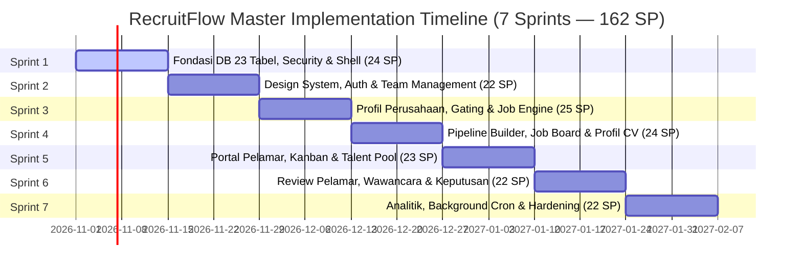

# Dokumen 06 — Product Backlog & Implementation Runbook
## RecruitFlow — Multi-Tenant Recruitment Management System
**Versi:** 4.0 (Locked & Master Production Baseline — Canonical Edition)  
**Status:** Canonical & Actionable Engineering Runbook  
**Acuan Rantai Kebenaran:** 
- `01-PDD-RecruitFlow.md` (Product Definition & Business Objectives)
- `02-PRD-RecruitFlow.md` (Product Requirements & Logic Engine v4.0)
- `03-UIUX-Spec-RecruitFlow.md` (UI/UX 8-Dimension Specification v4.0)
- `04-System-Architecture-Design-RecruitFlow.md` (System Architecture & API DDL v4.0)
- `05-Design-System-RecruitFlow.md` (Design Tokens & Component Architecture v4.0)
- `07-Test-Plan-RecruitFlow.md` (Master Quality Assurance & Test Plan v4.0 — Companion Verification Runbook)

---

## DAFTAR ISI
1. [Bab 1: Executive Summary & Framework Backlog](#bab-1-executive-summary--framework-backlog)
   - 1.1 Filosofi Greenfield 0% & Definisi Runbook
   - 1.2 Taksonomi & Konvensi Penomoran Backlog
   - 1.3 Matriks Harvest Kode Eksisting & Kebijakan Transisi
   - 1.4 Standar Tri-Level Definition of Done (DoD)
   - 1.5 Skala Estimasi Fibonacci & Velocity Target
2. [Bab 2: Fase 1 — Fondasi Sistem & Desain Sistem Inti (Epic 1.1 – 1.4)](#bab-2-fase-1--fondasi-sistem--desain-sistem-inti-epic-11--14)
   - Epic 1.1: Environment, Database & Transaction Pooling Setup (8 SP)
   - Epic 1.2: Backend Core Infrastructure & Security Middleware (9 SP)
   - Epic 1.3: Frontend Core Shell & State Architecture (7 SP)
   - Epic 1.4: Design System Atomic & Organism UI Component Library (7 SP)
3. [Bab 3: Fase 2 — Autentikasi, Identitas & Onboarding Multi-Tenant (Epic 2.1 – 2.3)](#bab-3-fase-2--autentikasi-identitas--onboarding-multi-tenant-epic-21--23)
   - Epic 2.1: Company Authentication & Team Management (9 SP)
   - Epic 2.2: Candidate Authentication & Global Identity (6 SP)
   - Epic 2.3: Company Profile & Gating Onboarding (9 SP)
4. [Bab 4: Fase 3 — Job Engine, Custom Question & Pipeline Builder (Epic 3.1 – 3.3)](#bab-4-fase-3--job-engine-custom-question--pipeline-builder-epic-31--33)
   - Epic 3.1: Job Lifecycle Management & Quota (9 SP)
   - Epic 3.2: Dynamic Custom Question Builder (7 SP)
   - Epic 3.3: Dynamic Pipeline Stage Configuration (7 SP)
5. [Bab 5: Fase 4 — Job Board Publik, Aplikasi Pelamar & Portal Talenta (Epic 4.1 – 4.3)](#bab-5-fase-4--job-board-publik-aplikasi-pelamar--portal-talenta-epic-41--43)
   - Epic 4.1: Public Discovery & Job Board Portal (13 SP)
   - Epic 4.2: Candidate Talent Portal & Application Tracking (11 SP)
   - Epic 4.3: Talent Pool & Candidate Database — HR View (7 SP)
6. [Bab 6: Fase 5 — Operasional Rekrutmen Lanjutan, Wawancara & Keputusan (Epic 5.1 – 5.4)](#bab-6-fase-5--operasional-rekrutmen-lanjutan-wawancara--keputusan-epic-51--54)
   - Epic 5.1: Interactive Pipeline Board / Kanban (9 SP)
   - Epic 5.2: Candidate Review, Scoring & Team Notes (7 SP)
   - Epic 5.3: Integrated Interview Scheduling & Conflict Detection (8 SP)
   - Epic 5.4: Formal Decision Engine & Email Templates (7 SP)
7. [Bab 7: Fase 6 — Analitik, Audit Log, Background Workers & Release Hardening (Epic 6.1 – 6.4)](#bab-7-fase-6--analitik-audit-log-background-workers--release-hardening-epic-61--64)
   - Epic 6.1: Recruitment Analytics & Reporting Engine (7 SP)
   - Epic 6.2: System Audit Logging & Compliance (4 SP)
   - Epic 6.3: Background Workers & Cron Automation (5 SP)
   - Epic 6.4: Release Hardening, End-to-End Verification & Production Readiness (6 SP)
8. [Bab 8: Master Sprint Schedule & Velocity Allocation](#bab-8-master-sprint-schedule--velocity-allocation)

---

# BAB 1: EXECUTIVE SUMMARY & FRAMEWORK BACKLOG

### 1.1 Filosofi Greenfield 0% & Definisi Runbook
Dokumen Product Backlog ini berfungsi sebagai **Actionable Implementation Runbook** presisi tingkat enterprise. Pengembangan sistem RecruitFlow diperlakukan dengan **Greenfield Mindset (Day 0 / Progres 0%)**:
1. Tidak ada satupun modul, tabel, atau komponen antarmuka yang dianggap "selesai" hanya karena file kodenya telah ada di repository.
2. Setiap task wajib dieksekusi, di-audit, di-refactor, atau ditulis ulang secara presisi berdasarkan spesifikasi formal Dokumen 01 hingga Dokumen 05.
3. Rantai kebenaran data dan arsitektur mengalir satu arah tanpa deviasi:
   $$\mathbf{PDD\ (01)} \longrightarrow \mathbf{PRD\ (02)} \longrightarrow \mathbf{UI/UX\ Spec\ (03)} \longrightarrow \mathbf{System\ Architecture\ (04)} \longrightarrow \mathbf{Design\ System\ (05)} \longrightarrow \mathbf{Product\ Backlog\ (06)}$$
4. **Kebijakan Monetisasi & Scope Guardrail (PDD §4 & PRD §4.4)**: Sistem RecruitFlow v1 **tidak memiliki paywall, tidak memiliki mock tier simulator, dan tidak membatasi kuota lowongan aktif berdasarkan paket**. Halaman `/harga` murni informasional untuk pemasaran B2B. Seluruh fitur PRD terbuka penuh bagi seluruh perusahaan terdaftar.

### 1.2 Taksonomi & Konvensi Penomoran Backlog
Setiap item pekerjaan memiliki kode pelacakan deterministik yang memetakan rantai implementasi dari kebutuhan produk hingga baris kode:
$$\mathbf{[TASK\text{-}X.Y.Z]} \longrightarrow \mathbf{[FR\text{-}PRD]} \longrightarrow \mathbf{[SCREEN\text{-}ID]} \longrightarrow \mathbf{[API\text{-}ENDPOINT]}$$
- **X**: Nomor Fase Pengembangan (Fase 1 sampai Fase 6).
- **Y**: Nomor Epic dalam Fase terkait.
- **Z**: Nomor Urut Task atomik.
- **FR-PRD**: Pemetaan ke Functional Requirement kanonikal di `02-PRD-RecruitFlow.md` (contoh: `[FR-1.1]`, `[FR-3.2]`, `[FR-8.1]`).
- **SCREEN-ID**: Pemetaan ke 26 kode layar kanonikal di `03-UIUX-Spec-RecruitFlow.md` (`[P-00]` s/d `[P-08]`, `[C-01]` s/d `[C-05]`, `[H-01]` s/d `[H-15]`).
- **API-ENDPOINT**: Pemetaan ke kontrak endpoint terstandar di `04-System-Architecture-Design-RecruitFlow.md` (contoh: `POST /api/company/jobs`, `PATCH /api/candidate/applications/:id/withdraw`).

### 1.3 Matriks Harvest Kode Eksisting & Kebijakan Transisi
Seluruh file kode yang saat ini ada di direktori `backend/src` dan `frontend/src` diklasifikasikan ke dalam 4 kategori aksi tegas dengan pelacakan file fisik nyata di disk:
- `[NEW FILE]`: File belum ada di repository dan dibangun baru sesuai arsitektur kanonikal.
- `[REWRITE]`: File ada di disk tetapi menyimpang secara fundamental dari kontrak DDL, pola middleware, atau arsitektur komponen, sehingga ditulis ulang total.
- `[REFACTOR & VERIFY]`: File ada di disk dan strukturnya dapat dipertahankan, namun membutuhkan penyesuaian penanganan error (`ERR_*`), DTO Zod, atau pemisahan UI.
- `[REFACTOR & RENAME dari <file_lama>]`: File warisan (*legacy*) di disk yang di-refactor dan diubah namanya agar selaras dengan penamaan kanonikal Dokumen 03 & 04.
- `[MARK FOR DELETION]`: File usang, dead code, atau artefak modul subscription yang wajib dihapus permanen dari repository (`subscriptions.controller.js`, `subscriptions.routes.js`, `DashboardTags.jsx`, `AuthContext.jsx`).

### 1.4 Standar Tri-Level Definition of Done (DoD)
Suatu task hanya dapat dinyatakan **DONE** apabila memenuhi tiga tingkatan verifikasi:
1. **Level 1: Contract DoD**
   - Format response JSON mematuhi envelope standar: `{ success: true, data: {...}, meta?: {...} }` atau `{ success: false, error: { code, message, details } }`.
   - Kode status HTTP dan kode error string mematuhi standarisasi `ERR_*` Dokumen 04 (contoh: `ERR_PROFILE_INCOMPLETE`, `ERR_UNAUTHORIZED`, `ERR_INTERVIEW_COLLISION`).
   - Tipe data, relasi kunci asing, dan indeks skema database mematuhi DDL Fisik 23 Tabel Dokumen 04 §4.1.
2. **Level 2: Positive Business Logic DoD**
   - Seluruh alur "happy path" berjalan tuntas sesuai skenario User Story PRD.
   - Mutasi status Finite State Machine (FSM) tersimpan presisi dan atomik.
   - Pemicuan audit log di `activity_logs` dan antrean email di `email_send_log` berjalan sesuai aturan pemicu bisnis.
3. **Level 3: Negative, Resilience & Security DoD**
   - Validasi input Zod menolak payload cacat dengan HTTP 400 `ERR_VALIDATION_ERROR`.
   - Otorisasi berlapis (JWT + RBAC + Tenant Scoping `company_id`) menolak akses tidak sah dengan HTTP 403 `ERR_FORBIDDEN_ROLE` atau `ERR_FORBIDDEN_TENANT_ACCESS`.
   - Safe rollback diterapkan pada kegagalan transaksi multi-query (`ROLLBACK` transaksi).
   - Penanganan UI adaptif: loading spinner, toast notification, empty state, dan form field error banner muncul sesuai standar Dokumen 05.

#### Penyelarasan DoD dengan Arsitektur Pengujian Dokumen 07
Setiap task backlog hanya sah dinyatakan **DONE** apabila diverifikasi melalui tingkatan pengujian yang relevan pada [`07-Test-Plan-RecruitFlow.md`](file:///d:/Projects/RecruitFlow/document/07-Test-Plan-RecruitFlow.md) sebagaimana dipetakan dalam **Master Traceability Matrix (§8.5)**:
- **Level 1 (Contract DoD)**: Diverifikasi oleh **Tingkat 1 (Unit Testing)** untuk validasi DTO Zod/helper murni dan **Tingkat 2 (Component & Middleware Testing)** untuk fail-closed security/RBAC.
- **Level 2 (Positive Business Logic DoD)**: Diverifikasi oleh **Tingkat 3 (Integration Testing REST API & DB)** untuk mutasi FSM/ACID dan **Tingkat 4 (System & E2E Testing)** untuk kelengkapan 5 Golden Flows peramban.
- **Level 3 (Negative, Resilience & Security DoD)**: Diverifikasi oleh **Tingkat 5 (Acceptance, Chaos Resilience & Regression)** untuk kekebalan pemadaman pihak ketiga, isolasi multi-tenant, zero-paywall guardrail, dan pemenuhan ambang batas Go/No-Go Release Gate (Dokumen 07 §8.4).

### 1.5 Skala Estimasi Fibonacci & Velocity Target
- **1 SP**: Penyesuaian konfigurasi, DTO/schema validator, konstanta, atau utility murni (< 2 jam).
- **2 SP**: Komponen UI atomik sederhana, endpoint CRUD single-table standar (2–4 jam).
- **3 SP**: Komponen UI organism dengan interaktivitas lokal, endpoint dengan validasi relasional dan hashing (4–8 jam).
- **4 SP**: Fitur transaksional multi-tabel atomik, multi-step flow, atau form kompleks (1–2 hari).
- **Total Backlog**: Tepat **72 Tasks Atomik** dengan akumulasi **162 Story Points**.
- **Target Velocity Tim**: 22–25 Story Points per Sprint (durasi 2 minggu per Sprint, total 7 Sprint).

---

# BAB 2: FASE 1 — FONDASI SISTEM & DESAIN SISTEM INTI (EPIC 1.1 – 1.4)

### Epic 1.1: Environment, Database & Transaction Pooling Setup
**Deskripsi & Scope**: Menyiapkan pondasi database PostgreSQL Supabase (Port 6543 Transaction Pooler), migrasi 23 tabel DDL fisik, indeks relasional, dan helper transaksi atomik `withTransaction`.
**Estimasi Total**: 8 SP | **Prioritas**: P0

#### Matriks Harvest Kode Eksisting
| Path File | Kategori Aksi | Rationale |
|---|---|---|
| `backend/src/config/db.js` | `[REFACTOR & VERIFY]` | Konfigurasi node-postgres Pool ke Port 6543 Supavisor dengan dedicated client acquisition `withTransaction()`. |
| `backend/src/config/env.js` | `[REFACTOR & VERIFY]` | Validasi seluruh variabel lingkungan wajib (`DATABASE_URL`, `JWT_*`, `RESEND_API_KEY`, `SUPABASE_*`). |
| `backend/src/migrations/001_initial_schema.sql` | `[NEW FILE]` | Buat file migrasi SQL perdana mencakup 23 tabel DDL Dokumen 04 §4.1 dan indeks §4.2. |

#### Rincian Breakdown Task
- **TASK-1.1.1** $\rightarrow$ `[NFR]` $\rightarrow$ `[-]` $\rightarrow$ `[-]`
  - **Judul**: Inisialisasi Environment & Validasi Skema Konfigurasi Runtime.
  - **Deskripsi**: Buat modul validasi runtime `env.js` menggunakan Zod untuk memastikan semua env-var wajib terdefinisi saat startup. Jika ada variabel yang hilang, proses Node.js langsung crash dengan error log eksplisit.
  - **DoD**:
    - *Contract*: File `.env.example` terdokumentasi lengkap mencakup port, secrets, dan URLs.
    - *Positive*: Aplikasi start sukses jika semua konfigurasi valid.
    - *Negative*: Aplikasi throw `Error: Missing required environment variables` dan exit code 1 jika salah satu env var hilang.
  - **Prioritas**: P0 | **Estimasi**: 1 SP
- **TASK-1.1.2** $\rightarrow$ `[NFR]` $\rightarrow$ `[-]` $\rightarrow$ `[-]`
  - **Judul**: Supabase Connection Pooler (Port 6543) & Dedicated Transaction Client Protocol.
  - **Deskripsi**: Konfigurasikan node-pg `Pool` menuju Supabase Transaction Pooler pada Port 6543. Sediakan wrapper helper `withTransaction(async (client) => { ... })` yang secara eksplisit menjalankan `client = await pool.connect()`, `await client.query('BEGIN')`, eksekusi callback, `await client.query('COMMIT')`, dan menjamin `client.release()` pada blok `finally`. Pastikan connection string mendukung mode pooler transaction.
  - **DoD**:
    - *Contract*: `db.js` mengekspor objek `pool` dan fungsi `withTransaction()`.
    - *Positive*: Multi-statement query dieksekusi pada session koneksi yang sama persis tanpa terpecah antar worker pool.
    - *Negative*: Jika callback melempar error, fungsi otomatis memanggil `await client.query('ROLLBACK')` dan melepas client kembali ke pool tanpa memory leak.
  - **Prioritas**: P0 | **Estimasi**: 3 SP
- **TASK-1.1.3** $\rightarrow$ `[NFR]` $\rightarrow$ `[-]` $\rightarrow$ `[-]`
  - **Judul**: Eksekusi Migrasi DDL Fisik 23 Tabel & Indeks Relasional.
  - **Deskripsi**: Tulis dan jalankan migrasi SQL lengkap 23 tabel sesuai Dokumen 04 §4.1: `companies`, `company_locations`, `company_members`, `candidates`, `candidate_profiles`, `candidate_documents`, `jobs`, `job_pipeline_stages`, `applications`, `application_documents`, `interviews`, `application_notes`, `candidate_scores`, `candidate_tags`, `application_tags`, `email_send_log`, `activity_logs`, `refresh_tokens`, `password_reset_tokens`, `job_custom_questions`, `application_answers`, `email_templates`, `saved_jobs`, `candidate_experiences`, `candidate_educations`.
  - **DoD**:
    - *Contract*: Seluruh 23 tabel, tipe enum, foreign key `ON DELETE CASCADE / SET NULL`, dan composite unique index terbentuk di Supabase.
    - *Positive*: Skrip migrasi idempotent dapat dijalankan berulang tanpa merusak struktur (`IF NOT EXISTS`).
    - *Negative*: Eksekusi gagal jika terdapat syntax SQL cacat atau tipe data tidak didukung Postgres 15+.
  - **Prioritas**: P0 | **Estimasi**: 4 SP

---

### Epic 1.2: Backend Core Infrastructure & Security Middleware
**Deskripsi & Scope**: Menyiapkan middleware keamanan, penanganan error standar `ERR_*`, dual-token JWT verification, RBAC, decoupled Resend mailer transport, dan audit activity logger.
**Estimasi Total**: 9 SP | **Prioritas**: P0

#### Matriks Harvest Kode Eksisting
| Path File | Kategori Aksi | Rationale |
|---|---|---|
| `backend/src/app.js` | `[REWRITE]` | Konfigurasi Express, CORS strict, helmet, body-parser limit (5MB), dan global error handler. |
| `backend/src/middlewares/authenticateUser.js` | `[REWRITE]` | Middleware verifikasi Bearer access token terpadu yang membedakan tipe akun `company_member` vs `candidate`. |
| `backend/src/middlewares/requireRole.js` | `[REFACTOR & VERIFY]` | Proteksi endpoint berdasarkan role (`admin` vs `hr`). |
| `backend/src/middlewares/errorHandler.js` | `[REWRITE]` | Format ulang error response agar 100% mematuhi kode error terstandar `ERR_*` Dokumen 04. |
| `backend/src/middlewares/rateLimiters.js` | `[REFACTOR & VERIFY]` | Tiered rate limiter berlapis sesuai spesifikasi Dokumen 04 §3.4. |
| `backend/src/utils/mailer.js` | `[NEW FILE]` | Inisialisasi client Resend SDK dengan mode decoupled asinkron khusus Offer, Reject, dan Reset Password (PRD §3A). |
| `backend/src/utils/logActivity.js` | `[NEW FILE]` | Helper asynchronous penyimpan jejak audit ke tabel `activity_logs`. |
| `backend/src/utils/jwt.js` & `password.js` | `[REFACTOR & VERIFY]` | Helper penandatanganan dual token HMAC SHA-256 dan cryptographic hashing bcrypt cost 12. |

#### Rincian Breakdown Task
- **TASK-1.2.1** $\rightarrow$ `[NFR]` $\rightarrow$ `[-]` $\rightarrow$ `[-]`
  - **Judul**: Implementasi Standardized Global Error Handler (`ERR_*` Codes).
  - **Deskripsi**: Buat kelas custom `AppError` yang menerima status code, application error code (format `ERR_*` Dokumen 04, contoh: `ERR_UNAUTHORIZED`, `ERR_FORBIDDEN_ROLE`, `ERR_VALIDATION_ERROR`, `ERR_PROFILE_INCOMPLETE`), message, dan optional details array. Buat Express error middleware di `errorHandler.js` yang menangkap error dan mengembalikan payload JSON terstandar.
  - **DoD**:
    - *Contract*: Response error selalu berformat `{ success: false, error: { code: string, message: string, details?: any[] } }`.
    - *Positive*: `AppError` mengembalikan HTTP status code dan error code yang sesuai.
    - *Negative*: Uncaught exception ditangkap sebagai HTTP 500 dengan code `ERR_INTERNAL_SERVER_ERROR` tanpa membocorkan stack trace di environment production.
  - **Prioritas**: P0 | **Estimasi**: 2 SP
- **TASK-1.2.2** $\rightarrow$ `[FR-1.5, FR-2.3]` $\rightarrow$ `[-]` $\rightarrow$ `[-]`
  - **Judul**: Dual-Token JWT Authentication & Session Middleware.
  - **Deskripsi**: Implementasikan `authenticateUser.js` middleware yang memvalidasi header `Authorization: Bearer <accessToken>`. Validasi token signature terhadap `JWT_ACCESS_SECRET` dan verifikasi apakah user ID masih aktif di database serta token tidak masuk blacklist pembatalan sesi.
  - **DoD**:
    - *Contract*: Menginjeksikan `req.user = { id, email, role, company_id, type }` ke object request.
    - *Positive*: Token valid mengizinkan request berlanjut ke handler berikutnya.
    - *Negative*: Mengembalikan HTTP 401 `ERR_UNAUTHORIZED` dengan detail `AUTH_TOKEN_EXPIRED` jika token expired atau `AUTH_TOKEN_INVALID` jika signature salah.
  - **Prioritas**: P0 | **Estimasi**: 2 SP
- **TASK-1.2.3** $\rightarrow$ `[FR-1.2]` $\rightarrow$ `[-]` $\rightarrow$ `[-]`
  - **Judul**: Role-Based Access Control (RBAC) Middleware.
  - **Deskripsi**: Buat middleware `requireRole.js` yang menerima daftar role yang diizinkan (`requireRole('admin')`). Khusus untuk operasi mutasi anggota tim dan konfigurasi perusahaan, hanya role `admin` yang diizinkan; recruiter/HR biasa diblokir.
  - **DoD**:
    - *Contract*: Handler menerima daftar role yang diizinkan.
    - *Positive*: User dengan role yang cocok diizinkan mengeksekusi request.
    - *Negative*: Mengembalikan HTTP 403 `ERR_FORBIDDEN_ROLE` jika role user tidak memenuhi syarat.
  - **Prioritas**: P0 | **Estimasi**: 1 SP
- **TASK-1.2.4** $\rightarrow$ `[PRD-3A, FR-10.2]` $\rightarrow$ `[-]` $\rightarrow$ `[-]`
  - **Judul**: Decoupled Resend Email Service Client (`mailer.js`).
  - **Deskripsi**: Buat modul `mailer.js` menggunakan `@resend/node`. Konfigurasikan pemanggilan email secara decoupled non-blocking melalui antrean `email_send_log` dan event dispatcher lokal `emailEvents.emit('dispatch', logId)`. Batasi penggunaan murni untuk Surat Penawaran (Offer), Penolakan (Reject), dan Reset Password sesuai PRD §3A.
  - **DoD**:
    - *Contract*: Fungsi `sendEmail({ to, subject, html, text })` mengekspor Promise.
    - *Positive*: Email terkirim ke server Resend dan mengembalikan `messageId`.
    - *Negative*: Kegagalan Resend dicatat sebagai `failed` di `email_send_log` dan tidak membatalkan transaksi mutasi status kandidat di database.
  - **Prioritas**: P0 | **Estimasi**: 2 SP
- **TASK-1.2.5** $\rightarrow$ `[FR-15.1, FR-15.2]` $\rightarrow$ `[-]` $\rightarrow$ `[-]`
  - **Judul**: Core Audit Activity Logger Utility (`logActivity.js`).
  - **Deskripsi**: Bangun helper `logActivity({ application_id, actor_type, actor_id, action_type, description, metadata })` yang menyisipkan catatan audit trail permanen ke tabel `activity_logs`. Modul ini disiapkan di Fase 1 agar siap dipanggil oleh seluruh modul di fase berikutnya tanpa refactoring susulan.
  - **DoD**:
    - *Contract*: Menerima parameter sesuai kolom tabel `activity_logs` (`04-System-Architecture §4.1`).
    - *Positive*: Row baru berhasil dibuat di `activity_logs` dengan timestamp UTC presisi.
    - *Negative*: Kegagalan logging ditangani dengan safe error catch sehingga tidak membatalkan aksi operasional utama.
  - **Prioritas**: P0 | **Estimasi**: 2 SP

---

### Epic 1.3: Frontend Core Shell & State Architecture
**Deskripsi & Scope**: Inisialisasi Vite + React, integrasi Tailwind CSS v3 dengan token Dokumen 05, setup global store Zustand (Auth, Toast, Filter, Kanban), Axios interceptor dengan auto-refresh token, dan routing layout shell.
**Estimasi Total**: 7 SP | **Prioritas**: P0

#### Matriks Harvest Kode Eksisting
| Path File | Kategori Aksi | Rationale |
|---|---|---|
| `frontend/src/App.jsx` | `[REWRITE]` | Daftarkan seluruh rute 29 layar, susun hierarki layout (`PublicLayout`, `CandidateLayout`, `DashboardLayout`), dan route guards. |
| `frontend/src/index.css` | `[REWRITE]` | Definisikan font Poppins & JetBrains Mono, CSS variables warna FSM, dan reset modern. |
| `tailwind.config.js` | `[REFACTOR & VERIFY]` | Sinkronkan palette warna, border radius, typography plugin, dan shadow Dokumen 05. |
| `frontend/src/services/api.js` | `[NEW FILE]` | Bangun Axios instance terisolasi dengan interceptor auto-refresh JWT saat menangkap HTTP 401. |
| `frontend/src/contexts/AuthContext.jsx` | `[MARK FOR DELETION]` | Hapus context API usang; migrasikan sepenuhnya ke Zustand `useAuthStore.js`. |
| `frontend/src/store/useAuthStore.js` | `[NEW FILE]` | Zustand store untuk sesi user, role, token access, dan aksi login/logout. |
| `frontend/src/store/useToastStore.js` | `[NEW FILE]` | Zustand store untuk antrean notifikasi toast global. |
| `frontend/src/store/useFilterStore.js` | `[NEW FILE]` | Zustand store untuk state filter stack pencarian Job Board publik. |
| `frontend/src/store/useKanbanStore.js` | `[NEW FILE]` | Zustand store untuk optimasi optimistic update pergeseran kartu kanban. |

#### Rincian Breakdown Task
- **TASK-1.3.1** $\rightarrow$ `[NFR]` $\rightarrow$ `[-]` $\rightarrow$ `[-]`
  - **Judul**: Setup Design Tokens, Typography & Tailwind CSS Configuration.
  - **Deskripsi**: Terapkan seluruh token desain dari `05-Design-System-RecruitFlow.md`: Warna Primary (Deep Indigo `#2563EB`), Neutral Slate, Semantic FSM (Emerald, Amber, Rose, Violet), font Poppins (display/sans) & JetBrains Mono (code/mono), dan pasang plugin `@tailwindcss/typography`.
  - **DoD**:
    - *Contract*: Utility class seperti `text-primary-600`, `bg-neutral-900`, `font-sans`, `font-mono` ter-render sempurna di DOM.
    - *Positive*: Font Poppins ter-load via Google Fonts dengan fallback `system-ui`.
    - *Negative*: Tidak ada class styling Tailwind default yang saling bertabrakan atau ter-purge secara tidak sengaja.
  - **Prioritas**: P0 | **Estimasi**: 1 SP
- **TASK-1.3.2** $\rightarrow$ `[NFR]` $\rightarrow$ `[-]` $\rightarrow$ `[-]`
  - **Judul**: Zustand Stores Setup (`useAuthStore`, `useToastStore`, `useFilterStore`, `useKanbanStore`).
  - **Deskripsi**: Pasang dependency `zustand` di frontend (`npm install zustand`) dan bangun 4 store Zustand terisolasi sesuai arsitektur Dokumen 04 §1: (1) `useAuthStore` untuk sesi dan role, (2) `useToastStore` untuk antrean notifikasi feedback, (3) `useFilterStore` untuk parameter filter pencarian lowongan, dan (4) `useKanbanStore` untuk cache stage kanban.
  - **DoD**:
    - *Contract*: `useAuthStore` mengekspor state ter-persist ke `localStorage` (hanya metadata user, token access disimpan di memory atau secure cookie).
    - *Positive*: Komponen UI dapat men-subscribe state auth dan toast secara reaktif.
    - *Negative*: State auth langsung kembali ke null dan `isAuthenticated: false` saat aksi `logout()` dipanggil.
  - **Prioritas**: P0 | **Estimasi**: 2 SP
- **TASK-1.3.3** $\rightarrow$ `[NFR]` $\rightarrow$ `[-]` $\rightarrow$ `[-]`
  - **Judul**: Axios API Client Interceptor dengan Seamless Token Refresh.
  - **Deskripsi**: Buat Axios instance di `frontend/src/services/api.js`. Pasang request interceptor untuk menyematkan `Authorization: Bearer <accessToken>`. Pasang response interceptor yang mendeteksi HTTP 401 `ERR_UNAUTHORIZED`, memanggil endpoint refresh token `/api/auth/*/refresh` secara otomatis (membaca cookie HttpOnly), memperbarui access token di store, dan mengulang request asli yang tertunda.
  - **DoD**:
    - *Contract*: Request membawa header Authorization yang valid.
    - *Positive*: Request yang gagal karena token kedaluwarsa otomatis sukses setelah refresh tanpa memaksa user login ulang.
    - *Negative*: Jika endpoint refresh juga gagal (HTTP 401), kosongkan state sesi di `useAuthStore` dan arahkan browser ke login page dengan toast session expired.
  - **Prioritas**: P0 | **Estimasi**: 2 SP
- **TASK-1.3.4** $\rightarrow$ `[NFR]` $\rightarrow$ `[-]` $\rightarrow$ `[-]`
  - **Judul**: Master App Router & Layout Shell Structure.
  - **Deskripsi**: Susun struktur perutean di `App.jsx` menggunakan `react-router-dom` v6+. Definisikan tiga wrapper layout utama: `PublicLayout` (dengan Navbar publik & Footer), `CandidateLayout` (dengan header khusus talenta), dan `DashboardLayout` (dengan Sidebar navigasi HR & Topbar operasional).
  - **DoD**:
    - *Contract*: Struktur layout membungkus rute anak melalui `<Outlet />`.
    - *Positive*: Rute publik, rute kandidat, dan rute HR me-render layout shell yang tepat sesuai spesifikasi Dokumen 03.
    - *Negative*: Transisi antar layout tidak mereset state global yang tidak diperlukan.
  - **Prioritas**: P0 | **Estimasi**: 2 SP

---

### Epic 1.4: Design System Atomic & Organism UI Component Library
**Deskripsi & Scope**: Membangun 10 komponen Atomic UI dan 10 komponen Organism UI yang terstandarisasi Dokumen 05, serta client-side role guard `AdminOnlyRoute.jsx` dan `ProtectedRoute.jsx`.
**Estimasi Total**: 7 SP | **Prioritas**: P0

#### Matriks Harvest Kode Eksisting
| Path File | Kategori Aksi | Rationale |
|---|---|---|
| `frontend/src/components/ui/Button.jsx` | `[NEW FILE]` | Implementasi varian primary, secondary, outline, ghost, danger, dan size sm, md, lg. |
| `frontend/src/components/ui/Input.jsx` | `[NEW FILE]` | Input atomik dengan support label, helper text, error text, dan leading/trailing icon. |
| `frontend/src/components/ui/Select.jsx` | `[NEW FILE]` | Dropdown select atomik terstandarisasi styling focus ring. |
| `frontend/src/components/ui/Badge.jsx` | `[NEW FILE]` | Badge status dengan warna semantik FSM (Applied, Interview, Offer, Hired, Rejected). |
| `frontend/src/components/ui/Modal.jsx` | `[REFACTOR & VERIFY]` | Dialog overlay dengan backdrop blur, escape key listener, dan trap focus (sudah ada di disk). |
| `frontend/src/components/common/AdminOnlyRoute.jsx` | `[NEW FILE]` | Route guard sisi klien khusus memproteksi `/dashboard/team` (`[H-05]`). |
| `frontend/src/components/common/ProtectedRoute.jsx` | `[NEW FILE]` | Guard otentikasi umum untuk mengecek status login dan tipe akun (company vs candidate). |

#### Rincian Breakdown Task
- **TASK-1.4.1** $\rightarrow$ `[NFR]` $\rightarrow$ `[-]` $\rightarrow$ `[-]`
  - **Judul**: Pustaka 10 Komponen Atomic UI (`Button`, `Input`, `Textarea`, `Select`, `Checkbox`, `Radio`, `Badge`, `Avatar`, `Spinner`, `Modal`).
  - **Deskripsi**: Bangun paket 10 komponen atomik di `frontend/src/components/ui/` yang sepenuhnya mematuhi token Dokumen 05 §3. Setiap komponen wajib mendukung properti `disabled`, `error` message string, focus ring `ring-2 ring-primary-500`, dan aksesibilitas ARIA.
  - **DoD**:
    - *Contract*: Props komponen terdefinisi rapi dengan PropTypes atau JSDoc.
    - *Positive*: Seluruh varian visual (warna, ukuran, status) ter-render presisi sesuai spesifikasi Dokumen 05.
    - *Negative*: State error menampilkan outline merah `border-rose-500` dan pesan teks bantuan di bawah input.
  - **Prioritas**: P0 | **Estimasi**: 3 SP
- **TASK-1.4.2** $\rightarrow$ `[NFR]` $\rightarrow$ `[-]` $\rightarrow$ `[-]`
  - **Judul**: Pustaka 10 Komponen Organism UI (`Navbar`, `Sidebar`, `Footer`, `JobCard`, `CandidateCard`, `EmptyState`, `Breadcrumb`, `Pagination`, `RichTextEditor`, `TagPill`).
  - **Deskripsi**: Bangun 10 komponen organism terstandarisasi di `frontend/src/components/organism/` sesuai Dokumen 05 §4. Komponen `Navbar` mendukung menu dua sisi, `Sidebar` mendukung badge menu aktif dan filter role, `JobCard` mendukung badge atribut kerja, dan `EmptyState` mendukung CTA aksi.
  - **DoD**:
    - *Contract*: Masing-masing organism menerima props data model standar.
    - *Positive*: Responsif di desktop dan mobile; interaksi klik dan hover berjalan mulus.
    - *Negative*: `EmptyState` muncul otomatis bila data list bernilai kosong (`length === 0`).
  - **Prioritas**: P0 | **Estimasi**: 3 SP
- **TASK-1.4.3** $\rightarrow$ `[FR-1.2]` $\rightarrow$ `[H-05]` $\rightarrow$ `[-]`
  - **Judul**: Implementasi Client-Side `AdminOnlyRoute.jsx` & `ProtectedRoute.jsx`.
  - **Deskripsi**: Buat wrapper rute `AdminOnlyRoute.jsx` dan `ProtectedRoute.jsx` di `frontend/src/components/common/`. Guard membaca `user.role` dan `user.type` dari `useAuthStore`. Jika user HR biasa mencoba mengakses rute khusus admin (`/dashboard/team`), sistem mencegat render, melempar toast peringatan `Akses Ditolak: Halaman ini khusus Administrator`, dan redirect otomatis ke `/dashboard`.
  - **DoD**:
    - *Contract*: Me-render `<Outlet />` jika user memiliki wewenang yang sesuai.
    - *Positive*: User admin dapat mengakses rute `/dashboard/team` tanpa hambatan.
    - *Negative*: User non-admin atau guest yang mengetikkan URL address bar langsung diblokir dan diredirect ke rute yang sah.
  - **Prioritas**: P0 | **Estimasi**: 1 SP

---

# BAB 3: FASE 2 — AUTENTIKASI, IDENTITAS & ONBOARDING MULTI-TENANT (EPIC 2.1 – 2.3)

### Epic 2.1: Company Authentication & Team Management
**Deskripsi & Scope**: Modul registrasi perusahaan `[H-01]`, login tim HR `[H-02]`, refresh token rotation, reset password, dan manajemen tim `[H-05]` dengan alur invite token aktivasi mandiri.
**Estimasi Total**: 9 SP | **Prioritas**: P0

#### Matriks Harvest Kode Eksisting
| Path File | Kategori Aksi | Rationale |
|---|---|---|
| `backend/src/controllers/auth.company.controller.js` | `[REWRITE]` | Pisahkan logic company auth; terapkan rotasi refresh token dan forced logout saat reset password. |
| `backend/src/controllers/team.controller.js` | `[NEW FILE]` | Controller khusus manajemen tim HR, proteksi `requireRole('admin')`, dan alur invite token. |
| `frontend/src/pages/CompanyRegister.jsx` | `[REWRITE]` | Layar registrasi perusahaan `[H-01]` (`/company/register`). |
| `frontend/src/pages/CompanyLogin.jsx` | `[REWRITE]` | Layar login HR `[H-02]` (`/company/login`). |
| `frontend/src/pages/CompanyForgotPassword.jsx` & `CompanyResetPassword.jsx` | `[REFACTOR & VERIFY]` | Layar lupa dan reset password tim perusahaan (sudah ada di disk). |
| `frontend/src/pages/TeamManagement.jsx` | `[REFACTOR & VERIFY]` | Layar manajemen tim `[H-05]` (`/dashboard/team`) dilindungi `AdminOnlyRoute`. |

#### Rincian Breakdown Task
- **TASK-2.1.1** $\rightarrow$ `[FR-1.1, FR-1.5]` $\rightarrow$ `[H-01]` $\rightarrow$ `POST /api/auth/company/register`
  - **Judul**: Backend API & Frontend Layar Registrasi Perusahaan `[H-01]`.
  - **Deskripsi**: Bangun endpoint dan form registrasi perusahaan di `/company/register`. Dalam satu transaksi atomik `withTransaction`, buat row di tabel `companies` dan row admin pertama di `company_members` (password bcrypt cost 12). Terbitkan JWT access token dan refresh token via HttpOnly cookie. Setelah sukses, arahkan user ke alur pelengkapan profil di `[H-04]`.
  - **DoD**:
    - *Contract*: Status 201 Created mengembalikan object user dan company data.
    - *Positive*: Akun perusahaan dan admin berhasil dibuat secara atomik.
    - *Negative*: Jika email sudah terdaftar, kembalikan HTTP 400 dengan error code `ERR_COMPANY_EMAIL_EXISTS`.
  - **Prioritas**: P0 | **Estimasi**: 2 SP
- **TASK-2.1.2** $\rightarrow$ `[FR-1.2, FR-1.5]` $\rightarrow$ `[H-02]` $\rightarrow$ `POST /api/auth/company/login` & `.../refresh`
  - **Judul**: Backend API & Frontend Layar Login HR `[H-02]` Serta Token Rotation.
  - **Deskripsi**: Bangun endpoint dan form login di `/company/login`. Verifikasi email dan password anggota tim. Pastikan `is_active = true`. Terbitkan access token (15 menit) dan simpan refresh token (30 hari) di tabel `refresh_tokens`. Sediakan endpoint refresh token dengan rotasi token otomatis.
  - **DoD**:
    - *Contract*: Header payload token membawa `company_id`, `role`, dan `type: 'company_member'`.
    - *Positive*: Login sukses mengarahkan pengguna ke `/dashboard` `[H-03]`.
    - *Negative*: Password salah mengembalikan HTTP 401 `ERR_INVALID_CREDENTIALS`. Anggota tim nonaktif (`is_active = false`) ditolak dengan HTTP 403 `ERR_ACCOUNT_DEACTIVATED`.
  - **Prioritas**: P0 | **Estimasi**: 2 SP
- **TASK-2.1.3** $\rightarrow$ `[FR-1.5]` $\rightarrow$ `[H-02]` $\rightarrow$ `POST /api/auth/company/forgot-password` & `.../reset-password`
  - **Judul**: Alur Pemulihan Password Perusahaan & Forced Global Logout.
  - **Deskripsi**: Buat endpoint forgot dan reset password untuk company member. Generate token satu-kali pakai di tabel `password_reset_tokens` (berlaku 1 jam), kirim tautan via `mailer.js`. Saat reset berhasil dieksekusi, tandai seluruh token lama di `refresh_tokens` sebagai `revoked = true` untuk membatalkan seluruh sesi aktif di perangkat lain secara global (Dokumen 04 §3.3).
  - **DoD**:
    - *Contract*: Endpoint reset menerima `{ token, new_password }`.
    - *Positive*: Password terbarui dan email konfirmasi terkirim.
    - *Negative*: Token usang atau palsu ditolak dengan HTTP 400 `ERR_AUTH_TOKEN_EXPIRED`.
  - **Prioritas**: P0 | **Estimasi**: 2 SP
- **TASK-2.1.4** $\rightarrow$ `[FR-1.2, FR-1.3, FR-1.4]` $\rightarrow$ `[H-05]` $\rightarrow$ `GET/POST/PATCH/DELETE /api/company/team`
  - **Judul**: Manajemen Anggota Tim HR & Alur Undangan Aktivasi Mandiri `[H-05]`.
  - **Deskripsi**: Bangun halaman `TeamManagement.jsx` `[H-05]` (`/dashboard/team`). Admin dapat mengundang anggota tim baru via endpoint `POST /api/company/team/invite`. Sistem membuat user dengan status `is_active = true`, menyimpan invite token di `password_reset_tokens`, dan mengirim email aktivasi via Resend agar anggota menetapkan password pribadinya sendiri. Admin juga dapat mengubah role (`admin` $\leftrightarrow$ `hr`) dan menonaktifkan anggota.
  - **DoD**:
    - *Contract*: Endpoint diproteksi `requireRole('admin')` di backend dan `AdminOnlyRoute` di frontend.
    - *Positive*: Anggota baru menerima email aktivasi dan dapat bergabung ke workspace.
    - *Negative*: HR biasa yang mencoba mengakses ditolak dengan HTTP 403 `ERR_FORBIDDEN_ROLE`. Admin tidak dapat menonaktifkan akunnya sendiri.
  - **Prioritas**: P0 | **Estimasi**: 3 SP

---

### Epic 2.2: Candidate Authentication & Global Identity
**Deskripsi & Scope**: Portal autentikasi terpadu talenta `[P-04]`, pendaftaran akun kandidat global lintas perusahaan (tanpa verifikasi email di awal per FR-2.2), sesi independen, dan pemulihan password.
**Estimasi Total**: 6 SP | **Prioritas**: P0

#### Matriks Harvest Kode Eksisting
| Path File | Kategori Aksi | Rationale |
|---|---|---|
| `backend/src/controllers/auth.candidate.controller.js` | `[REWRITE]` | Pastikan akun kandidat global (tanpa `company_id`) dan payload JWT memiliki klaim `type: 'candidate'`. |
| `frontend/src/pages/CandidateAuth.jsx` | `[REFACTOR & VERIFY]` | Layar portal autentikasi terpadu kandidat `[P-04]` (`/candidate/auth`). |
| `frontend/src/pages/CandidateForgotPassword.jsx` & `CandidateResetPassword.jsx` | `[REFACTOR & VERIFY]` | Layar lupa dan reset password talenta (sudah ada di disk). |

#### Rincian Breakdown Task
- **TASK-2.2.1** $\rightarrow$ `[FR-2.1, FR-2.2]` $\rightarrow$ `[P-04]` $\rightarrow$ `POST /api/auth/candidate/register`
  - **Judul**: Backend API Registrasi Kandidat Global Tanpa Hambatan Verifikasi.
  - **Deskripsi**: Buat endpoint pendaftaran akun kandidat global di tabel `candidates` dan row inisialisasi di `candidate_profiles`. Sesuai FR-2.2, akun baru langsung berstatus aktif tanpa kewajiban verifikasi email di awal untuk meminimalkan friksi pelamaran.
  - **DoD**:
    - *Contract*: Status 201 Created mengembalikan profil kandidat dan session tokens.
    - *Positive*: Kandidat langsung aktif dan dapat melamar ke lowongan perusahaan manapun.
    - *Negative*: Email duplikat ditolak dengan HTTP 400 `ERR_EMAIL_ALREADY_EXISTS`.
  - **Prioritas**: P0 | **Estimasi**: 2 SP
- **TASK-2.2.2** $\rightarrow$ `[FR-2.3]` $\rightarrow$ `[P-04]` $\rightarrow$ `POST /api/auth/candidate/login` & `.../refresh`
  - **Judul**: Backend API & Frontend Layar Portal Masuk/Daftar Kandidat `[P-04]`.
  - **Deskripsi**: Sempurnakan halaman `CandidateAuth.jsx` `[P-04]` di `/candidate/auth` (dengan alias `/candidate/login` dan `/candidate/register`). Sediakan tab toggle masuk dan daftar, verifikasi kredensial kandidat, serta penanganan parameter redirect callback (mis. `/candidate/auth?redirect=/jobs/:id/apply`).
  - **DoD**:
    - *Contract*: Header payload token membawa `type: 'candidate'`.
    - *Positive*: Setelah login, pengguna otomatis diredirect kembali ke alur pengajuan lamaran yang tertunda.
    - *Negative*: Kredensial tidak cocok mengembalikan HTTP 401 `ERR_INVALID_CREDENTIALS`.
  - **Prioritas**: P0 | **Estimasi**: 2 SP
- **TASK-2.2.3** $\rightarrow$ `[FR-2.4]` $\rightarrow$ `[P-04]` $\rightarrow$ `POST /api/auth/candidate/forgot-password` & `.../reset-password`
  - **Judul**: Alur Reset Password Kandidat dengan Token Berbatas Waktu.
  - **Deskripsi**: Implementasikan endpoint dan modal lupa/reset password khusus kandidat. Terbitkan token 64 karakter berdurasi 1 jam ke tabel `password_reset_tokens`, kirimkan tautan ke email kandidat via Resend, dan perbarui password hash secara aman.
  - **DoD**:
    - *Contract*: Body reset password menerima token dan password baru minimal 8 karakter.
    - *Positive*: Password kandidat berhasil diperbarui dan token hangus (`used = true`).
    - *Negative*: Token kedaluwarsa ditolak dengan HTTP 400 `ERR_AUTH_TOKEN_EXPIRED`.
  - **Prioritas**: P0 | **Estimasi**: 2 SP

---

### Epic 2.3: Company Profile & Gating Onboarding
**Deskripsi & Scope**: Layar kelola profil perusahaan `[H-04]`, multi-lokasi kantor, upload logo/banner via Signed URL Supabase Storage, checklist gating kelengkapan profil (FR-3.2), dan profil perusahaan publik `[P-03]`.
**Estimasi Total**: 9 SP | **Prioritas**: P0

#### Matriks Harvest Kode Eksisting
| Path File | Kategori Aksi | Rationale |
|---|---|---|
| `backend/src/controllers/companies.controller.js` | `[REWRITE]` | CRUD profil perusahaan, multi-lokasi kantor, endpoint gating status, dan profil publik slug (ada di disk). |
| `backend/src/services/companies.service.js` | `[REFACTOR & VERIFY]` | Logika bisnis profil perusahaan dan validasi kelengkapan gating publikasi (ada di disk). |
| `frontend/src/pages/CompanyProfileEdit.jsx` | `[REFACTOR & VERIFY]` | Layar kelola profil perusahaan `[H-04]` (`/dashboard/profile`). |
| `frontend/src/pages/CompanyProfile.jsx` | `[REFACTOR & RENAME ke CompanyProfilePublic.jsx]` | Layar profil perusahaan publik `[P-03]` (`/companies/:companySlug`). |

#### Rincian Breakdown Task
- **TASK-2.3.1** $\rightarrow$ `[FR-3.1]` $\rightarrow$ `[H-04]` $\rightarrow$ `GET/PUT /api/company/profile` & `/locations`
  - **Judul**: Backend API & Frontend Formulir Multi-Seksi Profil Perusahaan `[H-04]`.
  - **Deskripsi**: Bangun endpoint dan form `CompanyProfileEdit.jsx` `[H-04]` (`/dashboard/profile`). Formulir mencakup identitas dasar (nama, slug unik, tagline, industri, ukuran tim, tahun berdiri, website, media sosial, deskripsi rich text) dan manajemen daftar lokasi kantor cabang di `company_locations` (minimal satu kantor ditandai sebagai Headquarters).
  - **DoD**:
    - *Contract*: Endpoint membatasi update hanya pada `company_id` yang terikat pada JWT admin yang login.
    - *Positive*: Data profil dan lokasi tersimpan rapi dengan timestamp `updated_at`.
    - *Negative*: Menghapus kantor yang berstatus satu-satunya kantor pusat ditolak dengan HTTP 400 `ERR_VALIDATION_ERROR`.
  - **Prioritas**: P0 | **Estimasi**: 3 SP
- **TASK-2.3.2** $\rightarrow$ `[FR-3.1, NFR]` $\rightarrow$ `[H-04]` $\rightarrow$ `POST /api/uploads/signed-url`
  - **Judul**: Upload Aset Logo & Banner via Signed Upload URL Supabase Storage.
  - **Deskripsi**: Implementasikan endpoint penerbitan Signed Upload URL Supabase Storage berbatas waktu 900 detik (15 menit) untuk bucket `logos` dan `banners`. Frontend mengunggah berkas gambar langsung ke Supabase Storage, lalu menyimpan URL publiknya ke tabel `companies`.
  - **DoD**:
    - *Contract*: Payload `{ bucket: "logos" | "banners", filename, mime_type, file_size }`.
    - *Positive*: Signed URL terbit dan file berhasil terunggah ke bucket storage.
    - *Negative*: Berkas non-gambar atau ukuran melebihi 5 MB ditolak dengan HTTP 400 `ERR_FILE_TOO_LARGE` atau `ERR_INVALID_FILE_TYPE`.
  - **Prioritas**: P0 | **Estimasi**: 2 SP
- **TASK-2.3.3** $\rightarrow$ `[FR-3.2, FR-3.3]` $\rightarrow$ `[H-04, H-07]` $\rightarrow$ `GET /api/company/profile/gating-status`
  - **Judul**: Service Gating Kelengkapan Profil & Widget Checklist Onboarding.
  - **Deskripsi**: Bangun endpoint `/api/company/profile/gating-status` yang mengevaluasi 5 syarat wajib FR-3.2: (1) Nama Perusahaan terisi, (2) Industri terisi, (3) Ukuran Perusahaan terisi, (4) Minimal 1 Lokasi Kantor ditandai Headquarters, (5) Deskripsi minimal 50 karakter. Sediakan widget visual checklist di `[H-04]` yang menampilkan status centang hijau / silang abu-abu secara interaktif.
  - **DoD**:
    - *Contract*: Response 200 `{ can_publish: boolean, is_complete: boolean, missing_fields: string[] }`.
    - *Positive*: Jika kelima syarat lengkap, kolom `companies.is_profile_complete` bernilai `true`.
    - *Negative*: Jika salah satu syarat belum terpenuhi, `can_publish` bernilai `false` dan mencantumkan field yang bolong.
  - **Prioritas**: P0 | **Estimasi**: 2 SP
- **TASK-2.3.4** $\rightarrow$ `[FR-3.4]` $\rightarrow$ `[P-03]` $\rightarrow$ `GET /api/companies/:slug` & `.../jobs`
  - **Judul**: Backend API & Frontend Layar Profil Publik Perusahaan `[P-03]`.
  - **Deskripsi**: Bangun halaman publik `[P-03]` di rute `/companies/:companySlug`. Menampilkan banner, logo, profil resmi, peta lokasi kantor, dan daftar seluruh lowongan pekerjaan milik perusahaan tersebut yang saat ini berstatus `published`.
  - **DoD**:
    - *Contract*: Endpoint publik tidak membutuhkan header Authorization.
    - *Positive*: Halaman tampil elegan dan daftar lowongan aktif ter-render dengan link langsung ke detail lowongan `[P-02]`.
    - *Negative*: Slug perusahaan yang tidak ditemukan mengembalikan HTTP 404 `ERR_COMPANY_NOT_FOUND`.
  - **Prioritas**: P0 | **Estimasi**: 2 SP

---

# BAB 4: FASE 3 — JOB ENGINE, CUSTOM QUESTION & PIPELINE BUILDER (EPIC 3.1 – 3.3)

### Epic 3.1: Job Lifecycle Management & Quota
**Deskripsi & Scope**: Siklus hidup lowongan (Draft $\leftrightarrow$ Published $\rightarrow$ Closed), formulir lowongan `[H-07]`, daftar lowongan `[H-06]`, duplikasi lowongan, aturan reopen lowongan dengan kenaikan kuota (FR-4.5), pemetaan DTO `salary_visible = !hide_salary`, dan auto-close kuota/deadline (zero paywall per PRD §4.4).
**Estimasi Total**: 9 SP | **Prioritas**: P0

#### Matriks Harvest Kode Eksisting
| Path File | Kategori Aksi | Rationale |
|---|---|---|
| `backend/src/controllers/jobs.controller.js` | `[REWRITE]` | Implementasi penuh lifecycle lowongan, validasi kuota `positions_available`, duplikasi, dan reopen. |
| `backend/src/controllers/subscriptions.controller.js` | `[MARK FOR DELETION]` | Hapus controller subscription usang; RecruitFlow v1 zero paywall tanpa sistem langganan. |
| `backend/src/routes/subscriptions.routes.js` | `[MARK FOR DELETION]` | Hapus router subscription usang dari aplikasi. |
| `frontend/src/pages/JobListings.jsx` | `[REFACTOR & VERIFY]` | Layar kelola daftar lowongan `[H-06]` (`/dashboard/jobs`). |
| `frontend/src/pages/JobForm.jsx` | `[REFACTOR & VERIFY]` | Formulir buat dan edit lowongan `[H-07]` (`/dashboard/jobs/new`, `/edit`). |

#### Rincian Breakdown Task
- **TASK-3.1.1** $\rightarrow$ `[FR-4.1]` $\rightarrow$ `[H-06]` $\rightarrow$ `GET /api/company/jobs`
  - **Judul**: Backend API & Frontend Layar Kelola Daftar Lowongan HR `[H-06]`.
  - **Deskripsi**: Bangun endpoint dan halaman tabel `JobListings.jsx` `[H-06]` (`/dashboard/jobs`). Menampilkan daftar lowongan milik perusahaan dengan filter status (`all`, `published`, `draft`, `closed`), pencarian judul, indikator kuota terisi (`filled_count / quota`), sisa hari menuju deadline, dan menu aksi cepat.
  - **DoD**:
    - *Contract*: Response memuat array lowongan dan agregasi pelamar per status pipeline.
    - *Positive*: HR dapat memantau status seluruh lowongan kerja perusahaannya.
    - *Negative*: Terisolasi penuh per `company_id`; lowongan tenant lain dilarang bocor.
  - **Prioritas**: P0 | **Estimasi**: 2 SP
- **TASK-3.1.2** $\rightarrow$ `[FR-4.1, FR-3.3]` $\rightarrow$ `[H-07]` $\rightarrow$ `POST /api/company/jobs` & `PUT .../:id`
  - **Judul**: Formulir Buat/Edit Lowongan `[H-07]` & Validasi Gating Publikasi.
  - **Deskripsi**: Bangun form `JobForm.jsx` `[H-07]` (`/dashboard/jobs/new` dan `/:id/edit`). Form mencakup judul, departemen, jenis pekerjaan, level pengalaman, sistem kerja, lokasi kantor, kuota posisi (`quota >= 1`), rentang gaji (dengan opsi sembunyikan gaji `hide_salary`), deskripsi rich text, kualifikasi, dan deadline. Lakukan pemetaan DTO: `salary_visible = !req.body.hide_salary`. Jika user memilih status `published`, panggil validasi gating profil.
  - **DoD**:
    - *Contract*: Endpoint menerima payload lowongan terstruktur sesuai skema DDL `jobs`.
    - *Positive*: Lowongan berhasil disimpan sebagai draft atau langsung dipublikasikan.
    - *Negative*: Jika profil perusahaan belum lengkap (FR-3.2), tombol publish dinonaktifkan di frontend dan request API ditolak dengan HTTP 400 `ERR_PROFILE_INCOMPLETE`.
  - **Prioritas**: P0 | **Estimasi**: 3 SP
- **TASK-3.1.3** $\rightarrow$ `[FR-4.2, FR-4.3]` $\rightarrow$ `[H-06]` $\rightarrow$ `PATCH /api/company/jobs/:id/status`
  - **Judul**: FSM Transisi Status Lowongan & Auto-Close Pelamar Aktif.
  - **Deskripsi**: Buat endpoint transisi status lowongan. Terapkan aturan FSM: Lowongan draft dapat beralih ke published (jika profil lengkap). Lowongan published dapat ditutup manual menjadi `closed`. Sesuai FR-4.4, saat lowongan ditutup, tombol lamar di publik nonaktif, namun seluruh pelamar yang sudah berada di pipeline tetap dapat diproses hingga tuntas oleh HR.
  - **DoD**:
    - *Contract*: Payload `{ status: 'published' | 'closed' }`.
    - *Positive*: Kolom `status` terbarui dan kolom `published_at` atau `deadline` terekam presisi.
    - *Negative*: Upaya publish tanpa profil lengkap ditolak dengan HTTP 400 `ERR_PROFILE_INCOMPLETE`.
  - **Prioritas**: P0 | **Estimasi**: 2 SP
- **TASK-3.1.4** $\rightarrow$ `[FR-4.5]` $\rightarrow$ `[H-06]` $\rightarrow$ `POST /api/company/jobs/:id/duplicate` & Reopen Rule
  - **Judul**: Fitur Duplikasi Lowongan & Aturan Integritas Kuota Reopen Lowongan.
  - **Deskripsi**: Buat fitur duplikasi lowongan (menyalin data lowongan, pertanyaan custom, dan tahapan pipeline ke lowongan draft baru). Buat aturan pembukaan kembali (*reopen*) lowongan yang berstatus `closed`: Jika lowongan sebelumnya ditutup karena kuota penuh (`filled_count >= quota`), HR **wajib menaikkan kuota posisi baru** (`quota_baru > quota_lama`) sebelum diizinkan beralih kembali ke `published`.
  - **DoD**:
    - *Contract*: Endpoint duplicate mengembalikan `{ new_job_id: uuid }`.
    - *Positive*: Lowongan berhasil diduplikasi tanpa menyalin data pelamar lama.
    - *Negative*: Reopen lowongan kuota penuh tanpa menaikkan kuota ditolak dengan HTTP 400 `ERR_INVALID_QUOTA`.
  - **Prioritas**: P0 | **Estimasi**: 2 SP

---

### Epic 3.2: Dynamic Custom Question Builder
**Deskripsi & Scope**: Engine pembuat pertanyaan seleksi kustom pelamar per lowongan (5 tipe input) di `[H-07]` dan pencegahan modifikasi pertanyaan setelah lowongan memiliki pelamar aktif.
**Estimasi Total**: 7 SP | **Prioritas**: P0

#### Matriks Harvest Kode Eksisting
| Path File | Kategori Aksi | Rationale |
|---|---|---|
| `backend/src/controllers/jobs.questions.controller.js` | `[NEW FILE]` | Controller khusus CRUD pertanyaan skrining kustom per lowongan. |
| `frontend/src/components/jobs/CustomQuestionBuilder.jsx` | `[NEW FILE]` | Komponen builder interaktif di form lowongan `[H-07]`. |

#### Rincian Breakdown Task
- **TASK-3.2.1** $\rightarrow$ `[FR-4.1]` $\rightarrow$ `[H-07]` $\rightarrow$ `GET/PUT /api/company/jobs/:id/questions`
  - **Judul**: Backend API Manajemen Pertanyaan Kustom Skrining Lowongan.
  - **Deskripsi**: Buat endpoint untuk menyimpan daftar pertanyaan seleksi kustom ke tabel `job_custom_questions`. Mendukung 5 tipe: `text`, `paragraph`, `select`, `checkbox`, `file`. Jika tipe `select` atau `checkbox`, simpan array pilihan ke kolom JSONB `options`.
  - **DoD**:
    - *Contract*: Payload `{ questions: [{ question_text, question_type, is_required, options, order_index }] }`.
    - *Positive*: Seluruh pertanyaan tersimpan berurutan sesuai `order_index`.
    - *Negative*: Tipe pertanyaan selain 5 tipe sah ditolak dengan HTTP 400 `ERR_VALIDATION_ERROR`.
  - **Prioritas**: P0 | **Estimasi**: 3 SP
- **TASK-3.2.2** $\rightarrow$ `[FR-4.1]` $\rightarrow$ `[H-07]` $\rightarrow$ `[-]`
  - **Judul**: Frontend Komponen Builder Pertanyaan Kustom Dinamis `[H-07]`.
  - **Deskripsi**: Bangun komponen `CustomQuestionBuilder.jsx` di dalam form lowongan `[H-07]`. Sediakan antarmuka untuk menambah pertanyaan baru, memilih jenis input, toggle wajib diisi (*is_required*), menambah/menghapus opsi pilihan ganda, dan tombol reorder urutan pertanyaan.
  - **DoD**:
    - *Contract*: Memancarkan state array pertanyaan ke parent form `JobForm.jsx`.
    - *Positive*: Pengguna dapat menambah beragam tipe input pertanyaan dengan interaksi responsif.
    - *Negative*: Pertanyaan bertipe pilihan ganda wajib memiliki minimal 2 opsi jawaban sebelum form dapat disimpan.
  - **Prioritas**: P0 | **Estimasi**: 2 SP
- **TASK-3.2.3** $\rightarrow$ `[FR-4.1]` $\rightarrow$ `[H-07]` $\rightarrow$ `[-]`
  - **Judul**: Immutability Lock Pertanyaan Kustom Saat Lowongan Memiliki Pelamar.
  - **Deskripsi**: Terapkan aturan integritas data: Jika suatu lowongan telah menerima minimal 1 pelamar di tabel `applications`, pertanyaan kustom yang sudah tersimpan **terkunci permanen dari modifikasi atau penghapusan** guna menjaga konsistensi jawaban pelamar sebelumnya.
  - **DoD**:
    - *Contract*: Backend memeriksa `COUNT(applications.id) > 0` sebelum mengeksekusi mutasi pertanyaan.
    - *Positive*: Modifikasi diizinkan jika pelamar masih nol.
    - *Negative*: Tolak mutasi pertanyaan dengan HTTP 409 `ERR_QUESTIONS_LOCKED_HAS_APPLICANTS` jika sudah ada pelamar yang masuk, dan tampilkan badge gembok di antarmuka frontend.
  - **Prioritas**: P0 | **Estimasi**: 2 SP

---

### Epic 3.3: Dynamic Pipeline Stage Configuration
**Deskripsi & Scope**: Konfigurasi tahapan seleksi kanban per lowongan di `[H-07]` dengan penegakan 4 tahapan jangkar sistem (FR-8.1) dan tahapan perantara kustom dinamis.
**Estimasi Total**: 7 SP | **Prioritas**: P0

#### Matriks Harvest Kode Eksisting
| Path File | Kategori Aksi | Rationale |
|---|---|---|
| `backend/src/controllers/jobs.stages.controller.js` | `[NEW FILE]` | Controller manajemen tahapan pipeline per lowongan dan validasi anchor stage. |
| `frontend/src/components/jobs/PipelineStageBuilder.jsx` | `[NEW FILE]` | Komponen visual builder tahapan pipeline di form lowongan `[H-07]`. |

#### Rincian Breakdown Task
- **TASK-3.3.1** $\rightarrow$ `[FR-8.1, FR-8.2]` $\rightarrow$ `[H-07]` $\rightarrow$ `GET/PUT /api/company/jobs/:id/stages`
  - **Judul**: Backend API Konfigurasi Pipeline & Inisialisasi 4 Anchor Stages.
  - **Deskripsi**: Buat endpoint untuk mengelola tahapan seleksi di tabel `job_pipeline_stages`. Sistem mewajibkan 4 anchor stage imutabel: (1) `Applied` (posisi awal, `order_index: 0`), (2) `Hired` (posisi akhir positif), (3) `Rejected` (kolom penolakan), (4) `Withdrawn` (kolom penarikan diri). Tahapan perantara di antara `Applied` dan `Hired` dapat ditambah atau diubah urutannya secara bebas oleh HR.
  - **DoD**:
    - *Contract*: Menerima array tahapan dengan atribut `name`, `order_index`, `is_anchor`, `anchor_type`.
    - *Positive*: Saat lowongan dibuat, 4 anchor stage terbuat otomatis bersama tahapan default (mis. Screening, Interview).
    - *Negative*: Upaya menghapus salah satu dari 4 anchor stage ditolak dengan HTTP 400 `ERR_STAGE_ANCHOR_CANNOT_BE_DELETED`.
  - **Prioritas**: P0 | **Estimasi**: 3 SP
- **TASK-3.3.2** $\rightarrow$ `[FR-8.2]` $\rightarrow$ `[H-07]` $\rightarrow$ `[-]`
  - **Judul**: Frontend Visual Builder Tahapan Pipeline Kanban `[H-07]`.
  - **Deskripsi**: Bangun komponen `PipelineStageBuilder.jsx` di dalam form lowongan `[H-07]`. Menampilkan alur tahapan secara visual, memberikan indikator gembok pada 4 anchor stages sistem, dan menyediakan kontrol penambahan tahapan kustom di antara `Applied` dan `Hired` (misal: "Coding Challenge", "User Interview", "Offering").
  - **DoD**:
    - *Contract*: Memancarkan state array tahapan terurut ke `JobForm.jsx`.
    - *Positive*: Pengguna dapat menambah, mengganti nama tahapan tengah, dan menyusun ulang urutan tahapan.
    - *Negative*: Tombol hapus dan input nama dinonaktifkan pada 4 tahapan jangkar sistem.
  - **Prioritas**: P0 | **Estimasi**: 2 SP
- **TASK-3.3.3** $\rightarrow$ `[FR-8.2]` $\rightarrow$ `[H-07]` $\rightarrow$ `DELETE /api/company/jobs/:id/stages/:stageId`
  - **Judul**: Proteksi Integritas Penghapusan Tahapan Pipeline Berisi Pelamar.
  - **Deskripsi**: Buat endpoint penghapusan tahapan kustom perantara. Terapkan validasi ketat: Cegah penghapusan tahapan jika masih terdapat pelamar aktif yang sedang berada di tahapan tersebut pada tabel `applications`.
  - **DoD**:
    - *Contract*: Menerima `job_id` dan `stage_id`.
    - *Positive*: Tahapan kustom yang kosong berhasil dihapus dan `order_index` tahapan lainnya otomatis disinkronkan.
    - *Negative*: Jika masih ada pelamar di tahapan tersebut, tolak dengan HTTP 409 `ERR_STAGE_NOT_EMPTY`.
  - **Prioritas**: P0 | **Estimasi**: 2 SP

---

# BAB 5: FASE 4 — JOB BOARD PUBLIK, APLIKASI PELAMAR & PORTAL TALENTA (EPIC 4.1 – 4.3)

### Epic 4.1: Public Discovery & Job Board Portal
**Deskripsi & Scope**: Area publik dua sisi `[P-00]`, `[P-07]`, `[P-08]`, job board pencarian kerja `[P-01]`, detail lowongan `[P-02]`, form aplikasi pelamar 5 langkah `[P-05]`, dan konfirmasi berhasil `[P-06]`.
**Estimasi Total**: 13 SP | **Prioritas**: P0

#### Matriks Harvest Kode Eksisting
| Path File | Kategori Aksi | Rationale |
|---|---|---|
| `backend/src/controllers/public.jobs.controller.js` | `[REWRITE]` | Query pencarian lowongan publik dengan sort deterministik `published_at DESC, id ASC` dan submit lamaran atomik. |
| `frontend/src/pages/LandingPage.jsx` | `[REFACTOR & VERIFY]` | Layar landing page utama dua sisi `[P-00]` (`/`). |
| `frontend/src/pages/CompanyLanding.jsx` | `[REFACTOR & VERIFY]` | Layar employer branding `[P-07]` (`/untuk-perusahaan`). |
| `frontend/src/pages/Pricing.jsx` | `[REFACTOR & VERIFY]` | Layar harga informasional `[P-08]` (`/harga`). |
| `frontend/src/pages/JobBoard.jsx` | `[REFACTOR & VERIFY]` | Layar job board publik `[P-01]` (`/cari-lowongan`). |
| `frontend/src/pages/JobDetail.jsx` | `[REFACTOR & VERIFY]` | Layar rincian lowongan `[P-02]` (`/jobs/:jobId`). |
| `frontend/src/pages/JobApply.jsx` | `[REFACTOR & RENAME ke ApplicationForm.jsx]` | Formulir lamaran 5 langkah `[P-05]` (`/jobs/:jobId/apply`) dengan pembuatan snapshot dokumen. |
| `frontend/src/pages/ApplicationConfirmation.jsx` | `[NEW FILE]` | Layar tiket konfirmasi berhasil melamar `[P-06]` (`/jobs/:jobId/success`). |

#### Rincian Breakdown Task
- **TASK-4.1.1** $\rightarrow$ `[FR-5.1, FR-5.2, FR-5.3, FR-5.4, FR-5.5, FR-5.6]` $\rightarrow$ `[P-01]` $\rightarrow$ `GET /api/jobs`
  - **Judul**: Backend API Job Board Publik dengan Multi-Filter & Deterministic Tie-Breaker.
  - **Deskripsi**: Buat endpoint pencarian lowongan publik (`GET /api/jobs` / `/api/public/jobs`). Hanya tampilkan lowongan `published`. Dukung pencarian teks responsif pada judul, perusahaan, keahlian; filter multi-kategori (OR dalam kategori, AND antar kategori); serta sort berprioritas berjenjang dengan fallback deterministik mutlak: `ORDER BY published_at DESC, id ASC` (FR-5.5). Serialisasikan seluruh parameter ke query string URL (FR-5.6).
  - **DoD**:
    - *Contract*: Response 200 memuat array lowongan publik beserta pagination metadata.
    - *Positive*: Query filter gabungan mengembalikan data yang konsisten dan akurat.
    - *Negative*: Lowongan draft atau closed tidak pernah muncul di hasil pencarian.
  - **Prioritas**: P0 | **Estimasi**: 3 SP
- **TASK-4.1.2** $\rightarrow$ `[FR-5.1, PDD-§2]` $\rightarrow$ `[P-00, P-01, P-02, P-07, P-08]` $\rightarrow$ `[-]`
  - **Judul**: Frontend Halaman Penemuan Publik & Pemasaran B2B.
  - **Deskripsi**: Sempurnakan halaman publik: `LandingPage.jsx` `[P-00]` (hero dua sisi), `JobBoard.jsx` `[P-01]` (panel filter dan kartu lowongan), `JobDetail.jsx` `[P-02]` (sticky apply card, render rich text persyaratan dan benefit), `CompanyLanding.jsx` `[P-07]` (employer branding), dan `Pricing.jsx` `[P-08]` (tabel paket informasional tanpa tombol beli).
  - **DoD**:
    - *Contract*: Seluruh halaman me-render layout `PublicLayout` dan responsif mobile-first.
    - *Positive*: Klik "Lamar Sekarang" di `[P-02]` mengarahkan kandidat login ke `[P-05]`, atau ke `[P-04]` dengan redirect parameter jika belum login.
    - *Negative*: Lowongan closed menampilkan badge "Lowongan Telah Ditutup" dan menonaktifkan tombol lamar.
  - **Prioritas**: P0 | **Estimasi**: 4 SP
- **TASK-4.1.3** $\rightarrow$ `[FR-6.2, FR-6.3, FR-6.4]` $\rightarrow$ `[P-05]` $\rightarrow$ `POST /api/jobs/:jobId/apply`
  - **Judul**: Transaksi Backend Pengajuan Lamaran Atomik & Pembuatan Snapshot CV.
  - **Deskripsi**: Bangun endpoint dan form aplikasi 5 langkah di `ApplicationForm.jsx` `[P-05]` (`/jobs/:jobId/apply`). Eksekusi pengajuan lamaran dalam transaksi atomik `withTransaction`: (1) Cek status lowongan `published`, (2) Cegah lamaran ganda jika ada lamaran berstatus `active` pada lowongan yang sama (FR-6.4), (3) Buat row di tabel `applications` dengan status `active` dan stage `Applied`, (4) Buat salinan referensi berkas imutabel di `application_documents` (FR-6.3 Snapshot Integrity), (5) Simpan jawaban kustom di `application_answers`, (6) Catat audit trail di `activity_logs`.
  - **DoD**:
    - *Contract*: Status 201 Created mengembalikan nomor referensi lamaran dan application ID.
    - *Positive*: Seluruh data lamaran, snapshot dokumen, dan jawaban tersimpan secara atomik.
    - *Negative*: Jika kandidat sudah memiliki lamaran berstatus `active` di lowongan tersebut, tolak transaksi dengan HTTP 400 `ERR_DUPLICATE_APPLICATION`.
  - **Prioritas**: P0 | **Estimasi**: 4 SP
- **TASK-4.1.4** $\rightarrow$ `[FR-6.2]` $\rightarrow$ `[P-06]` $\rightarrow$ `GET /api/candidate/applications/:id/summary`
  - **Judul**: Frontend Layar Tiket Konfirmasi Berhasil Melamar `[P-06]`.
  - **Deskripsi**: Bangun komponen `ApplicationConfirmation.jsx` `[P-06]` pada rute `/jobs/:jobId/success`. Layar menampilkan kartu konfirmasi elegan, nomor referensi pendaftaran, nama lowongan & perusahaan, tombol menuju pelacakan lamaran di `/candidate/applications/:id`, dan tombol kembali ke Job Board.
  - **DoD**:
    - *Contract*: Menerima query param atau state navigasi ID lamaran yang baru dibuat.
    - *Positive*: Tampilan informatif yang memberikan kepastian kepada kandidat bahwa lamaran telah masuk ke sistem.
    - *Negative*: Jika dibuka tanpa ID lamaran yang valid, tampilkan fallback ramah dengan tombol menuju `/cari-lowongan`.
  - **Prioritas**: P0 | **Estimasi**: 2 SP

---

### Epic 4.2: Candidate Talent Portal & Application Tracking
**Deskripsi & Scope**: Dasbor kandidat `[C-01]`, rincian status lamaran dengan label publik yang disederhanakan dan withdraw mandiri `[C-02]`, lowongan tersimpan `[C-03]`, profil lengkap reusable `[C-04]`, dan koleksi berkas resume master `[C-05]`.
**Estimasi Total**: 11 SP | **Prioritas**: P0

#### Matriks Harvest Kode Eksisting
| Path File | Kategori Aksi | Rationale |
|---|---|---|
| `backend/src/controllers/candidate.application.controller.js` | `[REWRITE]` | Controller lamaran kandidat dan endpoint penarikan diri mandiri (*self-withdraw*). |
| `backend/src/controllers/candidate.jobs.controller.js` | `[REWRITE]` | Controller bookmark lowongan tersimpan kandidat. |
| `backend/src/controllers/candidate.profile.controller.js` | `[REWRITE]` | Controller biodata profil, pengalaman, pendidikan, dan master resumes. |
| `frontend/src/pages/CandidateDashboard.jsx` | `[REFACTOR & VERIFY]` | Layar dasbor utama kandidat `[C-01]` (`/candidate/dashboard`). |
| `frontend/src/pages/CandidateApplicationDetail.jsx` | `[REWRITE]` | Layar detail lamaran `[C-02]` (`/candidate/applications/:id`) dengan stepper publik & tombol withdraw. |
| `frontend/src/pages/CandidateSavedJobs.jsx` | `[REFACTOR & VERIFY]` | Layar lowongan disimpan `[C-03]` (`/candidate/saved-jobs`). |
| `frontend/src/pages/CandidateProfile.jsx` | `[REFACTOR & VERIFY]` | Layar profil lengkap reusable `[C-04]` (`/candidate/profile`). |
| `frontend/src/pages/CandidateDocuments.jsx` | `[REFACTOR & VERIFY]` | Layar koleksi berkas CV master `[C-05]` (`/candidate/documents`). |

#### Rincian Breakdown Task
- **TASK-4.2.1** $\rightarrow$ `[FR-13.1, FR-14.1]` $\rightarrow$ `[C-01]` $\rightarrow$ `GET /api/candidate/dashboard-stats` & `/applications`
  - **Judul**: Backend API & Frontend Dasbor Utama Pelamar `[C-01]`.
  - **Deskripsi**: Bangun endpoint dan halaman `CandidateDashboard.jsx` `[C-01]`. Menampilkan kartu ringkasan (jumlah lamaran aktif, jadwal interview mendatang, lowongan tersimpan) dan daftar seluruh lamaran aktif kandidat lintas perusahaan dengan badge status terkini.
  - **DoD**:
    - *Contract*: Response 200 memuat array lamaran milik kandidat yang login.
    - *Positive*: Kandidat melihat perkembangan seluruh lamarannya dalam satu antarmuka terpusat.
    - *Negative*: Catatan internal HR, skor penilaian, atau nama kolom kustom internal dilarang bocor ke response ini (FR-13.2).
  - **Prioritas**: P0 | **Estimasi**: 2 SP
- **TASK-4.2.2** $\rightarrow$ `[FR-6.5, FR-13.2]` $\rightarrow$ `[C-02]` $\rightarrow$ `GET/PATCH /api/candidate/applications/:id`
  - **Judul**: Layar Detail Status Seleksi `[C-02]`, Label Publik Sederhana & Aksi Withdraw Mandiri.
  - **Deskripsi**: Bangun halaman `CandidateApplicationDetail.jsx` `[C-02]`. Terapkan aturan FR-13.2: Label status disederhanakan menjadi 6 status publik ("Lamaran Terkirim", "Dalam Proses Seleksi", "Interview Dijadwalkan", "Diterima / Penawaran", "Tidak Lolos Seleksi", "Lamaran Ditarik"). Implementasikan tombol penarikan diri mandiri (*Self-Service Withdraw* via `PATCH /withdraw`): status lamaran berubah menjadi `withdrawn` permanen dan tercatat di `activity_logs`.
  - **DoD**:
    - *Contract*: Endpoint withdraw memvalidasi bahwa pengakses adalah pemilik sah lamaran (`candidate_id === req.user.id`).
    - *Positive*: Kandidat dapat menarik lamarannya selama status masih `active`.
    - *Negative*: Upaya withdraw oleh HR diblokir dengan HTTP 403 `ERR_FORBIDDEN`. Lamaran yang sudah berstatus final tidak dapat di-withdraw kembali.
  - **Prioritas**: P0 | **Estimasi**: 3 SP
- **TASK-4.2.3** $\rightarrow$ `[FR-5.7]` $\rightarrow$ `[C-03]` $\rightarrow$ `GET/POST/DELETE /api/candidate/saved-jobs`
  - **Judul**: Backend API & Frontend Layar Lowongan Disimpan `[C-03]`.
  - **Deskripsi**: Bangun endpoint dan halaman `CandidateSavedJobs.jsx` `[C-03]` (`/candidate/saved-jobs`). Kandidat dapat menyimpan lowongan dari Job Board (`[P-01]`) atau Detail (`[P-02]`), melihat daftar lowongan tersimpan di dasbornya, dan menghapus bookmark sewaktu-waktu.
  - **DoD**:
    - *Contract*: Mengelola row pada tabel `saved_jobs` terikat pada `candidate_id`.
    - *Positive*: Lowongan tersimpan tampil rapi dengan informasi status apakah lowongan masih buka atau sudah ditutup.
    - *Negative*: Menyimpan lowongan yang sama berulang kali ditangani secara idempotent tanpa error 500.
  - **Prioritas**: P0 | **Estimasi**: 2 SP
- **TASK-4.2.4** $\rightarrow$ `[FR-6.1]` $\rightarrow$ `[C-04]` $\rightarrow$ `GET/PUT /api/candidate/profile`
  - **Judul**: Backend API & Frontend Kelola Profil Lengkap Reusable `[C-04]`.
  - **Deskripsi**: Bangun halaman `CandidateProfile.jsx` `[C-04]` (`/candidate/profile`). Profil mencakup biodata diri, kontak WhatsApp, ringkasan profesional, multi-entri riwayat pengalaman kerja di `candidate_experiences`, multi-entri pendidikan di `candidate_educations`, tag keahlian, dan tautan portofolio/sosial media.
  - **DoD**:
    - *Contract*: Response 200 mengembalikan profil lengkap bersarang (nested).
    - *Positive*: Data profil tersimpan dan otomatis terisi saat kandidat melamar ke lowongan baru.
    - *Negative*: Tanggal mulai kerja yang lebih besar dari tanggal selesai ditolak dengan HTTP 400 `ERR_VALIDATION_ERROR`.
  - **Prioritas**: P0 | **Estimasi**: 2 SP
- **TASK-4.2.5** $\rightarrow$ `[FR-6.1, FR-6.3]` $\rightarrow$ `[C-05]` $\rightarrow$ `GET/POST/PATCH/DELETE /api/candidate/resumes`
  - **Judul**: Backend API & Frontend Pustaka Master CV Berlabel `[C-05]`.
  - **Deskripsi**: Bangun halaman `CandidateDocuments.jsx` `[C-05]` (`/candidate/documents`). Kandidat dapat mengunggah maksimal 5 berkas CV/resume berlabel (misal: "CV Frontend Developer", "CV UI Designer") ke tabel `candidate_documents` dan bucket `resumes`. Kandidat dapat menandai satu berkas sebagai CV utama (*primary*). Menghapus berkas master CV di sini tidak merusak snapshot dokumen pada lamaran yang sudah dikirim (FR-6.3).
  - **DoD**:
    - *Contract*: Multipart upload PDF/DOCX maksimal 5 MB.
    - *Positive*: Berkas tersimpan dengan label dan dapat dipilih saat melamar.
    - *Negative*: Melebihi kuota 5 resume master ditolak dengan HTTP 400 `ERR_RESUME_QUOTA_EXCEEDED`.
  - **Prioritas**: P0 | **Estimasi**: 2 SP

---

### Epic 4.3: Talent Pool & Candidate Database — HR View
**Deskripsi & Scope**: Pangkalan data seluruh pelamar perusahaan `[H-10]`, pencarian talenta lintas lowongan, tagging internal terisolasi multi-tenant (`candidate_tags` & `application_tags`), dan ekspor data pelamar ke CSV (NFR).
**Estimasi Total**: 7 SP | **Prioritas**: P1

#### Matriks Harvest Kode Eksisting
| Path File | Kategori Aksi | Rationale |
|---|---|---|
| `backend/src/controllers/hr.candidates.controller.js` | `[REWRITE]` | Controller pangkalan data kandidat perusahaan, filter lintas lowongan, dan ekspor CSV. |
| `backend/src/controllers/hr.tags.controller.js` | `[REWRITE]` | Controller tagging internal kandidat terisolasi multi-tenant. |
| `frontend/src/pages/DashboardCandidates.jsx` | `[REFACTOR & RENAME ke CandidateDatabase.jsx]` | Layar database kandidat `[H-10]` (`/dashboard/candidates`). |
| `frontend/src/pages/DashboardTags.jsx` | `[MARK FOR DELETION]` | Hapus halaman rute terpisah ini; fungsionalitas tag menyatu di `[H-10]` dan `[H-09]`. |
| `frontend/src/components/candidates/TagManager.jsx` | `[NEW FILE]` | Komponen modal/panel pengelola tag kustom internal perusahaan. |
| `frontend/src/components/candidates/TagPill.jsx` | `[NEW FILE]` | Badge tag semantik dengan warna kustom terisolasi per perusahaan. |

#### Rincian Breakdown Task
- **TASK-4.3.1** $\rightarrow$ `[FR-7.1, FR-7.3]` $\rightarrow$ `[H-10]` $\rightarrow$ `GET /api/company/candidates`
  - **Judul**: Backend API Pangkalan Data Pelamar Terpadu (Company-Scoped Talent Pool).
  - **Deskripsi**: Buat endpoint untuk mengambil seluruh kandidat yang pernah melamar ke lowongan-lowongan milik perusahaan terkait. Dukung pencarian nama/email/posisi, filter berdasarkan posisi lowongan, status seleksi terakhir, dan tag internal. Terapkan isolasi mutlak: HR tidak dapat melihat riwayat pelamaran kandidat ke perusahaan lain (FR-7.3).
  - **DoD**:
    - *Contract*: Response 200 memuat array kandidat beserta histori lamaran mereka khusus di perusahaan ini.
    - *Positive*: HR dapat mencari dan memfilter seluruh talenta yang pernah melamar.
    - *Negative*: Upaya mengakses kandidat yang tidak pernah melamar ke perusahaan ini diblokir dengan HTTP 403 `ERR_FORBIDDEN_TENANT_ACCESS`.
  - **Prioritas**: P1 | **Estimasi**: 3 SP
- **TASK-4.3.2** $\rightarrow$ `[FR-7.2]` $\rightarrow$ `[H-10, H-09]` $\rightarrow$ `GET/POST/DELETE /api/company/tags`
  - **Judul**: Manajemen Tag Kandidat Internal Terisolasi Multi-Tenant (`TagManager` & `TagPill`).
  - **Deskripsi**: Bangun modul tagging internal di tabel `candidate_tags` dan `application_tags`. HR dapat membuat tag kustom (misal: "Top Talent", "Fast Learner", "Blacklist") dan menyematkannya pada pelamar di `[H-10]` dan drawer `[H-09]`. Terapkan aturan isolasi FR-7.2: Tag bersifat spesifik per `company_id`; Perusahaan A tidak dapat melihat tag yang dibuat Perusahaan B. Hapus file usang `DashboardTags.jsx`.
  - **DoD**:
    - *Contract*: Kolom `company_id` wajib disematkan pada setiap row `candidate_tags`.
    - *Positive*: Tag tampil rapi dengan warna badge semantik melalui komponen `TagPill.jsx`.
    - *Negative*: Tag duplikat dalam perusahaan yang sama ditolak dengan HTTP 400 `ERR_TAG_ALREADY_EXISTS`.
  - **Prioritas**: P1 | **Estimasi**: 2 SP
- **TASK-4.3.3** $\rightarrow$ `[NFR-Portabilitas Data]` $\rightarrow$ `[H-10]` $\rightarrow$ `GET /api/company/candidates/export-csv`
  - **Judul**: Fitur Ekspor Data Kandidat ke Berkas CSV Terstruktur.
  - **Deskripsi**: Buat endpoint dan tombol aksi di `[H-10]` untuk mengunduh dataset pelamar ke dalam berkas CSV terstruktur. Sesuai NFR Dokumen 02 §3, format kolom wajib mencakup: *Nama Lengkap, Email, Nomor Telepon, Posisi Lowongan, Tahap Terakhir, Status Lamaran, Tanggal Melamar, Rata-rata Skor Evaluasi*.
  - **DoD**:
    - *Contract*: Header response `Content-Type: text/csv` dan `Content-Disposition: attachment; filename=candidates-export-YYYYMMDD.csv`.
    - *Positive*: File CSV berhasil diunduh dan dapat dibuka sempurna di spreadsheet tanpa karakter corrupt (UTF-8 with BOM).
    - *Negative*: Ekspor dibatasi hanya pada data pelamar milik perusahaan yang login.
  - **Prioritas**: P1 | **Estimasi**: 2 SP

---

# BAB 6: FASE 5 — OPERASIONAL REKRUTMEN LANJUTAN, WAWANCARA & KEPUTUSAN (EPIC 5.1 – 5.4)

### Epic 5.1: Interactive Pipeline Board / Kanban
**Deskripsi & Scope**: Papan Kanban interaktif `[H-08]`, drag-and-drop antar tahapan seleksi, validasi transisi status FSM, re-evaluasi dari status Rejected (FR-8.3), dan proteksi kolom Withdrawn.
**Estimasi Total**: 9 SP | **Prioritas**: P0

#### Matriks Harvest Kode Eksisting
| Path File | Kategori Aksi | Rationale |
|---|---|---|
| `backend/src/controllers/pipeline.controller.js` | `[REWRITE]` | Query agregasi kanban per lowongan dan mutasi stage dengan audit trail otomatis. |
| `frontend/src/pages/JobPipeline.jsx` | `[REFACTOR & RENAME ke PipelineBoard.jsx]` | Papan kanban responsif `[H-08]` (`/dashboard/jobs/:id/pipeline`). |
| `frontend/src/components/kanban/KanbanColumn.jsx` | `[NEW FILE]` | Komponen kolom kanban dengan header badge counter dan area drop. |

#### Rincian Breakdown Task
- **TASK-5.1.1** $\rightarrow$ `[FR-8.1, FR-8.4]` $\rightarrow$ `[H-08]` $\rightarrow$ `GET /api/company/jobs/:id/pipeline`
  - **Judul**: Backend API Agregasi Papan Kanban Per Lowongan.
  - **Deskripsi**: Buat endpoint yang mengembalikan struktur tahapan pipeline suatu lowongan beserta seluruh kartu pelamar yang dikelompokkan per kolom tahapan (`job_pipeline_stages` join `applications`). Sertakan data ringkas pelamar (nama, foto/avatar, tanggal masuk tahapan, rata-rata skor evaluasi, jumlah catatan, status). Kolom Rejected dan Withdrawn dipisahkan di sisi kanan (FR-8.4).
  - **DoD**:
    - *Contract*: Response memuat array kolom stages terurut, tiap kolom berisi array kartu pelamar.
    - *Positive*: Single query JSON aggregation teroptimasi tanpa masalah N+1 query.
    - *Negative*: Mengembalikan HTTP 404 `ERR_JOB_NOT_FOUND` jika lowongan tidak terdaftar di perusahaan terkait.
  - **Prioritas**: P0 | **Estimasi**: 3 SP
- **TASK-5.1.2** $\rightarrow$ `[FR-8.3, FR-8.5]` $\rightarrow$ `[H-08]` $\rightarrow$ `PATCH /api/company/applications/:id/stage`
  - **Judul**: Backend Validasi FSM Perpindahan Tahapan Kanban & Audit Trail Otomatis.
  - **Deskripsi**: Buat endpoint pemindahan kartu pelamar antar tahapan seleksi. Terapkan aturan FSM Dokumen 04 §5.1: (1) Pelamar yang berstatus `withdrawn` **terkunci permanen** dan dilarang dipindahkan (`ERR_CANNOT_MOVE_TO_WITHDRAWN`), (2) Pemindahan antar tahapan aktif memperbarui `current_stage_id`, (3) Setiap mutasi sukses otomatis mencatat audit trail di `activity_logs` (`STAGE_MOVED`).
  - **DoD**:
    - *Contract*: Payload `{ target_stage_id: uuid }`.
    - *Positive*: Kolom stage terbarui dan row aktivitas tercatat di `activity_logs`.
    - *Negative*: Upaya memindahkan kartu berstatus `withdrawn` ditolak dengan HTTP 422 `ERR_STATE_IS_TERMINAL`.
  - **Prioritas**: P0 | **Estimasi**: 3 SP
- **TASK-5.1.3** $\rightarrow$ `[FR-8.3, FR-8.4]` $\rightarrow$ `[H-08]` $\rightarrow$ `[-]`
  - **Judul**: Frontend Papan Kanban Drag-and-Drop `[H-08]` & Alur Re-evaluasi Rejected.
  - **Deskripsi**: Bangun antarmuka Kanban di `PipelineBoard.jsx` `[H-08]` memanfaatkan pustaka `@dnd-kit/core` dan `@dnd-kit/sortable` yang telah terpasang di frontend. Sediakan fitur drag-and-drop kartu dengan optimistic update dan visual feedback. Implementasikan aturan FR-8.3: Jika HR ingin memindahkan kartu dari kolom `Rejected` kembali ke tahap aktif (karena salah klik / re-evaluasi), sistem menampilkan modal konfirmasi yang **mewajibkan pengisian alasan re-evaluasi minimal 10 karakter**, yang kemudian dicatat ke `activity_logs`. Klik kartu membuka preview modal/stub di Sprint 5, dan terintegrasi penuh dengan drawer `[H-09]` di Sprint 6.
  - **DoD**:
    - *Contract*: Terhubung dengan endpoint pipeline dan stage update.
    - *Positive*: Drag-and-drop responsif; kartu yang di-reevaluasi dari Rejected berhasil kembali ke kolom aktif.
    - *Negative*: Jika backend melempar error validasi, posisi kartu otomatis rollback ke kolom asal dan muncul toast error.
  - **Prioritas**: P0 | **Estimasi**: 3 SP

---

### Epic 5.2: Candidate Review, Scoring & Team Notes
**Deskripsi & Scope**: Layar/drawer evaluasi rincian pelamar sisi HR `[H-09]`, inspeksi snapshot dokumen CV, catatan internal tim kolaboratif dengan proteksi author-only edit/delete (FR-12.1), dan penilaian skor 1–5 bintang (FR-12.2).
**Estimasi Total**: 7 SP | **Prioritas**: P1

#### Matriks Harvest Kode Eksisting
| Path File | Kategori Aksi | Rationale |
|---|---|---|
| `backend/src/controllers/hr.notes.controller.js` | `[REWRITE]` | Controller penanganan catatan internal tim kolaboratif. |
| `backend/src/controllers/hr.scores.controller.js` | `[REWRITE]` | Controller penilaian skor 1-5 bintang dan agregasi rata-rata otomatis. |
| `frontend/src/pages/DashboardApplicationDetail.jsx` | `[REFACTOR & RENAME ke CandidateEvaluationDetail.jsx]` | Layar drawer/halaman evaluasi detail pelamar `[H-09]` (`/dashboard/applications/:id`). |

#### Rincian Breakdown Task
- **TASK-5.2.1** $\rightarrow$ `[FR-6.3, FR-6.4, FR-15.3]` $\rightarrow$ `[H-09]` $\rightarrow$ `GET /api/company/applications/:id`
  - **Judul**: Backend API & Frontend Layar Drawer Evaluasi Pelamar HR `[H-09]`.
  - **Deskripsi**: Bangun endpoint dan antarmuka `CandidateEvaluationDetail.jsx` `[H-09]`. Menampilkan data profil kandidat, tautan snapshot CV di `application_documents`, jawaban lengkap pertanyaan skrining, riwayat tahapan seleksi kronologis dari `activity_logs`, daftar catatan internal tim dari `application_notes`, dan rekapitulasi penilaian dari `candidate_scores`.
  - **DoD**:
    - *Contract*: Response 200 memuat seluruh berkas evaluasi pelamar teragregasi.
    - *Positive*: HR dapat meninjau CV pelamar via PDF inline preview dan memeriksa seluruh histori seleksi.
    - *Negative*: HR dari perusahaan lain diblokir dengan HTTP 403 `ERR_FORBIDDEN_TENANT_ACCESS`.
  - **Prioritas**: P1 | **Estimasi**: 3 SP
- **TASK-5.2.2** $\rightarrow$ `[FR-12.1]` $\rightarrow$ `[H-09]` $\rightarrow$ `POST/PUT/DELETE /api/company/applications/:id/notes`
  - **Judul**: Catatan Internal Tim Kolaboratif & Hak Akses Author-Only.
  - **Deskripsi**: Buat endpoint dan komponen catatan internal di tabel `application_notes`. Anggota tim HR dapat menambahkan catatan evaluasi bebas. Terapkan aturan hak akses FR-12.1: Anggota HR hanya dapat menyunting atau menghapus catatan yang ditulisnya sendiri (`author_id === req.user.id`). Khusus pengguna dengan role `admin`, diberikan hak moderasi untuk menghapus catatan anggota lain bila diperlukan.
  - **DoD**:
    - *Contract*: Endpoint memvalidasi ownership catatan sebelum eksekusi update/delete.
    - *Positive*: Catatan tersimpan dengan cap waktu dan nama anggota tim penulis.
    - *Negative*: HR non-admin yang mencoba mengedit catatan milik recruiter lain ditolak dengan HTTP 403 `ERR_FORBIDDEN_ROLE`.
  - **Prioritas**: P1 | **Estimasi**: 2 SP
- **TASK-5.2.3** $\rightarrow$ `[FR-12.2, FR-12.3]` $\rightarrow$ `[H-09]` $\rightarrow$ `POST /api/company/applications/:id/scores`
  - **Judul**: Penilaian Skor Individu 1–5 Bintang & Agregasi Rata-rata Konsensus.
  - **Deskripsi**: Buat endpoint dan widget bintang interaktif untuk tabel `candidate_scores`. Setiap anggota tim interviewer dapat memberikan skor evaluasi mandiri dalam skala integer 1 sampai 5 bintang (dibatasi `UNIQUE (application_id, scorer_id)`). Sistem menampilkan rincian seluruh skor individual dan secara otomatis menghitung nilai rata-rata (*average score*) sebagai konsensus tim.
  - **DoD**:
    - *Contract*: Payload `{ score: number (1-5) }`.
    - *Positive*: Skor individu tersimpan dan nilai rata-rata otomatis terkalkulasi ulang.
    - *Negative*: Skor di luar rentang 1–5 ditolak dengan HTTP 400 `ERR_VALIDATION_ERROR`.
  - **Prioritas**: P1 | **Estimasi**: 2 SP

---

### Epic 5.3: Integrated Interview Scheduling & Conflict Detection
**Deskripsi & Scope**: Kalender jadwal wawancara `[H-11]`, modal penjadwalan `[H-14]`, algoritma deteksi bentrok jadwal interviewer (*collision check*), reschedule, pembatalan, dan refleksi in-app tanpa email blast (PRD §3A).
**Estimasi Total**: 8 SP | **Prioritas**: P1

#### Matriks Harvest Kode Eksisting
| Path File | Kategori Aksi | Rationale |
|---|---|---|
| `backend/src/controllers/hr.interviews.controller.js` | `[REWRITE]` | CRUD jadwal wawancara dengan algoritma deteksi tabrakan waktu (*collision check*). |
| `frontend/src/pages/DashboardInterviews.jsx` | `[REFACTOR & RENAME ke InterviewCalendar.jsx]` | Layar kalender jadwal wawancara `[H-11]` (`/dashboard/interviews`). |
| `frontend/src/components/interviews/InterviewModal.jsx` | `[NEW FILE]` | Modal penjadwalan & reschedule wawancara `[H-14]`. |

#### Rincian Breakdown Task
- **TASK-5.3.1** $\rightarrow$ `[FR-9.1]` $\rightarrow$ `[H-14]` $\rightarrow$ `POST /api/company/interviews` & `/collision-check`
  - **Judul**: Backend API Penjadwalan Wawancara & Algoritma Deteksi Bentrok Jadwal.
  - **Deskripsi**: Buat endpoint penjadwalan wawancara di tabel `interviews`. Implementasikan algoritma deteksi bentrok (*collision detection*): Periksa apakah interviewer yang ditugaskan sudah memiliki agenda wawancara berstatus `scheduled` pada rentang waktu `(scheduled_at < $end_at AND end_at > $scheduled_at)`. Simpan waktu dalam format ISO 8601 UTC. Sesuai PRD §3A, jadwal wawancara langsung tercermin di kalender internal HR `[H-11]` dan portal kandidat `[C-02]` tanpa blast email rutin.
  - **DoD**:
    - *Contract*: Menerima `{ application_id, interviewer_id, scheduled_at, end_at, type: 'online' | 'offline', location_or_link, notes }`.
    - *Positive*: Jadwal tersimpan presisi dan tercatat di `activity_logs`.
    - *Negative*: Jika waktu interviewer bentrok, tolak request dengan HTTP 409 `ERR_INTERVIEW_COLLISION`.
  - **Prioritas**: P1 | **Estimasi**: 3 SP
- **TASK-5.3.2** $\rightarrow$ `[FR-9.2]` $\rightarrow$ `[H-11]` $\rightarrow$ `GET /api/company/interviews`
  - **Judul**: Backend API & Frontend Kalender Wawancara Month/Week View `[H-11]`.
  - **Deskripsi**: Bangun endpoint query agenda wawancara berbasis rentang tanggal dan halaman `InterviewCalendar.jsx` `[H-11]` (`/dashboard/interviews`). Mendukung mode tampilan Grid Bulanan (*Month View*) dan Agenda Mingguan (*Week View*), dilengkapi indikator tipe wawancara (Online Meet / Offline Kantor).
  - **DoD**:
    - *Contract*: Response mengembalikan array event kalender lengkap dengan nama pelamar, lowongan, dan interviewer.
    - *Positive*: Grid kalender me-render seluruh jadwal dengan penyesuaian zona waktu lokal pengguna (WIB/WITA/WIT).
    - *Negative*: Klik pada event kalender membuka drawer rincian pelamar atau modal reschedule.
  - **Prioritas**: P1 | **Estimasi**: 3 SP
- **TASK-5.3.3** $\rightarrow$ `[FR-9.4]` $\rightarrow$ `[H-14]` $\rightarrow$ `PUT/DELETE /api/company/interviews/:id`
  - **Judul**: Frontend Modal Penjadwalan `[H-14]`, Reschedule & Validasi Tanggal Lampau.
  - **Deskripsi**: Bangun komponen modal `InterviewModal.jsx` `[H-14]`. Sediakan pemilih tanggal/jam, dropdown interviewer, radio tipe Online/Offline, dan input link Google Meet / Zoom. Terapkan validasi pembatalan dan reschedule: Waktu penjadwalan baru dilarang diatur di masa lalu (*past date validation*). Perubahan status langsung tercermin di portal kandidat dan `activity_logs`.
  - **DoD**:
    - *Contract*: Endpoint update menerima tanggal baru dan mengecek ulang tabrakan jadwal.
    - *Positive*: Jadwal berhasil di-reschedule atau dibatalkan (`status = 'cancelled'`).
    - *Negative*: Pemilihan waktu sebelum waktu saat ini (`scheduled_at < NOW()`) ditolak dengan HTTP 400 `ERR_INVALID_SCHEDULE_TIME`.
  - **Prioritas**: P0 | **Estimasi**: 2 SP

---

### Epic 5.4: Formal Decision Engine & Email Templates
**Deskripsi & Scope**: Modal keputusan akhir status pelamar `[H-15]` (Hired/Rejected), auto-increment kuota lowongan terisi, auto-close lowongan kuota penuh, manajemen template surat penawaran & penolakan `[H-12]`, dan decoupled email worker (PRD §3A).
**Estimasi Total**: 7 SP | **Prioritas**: P1

#### Matriks Harvest Kode Eksisting
| Path File | Kategori Aksi | Rationale |
|---|---|---|
| `backend/src/controllers/company.decisions.controller.js` | `[NEW FILE]` | Controller penetapan status akhir lamaran, kuota update, dan pemicuan antrean email. |
| `backend/src/controllers/hr.emailTemplates.controller.js` | `[REWRITE]` | CRUD template email resmi Offer dan Reject. |
| `frontend/src/pages/DashboardEmailTemplates.jsx` | `[REFACTOR & RENAME ke EmailTemplates.jsx]` | Layar kelola template email rekrutmen `[H-12]` (`/dashboard/email-templates`). |
| `frontend/src/components/candidates/DecisionModal.jsx` | `[NEW FILE]` | Modal konfirmasi penetapan keputusan akhir `[H-15]`. |

#### Rincian Breakdown Task
- **TASK-5.4.1** $\rightarrow$ `[FR-11.1, FR-11.2]` $\rightarrow$ `[H-12]` $\rightarrow$ `GET/PUT /api/company/email-templates`
  - **Judul**: Manajemen Template Surat Penawaran & Penolakan Resmi `[H-12]`.
  - **Deskripsi**: Buat endpoint CRUD dan antarmuka `EmailTemplates.jsx` `[H-12]` (`/dashboard/email-templates`) untuk tabel `email_templates`. Sistem menyediakan dua template default: (1) Surat Penawaran (*Offer Letter*), (2) Surat Penolakan (*Rejection Notice*). Mendukung penggantian otomatis 4 variabel dinamis resmi: `{{candidate_name}}`, `{{job_title}}`, `{{company_name}}`, dan `{{date}}`.
  - **DoD**:
    - *Contract*: Model terikat pada `company_id` dengan tipe enum `'offer'` atau `'reject'`.
    - *Positive*: HR dapat mengkustomisasi subjek dan isi surat perusahaannya.
    - *Negative*: Payload yang menghapus variabel wajib ditolak dengan pesan validasi.
  - **Prioritas**: P1 | **Estimasi**: 2 SP
- **TASK-5.4.2** $\rightarrow$ `[FR-4.3, FR-10.1, FR-10.2]` $\rightarrow$ `[H-15]` $\rightarrow$ `PATCH /api/company/applications/:id/decision`
  - **Judul**: Backend Engine Keputusan Akhir, Kuota Auto-Increment & Auto-Close Lowongan.
  - **Deskripsi**: Buat endpoint penetapan keputusan akhir dalam transaksi atomik `withTransaction`:
    - Jika **Hired**: Pastikan kuota masih ada (`filled_count < quota`). Perbarui status lamaran menjadi `hired`, naikkan `filled_count += 1`. Jika `filled_count >= quota`, otomatis ubah status lowongan menjadi `closed`. Jika opsi kirim email aktif, sisipkan pesan ke antrean `email_send_log`.
    - Jika **Rejected**: Perbarui status lamaran menjadi `rejected`. Jika opsi kirim email aktif, sisipkan pesan ke `email_send_log`.
    - Terapkan aturan ketahanan sistem (FR-10.2): Transaksi database wajib berhasil terlebih dahulu; kegagalan email pihak ketiga tidak boleh me-rollback status lamaran.
  - **DoD**:
    - *Contract*: Payload `{ decision: 'hired' | 'rejected', send_email: boolean, rejection_reason?: string }`.
    - *Positive*: FSM status terupdate, kuota bertambah, dan log aktivitas tercatat.
    - *Negative*: Menetapkan Hired saat kuota sudah habis ditolak dengan HTTP 400 `ERR_QUOTA_EXCEEDED`.
  - **Prioritas**: P1 | **Estimasi**: 3 SP
- **TASK-5.4.3** $\rightarrow$ `[FR-10.1, FR-10.2]` $\rightarrow$ `[H-15, H-09]` $\rightarrow$ `[-]`
  - **Judul**: Frontend Modal Keputusan `[H-15]` & Tombol Kirim Ulang Email Gagal.
  - **Deskripsi**: Bangun modal `DecisionModal.jsx` `[H-15]` yang dipicu dari drawer evaluasi `[H-09]`. Menyediakan tab penetapan Diterima (*Hired*) dan Ditolak (*Rejected*), toggle "Kirim surat resmi via email?", dan live preview template email dengan variabel terisi. Sesuai FR-10.2, jika pengiriman email gagal di background, sediakan tombol *"Kirim Ulang Email"* di `[H-09]`.
  - **DoD**:
    - *Contract*: Modal terhubung dengan endpoint penetapan keputusan dan me-refresh data kanban/evaluasi.
    - *Positive*: HR dapat meninjau draf surat sebelum konfirmasi akhir.
    - *Negative*: Tombol submit mewajibkan konfirmasi sadar sebelum mengeksekusi aksi terminal.
  - **Prioritas**: P1 | **Estimasi**: 2 SP

---

# BAB 7: FASE 6 — ANALITIK, AUDIT LOG, BACKGROUND WORKERS & RELEASE HARDENING (EPIC 6.1 – 6.4)

### Epic 6.1: Recruitment Analytics & Reporting Engine
**Deskripsi & Scope**: Dasbor analitik rekrutmen `[H-13]`, rumus baku perhitungan Time-to-Hire matematis (FR-14.2), corong konversi funnel (FR-14.3), pemisahan metrik drop-off Rejected vs Withdrawn (FR-14.4), dan ekspor laporan ke CSV.
**Estimasi Total**: 7 SP | **Prioritas**: P2

#### Matriks Harvest Kode Eksisting
| Path File | Kategori Aksi | Rationale |
|---|---|---|
| `backend/src/controllers/analytics.controller.js` | `[REWRITE]` | Controller agregasi metrik rekrutmen dan kalkulasi Time-to-Hire. |
| `frontend/src/pages/DashboardAnalytics.jsx` | `[REFACTOR & RENAME ke AnalyticsDashboard.jsx]` | Layar dasbor analitik dan laporan rekrutmen `[H-13]` (`/dashboard/analytics`). |

#### Rincian Breakdown Task
- **TASK-6.1.1** $\rightarrow$ `[FR-14.1, FR-14.2, FR-14.3, FR-14.4, FR-14.5]` $\rightarrow$ `[H-13]` $\rightarrow$ `GET /api/company/analytics/overview`
  - **Judul**: Backend API Agregasi Metrik Analitik & Formula Baku Time-to-Hire.
  - **Deskripsi**: Buat endpoint analitik rekrutmen. Hitung metrik: (1) Total lowongan dan pelamar baru, (2) Rata-rata Time-to-Hire (TTH) dalam hari kalender dengan formula: $\text{TTH} = \text{Tanggal Hired} - \text{Tanggal Applied At}$ (FR-14.2), (3) Rasio konversi funnel antar tahapan seleksi, (4) Pemisahan angka pelamar gugur Ditolak Perusahaan (*Rejected*) vs Mengundurkan Diri Mandiri (*Withdrawn*) sebagai dua metrik drop-off terpisah (FR-14.4), (5) Distribusi sumber pelamar (*Candidate Source*).
  - **DoD**:
    - *Contract*: Response 200 memuat ringkasan KPI, data funnel conversion, dan data grafik tren.
    - *Positive*: Kalkulasi teragregasi presisi dan dapat difilter per rentang tanggal atau posisi lowongan.
    - *Negative*: Query teroptimasi menggunakan agregasi database tanpa full-table scan.
  - **Prioritas**: P2 | **Estimasi**: 3 SP
- **TASK-6.1.2** $\rightarrow$ `[FR-14.1, FR-14.3, FR-14.4]` $\rightarrow$ `[H-13]` $\rightarrow$ `[-]`
  - **Judul**: Frontend Dasbor Analitik & Visualisasi Grafik Funnel `[H-13]`.
  - **Deskripsi**: Sempurnakan halaman `AnalyticsDashboard.jsx` `[H-13]` (`/dashboard/analytics`). Tampilkan kartu ringkasan KPI, visualisasi diagram corong konversi (Funnel Bar Chart), grafik tren pelamar, dan pemisahan indikator drop-off (merah untuk Rejected, abu-abu untuk Withdrawn).
  - **DoD**:
    - *Contract*: Mengonsumsi data dari endpoint overview analitik.
    - *Positive*: Tampilan visual tajam, responsif, dan mudah dipahami oleh pengambil keputusan manajemen.
    - *Negative*: Data kosong menampilkan placeholder grafis informatif.
  - **Prioritas**: P2 | **Estimasi**: 3 SP
- **TASK-6.1.3** $\rightarrow$ `[NFR]` $\rightarrow$ `[H-13]` $\rightarrow$ `GET /api/company/analytics/export-csv`
  - **Judul**: Ekspor Laporan Metrik Analitik ke Berkas CSV.
  - **Deskripsi**: Buat endpoint dan tombol unduh di `[H-13]` untuk mengekspor rekapitulasi data performa rekrutmen per lowongan ke dalam format CSV.
  - **DoD**:
    - *Contract*: Header `Content-Type: text/csv` dengan data tabel terstruktur.
    - *Positive*: Berkas CSV berhasil terunduh dengan angka metrik yang akurat.
    - *Negative*: Hanya dapat diakses oleh user perusahaan yang terotentikasi.
  - **Prioritas**: P2 | **Estimasi**: 1 SP

---

### Epic 6.2: System Audit Logging & Compliance
**Deskripsi & Scope**: Pencatatan audit trail permanen di `activity_logs`, pemantauan mutasi data penting per lamaran, dan penampil riwayat audit di antarmuka HR.
**Estimasi Total**: 4 SP | **Prioritas**: P2

#### Matriks Harvest Kode Eksisting
| Path File | Kategori Aksi | Rationale |
|---|---|---|
| `backend/src/controllers/activityLogs.controller.js` | `[REWRITE]` | Controller pembacaan riwayat aktivitas operasional rekrutmen. |
| `frontend/src/components/common/ActivityLogViewer.jsx` | `[NEW FILE]` | Komponen visual audit trail kronologis di drawer `[H-09]` dan dasbor `[H-03]`. |

#### Rincian Breakdown Task
- **TASK-6.2.1** $\rightarrow$ `[FR-15.1, FR-15.2]` $\rightarrow$ `[H-09]` $\rightarrow$ `GET /api/company/applications/:id/activity-logs`
  - **Judul**: Backend API Riwayat Audit Trail Kronologis Per Lamaran.
  - **Deskripsi**: Buat endpoint untuk mengambil seluruh log aktivitas suatu lamaran dari tabel `activity_logs`. Mencatat peristiwa pelamaran pertama kali, perpindahan tahap seleksi, penjadwalan/reschedule interview, penambahan catatan/skor, penetapan keputusan Hired/Rejected, dan penarikan diri oleh kandidat. Seluruh baris bersifat permanen (*immutable* tanpa opsi hapus).
  - **DoD**:
    - *Contract*: Response mengembalikan daftar log terurut kronologis menurun (`created_at DESC`).
    - *Positive*: Memuat `actor_type`, nama aktor, `action_type`, `description`, dan cap waktu ISO 8601 UTC.
    - *Negative*: Catatan log terisolasi hanya untuk lamaran di perusahaan terkait.
  - **Prioritas**: P2 | **Estimasi**: 2 SP
- **TASK-6.2.2** $\rightarrow$ `[FR-15.3]` $\rightarrow$ `[H-09, H-03]` $\rightarrow$ `[-]`
  - **Judul**: Frontend Komponen Penampil Jejak Audit `ActivityLogViewer`.
  - **Deskripsi**: Bangun komponen visual `ActivityLogViewer.jsx` di tab riwayat drawer evaluasi `[H-09]` dan widget aktivitas terbaru di dasbor utama `[H-03]`. Menampilkan ikon semantik untuk setiap jenis aksi, label aktor (HR vs Kandidat vs Sistem), dan cap waktu relatif (contoh: "15 menit yang lalu").
  - **DoD**:
    - *Contract*: Menerima array data log aktivitas.
    - *Positive*: Tampilan vertikal timeline yang rapi, transparan, dan mudah ditelusuri.
    - *Negative*: Log sistem tidak memunculkan data sensitif kredensial.
  - **Prioritas**: P2 | **Estimasi**: 2 SP

---

### Epic 6.3: Background Workers & Cron Automation
**Deskripsi & Scope**: Background cron scheduler via `node-cron`: auto-close lowongan expired pukul 00:01 WIB, pembersihan token usang mingguan, dan decoupled secondary email sweeper setiap 30 detik.
**Estimasi Total**: 5 SP | **Prioritas**: P1

#### Matriks Harvest Kode Eksisting
| Path File | Kategori Aksi | Rationale |
|---|---|---|
| `backend/src/cron/jobStatus.cron.js` | `[REWRITE & RENAME ke jobDeadlineChecker.cron.js]` | Cron harian pukul 00:01 WIB untuk auto-close lowongan melewati tanggal deadline (FR-4.3). |
| `backend/src/cron/purgeRevokedTokens.cron.js` | `[NEW FILE]` | Worker mingguan pembersih token kedaluwarsa di `refresh_tokens` dan `password_reset_tokens`. |
| `backend/src/cron/emailSweeper.cron.js` | `[NEW FILE]` | Decoupled sweeper cron berjalan tiap 30 detik untuk pengiriman ulang antrean email pending/failed. |

#### Rincian Breakdown Task
- **TASK-6.3.1** $\rightarrow$ `[FR-4.3]` $\rightarrow$ `[-]` $\rightarrow$ `[-]`
  - **Judul**: Cron Auto-Close Lowongan Melewati Deadline (`jobDeadlineChecker.cron.js`).
  - **Deskripsi**: Bangun cron job terjadwal menggunakan `node-cron` yang dieksekusi setiap hari pukul **00:01 WIB** (`1 0 * * *`). Cari seluruh lowongan dengan status `published` yang memiliki `deadline < NOW()`. Ubah status lowongan tersebut menjadi `closed` secara otomatis dan catat peristiwa ke `activity_logs`.
  - **DoD**:
    - *Contract*: Fungsi cron berjalan terisolasi di background proses Node.js.
    - *Positive*: Lowongan yang melewati batas akhir waktu otomatis ditutup tepat waktu.
    - *Negative*: Error koneksi ditangani dengan graceful error logging tanpa mematikan server Express.
  - **Prioritas**: P1 | **Estimasi**: 2 SP
- **TASK-6.3.2** $\rightarrow$ `[NFR-Keamanan]` $\rightarrow$ `[-]` $\rightarrow$ `[-]`
  - **Judul**: Background Worker Pembersihan Token Usang (`purgeRevokedTokens.cron.js`).
  - **Deskripsi**: Bangun worker mingguan untuk menghapus baris token yang telah kedaluwarsa atau di-revoke lebih dari 7 hari di tabel `refresh_tokens` dan `password_reset_tokens` guna menjaga kebersihan dan performa basis data.
  - **DoD**:
    - *Contract*: Mengeksekusi query pembersihan terindeks: `DELETE WHERE expires_at < NOW() - INTERVAL '7 days'`.
    - *Positive*: Baris usang terhapus dan jumlah baris tercatat di log konsol.
    - *Negative*: Eksekusi query dibatasi per batch agar tidak mengunci tabel terlalu lama.
  - **Prioritas**: P1 | **Estimasi**: 1 SP
- **TASK-6.3.3** $\rightarrow$ `[FR-10.2, Dok 04 §7.2]` $\rightarrow$ `[-]` $\rightarrow$ `[-]`
  - **Judul**: Decoupled Secondary Email Sweeper Worker (`emailSweeper.cron.js`).
  - **Deskripsi**: Bangun worker terjadwal yang berjalan setiap **30 detik** (`*/30 * * * * *`) sesuai spesifikasi Dokumen 04 §7.2 dan Dokumen 07 §7.6.2. Melakukan query non-blocking (`FOR UPDATE SKIP LOCKED`) terhadap baris `email_send_log` yang berstatus `'pending'` atau `'failed'` dengan `retry_count < 5` dan `created_at < NOW() - INTERVAL '30 seconds'`. Lakukan pengiriman ulang via Resend dengan exponential backoff dan pembakuan kunci unik `idempotency_key = SHA256(...)` guna mencegah pengiriman ganda.
  - **DoD**:
    - *Contract*: Membaca antrean `email_send_log` non-blocking dan memanggil Resend API dengan timeout ketat $\le 3000\text{ms}$.
    - *Positive*: Email yang sempat tertunda akibat network timeout otomatis terkirim tuntas pada putaran sweeper (SLA $\le 15$ menit).
    - *Negative*: Email yang gagal setelah 5 kali percobaan dialihkan ke status permanen `'permanently_failed'` (Dead-Letter Queue / DLQ) dan mencatat entri log kritis admin di `activity_logs`.
  - **Prioritas**: P1 | **Estimasi**: 2 SP

---

### Epic 6.4: Release Hardening, End-to-End Verification & Production Readiness
**Deskripsi & Scope**: Konfigurasi produksi Railway (backend) & Vercel (frontend), sanitasi CORS, tiered rate limiting, health check endpoints, dan verifikasi akhir kepatuhan Dokumen 01–05.
**Estimasi Total**: 6 SP | **Prioritas**: P0

#### Matriks Harvest Kode Eksisting
| Path File | Kategori Aksi | Rationale |
|---|---|---|
| `backend/src/server.js` | `[REWRITE]` | Server bootstrap dengan graceful shutdown listener (`SIGTERM`, `SIGINT`) dan health check. |
| `frontend/vercel.json` | `[NEW FILE]` | Konfigurasi routing rewrite SPA React untuk deployment Vercel tanpa 404 pada deep link. |
| `backend/Procfile` | `[NEW FILE]` | Konfigurasi runtime start worker untuk platform Railway. |

#### Rincian Breakdown Task
- **TASK-6.4.1** $\rightarrow$ `[NFR]` $\rightarrow$ `[-]` $\rightarrow$ `GET /api/health`
  - **Judul**: Health Check Endpoint & Graceful Shutdown Handler.
  - **Deskripsi**: Buat endpoint `/api/health` yang memverifikasi kesiapan server dan konektivitas pool PostgreSQL Port 6543. Pasang handler graceful shutdown pada sinyal `SIGTERM` dan `SIGINT` yang menutup pool database dan server HTTP secara bersih sebelum proses dimatikan oleh orchestrator container.
  - **DoD**:
    - *Contract*: Response 200 `{ status: "ok", uptime: number, timestamp: string, database: "connected" }`.
    - *Positive*: Container health check Railway dapat memonitor ketersediaan aplikasi secara berkala.
    - *Negative*: Mengembalikan HTTP 503 `ERR_DATABASE_DISCONNECTED` jika pool koneksi terputus.
  - **Prioritas**: P0 | **Estimasi**: 1 SP
- **TASK-6.4.2** $\rightarrow$ `[NFR-Keamanan]` $\rightarrow$ `[-]` $\rightarrow$ `[-]`
  - **Judul**: Tiered Rate Limiter & Strict Production CORS Configuration.
  - **Deskripsi**: Pasang `express-rate-limit` bertingkat sesuai Dokumen 04 §3.4: Auth Strict (`/api/auth/*/login`, `/register`) 5 req/menit; Password Reset 3 req/15 menit; Public Discovery 100 req/menit; Workspace HR 300 req/menit; Upload Signed URL 10 req/menit. Konfigurasikan whitelist CORS ketat yang hanya mengizinkan domain frontend Vercel resmi dan localhost pengembangan.
  - **DoD**:
    - *Contract*: Header rate limit standar (`RateLimit-Limit`, `RateLimit-Remaining`) tersemat pada response HTTP.
    - *Positive*: Request normal beroperasi tanpa hambatan.
    - *Negative*: Request melebihi batas langsung diputus dengan HTTP 429 Too Many Requests.
  - **Prioritas**: P0 | **Estimasi**: 2 SP
- **TASK-6.4.3** $\rightarrow$ `[NFR]` $\rightarrow$ `[-]` $\rightarrow$ `[-]`
  - **Judul**: Konfigurasi Deployment Produksi Vercel & Railway.
  - **Deskripsi**: Siapkan file `frontend/vercel.json` dengan rewrite rule SPA (`"source": "/(.*)", "destination": "/index.html"`) untuk mencegah error 404 saat pengguna me-refresh halaman deep-link di browser. Siapkan konfigurasi `backend/Procfile` untuk startup container di Railway.
  - **DoD**:
    - *Contract*: Konfigurasi JSON valid dan terbaca oleh CLI Vercel / Railway.
    - *Positive*: Seluruh 29 layar dapat diakses langsung via deep link URL tanpa kendala routing.
    - *Negative*: Tidak ada aset statis yang gagal dimuat (MIME type mismatch).
  - **Prioritas**: P0 | **Estimasi**: 1 SP
- **TASK-6.4.4** $\rightarrow$ `[NFR]` $\rightarrow$ `[-]` $\rightarrow$ `[-]`
  - **Judul**: End-to-End Regression Audit 29 Layar & 15 Modul PRD.
  - **Deskripsi**: Lakukan pengujian integrasi menyeluruh dua sisi (HR dan Pelamar) mengacu pada **Dokumen 07 (Test Plan & QA Strategy)**: Eksekusi 5 Golden Flows (`[E2E-FLOW-01]` s/d `[E2E-FLOW-05]`), audit visual responsif 29 Layar UI/UX, dan eksekusi rangkaian regresi terpadu `npm run test:sanity`. Verifikasi ketahanan bencana saat simulasi pemadaman Resend API dan Supabase Storage, serta audit kepatuhan bebas biaya rekrutmen selamanya (Zero-Paywall Guardrail).
  - **DoD**:
    - *Contract*: Seluruh 29 layar UI bebas dari error runtime console dan seluruh request API menghasilkan status code sesuai kontrak Dokumen 04.
    - *Positive*: Alur end-to-end berjalan 100% mulus sesuai rancangan produk, dan seluruh 141 kasus uji otomatis berstatus PASS.
    - *Negative*: Memenuhi kriteria rilis resmi Go/No-Go Release Gate (Dokumen 07 §8.4): 0 Critical (P1), 0 High (P2), dan maksimal 3 Medium (P3) dengan persetujuan formal Tri-Role.
  - **Prioritas**: P0 | **Estimasi**: 2 SP

---

# BAB 8: MASTER SPRINT SCHEDULE & VELOCITY ALLOCATION

Berdasarkan total estimasi **162 Story Points** dan target velocity tim **~22–25 SP per Sprint (durasi 2 minggu per Sprint)**, alokasi backlog diatur ulang secara presisi untuk mengeliminasi ketergantungan patah antar modul:

### Tabel Rincian Distribusi Sprint & Deliverable Utama

| Sprint | Fokus Arsitektur & Fungsionalitas | Task yang Dikerjakan | Target Deliverable Kunci | Total SP |
|---|---|---|---|:---:|
| **Sprint 1** | **Fondasi Sistem, DB & Core Shell** | `TASK-1.1.1` s/d `1.1.3` (8 SP) `TASK-1.2.1` s/d `1.2.5` (9 SP) `TASK-1.3.1` s/d `1.3.4` (7 SP) | Skema 23 tabel DDL live di Supabase, Port 6543 pooler aktif, handler error `ERR_*`, dual-token JWT middleware, shell layout & Zustand store. | **24 SP** |
| **Sprint 2** | **Desain Sistem & Identitas Pengguna** | `TASK-1.4.1` s/d `1.4.3` (7 SP) `TASK-2.1.1` s/d `2.1.4` (9 SP) `TASK-2.2.1` s/d `2.2.3` (6 SP) | Pustaka 10 komponen atomic & 10 organism UI, `AdminOnlyRoute.jsx`, Register `[H-01]`, Login `[H-02]`, Team Invite `[H-05]`, Auth Kandidat `[P-04]`. | **22 SP** |
| **Sprint 3** | **Profil Perusahaan & Job Engine** | `TASK-2.3.1` s/d `2.3.4` (9 SP) `TASK-3.1.1` s/d `3.1.4` (9 SP) `TASK-3.2.1` s/d `3.2.3` (7 SP) | Profil & Gating Onboarding `[H-04]`, Profil Publik `[P-03]`, Kelola Lowongan `[H-06]`, Form Lowongan `[H-07]`, Builder Pertanyaan Kustom `[H-07]`. | **25 SP** |
| **Sprint 4** | **Pipeline Builder, Job Board & Master Resume** | `TASK-3.3.1` s/d `3.3.3` (7 SP) `TASK-4.1.1` s/d `4.1.4` (13 SP) `TASK-4.2.4` s/d `4.2.5` (4 SP) | Builder Pipeline 4 Anchor `[H-07]`, Halaman Publik `[P-00, P-07, P-08]`, Job Board `[P-01]`, Detail `[P-02]`, Form 5-Step `[P-05]`, Tiket Sukses `[P-06]`, Profil Kandidat `[C-04]` & Pustaka Resume Master `[C-05]`. | **24 SP** |
| **Sprint 5** | **Portal Pelamar, Kanban & Talent Pool** | `TASK-4.2.1` s/d `4.2.3` (7 SP) `TASK-5.1.1` s/d `5.1.3` (9 SP) `TASK-4.3.1` s/d `4.3.3` (7 SP) | Dasbor Pelamar `[C-01]`, Status Stepper & Withdraw `[C-02]`, Saved Jobs `[C-03]`, Papan Kanban Drag-and-Drop `[H-08]`, Database Pelamar `[H-10]`, Tag Manager `TagPill.jsx` & Ekspor CSV. | **23 SP** |
| **Sprint 6** | **Review Pelamar, Wawancara & Keputusan** | `TASK-5.2.1` s/d `5.2.3` (7 SP) `TASK-5.3.1` s/d `5.3.3` (8 SP) `TASK-5.4.1` s/d `5.4.3` (7 SP) | Drawer Evaluasi `[H-09]`, Catatan & Skor Bintang Tim, Kalender Wawancara `[H-11]`, Modal Wawancara `[H-14]`, Template Email `[H-12]`, Modal Keputusan Hired/Rejected `[H-15]`. | **22 SP** |
| **Sprint 7** | **Analitik, Background Cron & Hardening** | `TASK-6.1.1` s/d `6.1.3` (7 SP) `TASK-6.2.1` s/d `6.2.2` (4 SP) `TASK-6.3.1` s/d `6.3.3` (5 SP) `TASK-6.4.1` s/d `6.4.4` (6 SP) | Dasbor Analitik `[H-13]`, Viewer Jejak Audit, Cron Auto-Close & Secondary Email Sweeper, Rate Limiting, Deployment Railway/Vercel & Audit E2E 29 Layar. | **22 SP** |
| **TOTAL** | | **72 Tasks** | **Sistem RecruitFlow Siap Produksi 100% (Greenfield Selesai)** | **162 SP** |

---
*Dokumen 06 Product Backlog & Implementation Runbook ini telah dikunci sebagai acuan tunggal operasional pengerjaan sistem RecruitFlow.*
